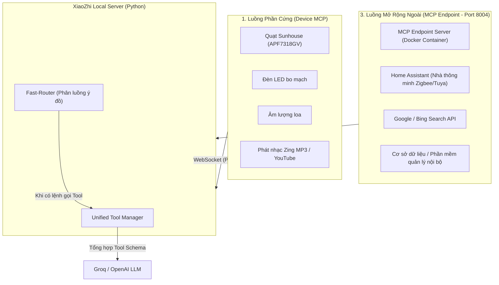

# Hướng Dẫn Triển Khai & Sử Dụng Điểm Truy Cập MCP (MCP Endpoint)

> **Tài liệu gốc:** `mcp-endpoint-enable.md`  
> **Ngôn ngữ:** Tiếng Việt (Bản dịch chuẩn & Giải thích chuyên sâu kiến trúc)

---

## MỤC LỤC
1. [Phần I: Bản Dịch Chi Tiết](#phần-i-bản-dịch-chi-tiết)
   - [1. Cách triển khai dịch vụ MCP Endpoint](#1-cách-triển-khai-dịch-vụ-mcp-endpoint)
   - [2. Cấu hình khi triển khai Toàn Module (Có Web Admin Trí Khống Đài)](#2-cấu-hình-khi-triển-khai-toàn-module-có-web-admin-trí-khống-đài)
   - [3. Cấu hình khi triển khai Đơn Module (Server Python độc lập)](#3-cấu-hình-khi-triển-khai-đơn-module-server-python-độc-lập)
2. [Phần II: Giải Thích Chuyên Sâu Kiến Trúc MCP Trong XiaoZhi](#phần-ii-giải-thích-chuyên-sâu-kiến-trúc-mcp-trong-xiaozhi)
   - [1. Bản chất của MCP Endpoint là gì?](#1-bản-chất-của-mcp-endpoint-là-gì)
   - [2. Sơ đồ kiến trúc 3 luồng MCP trong XiaoZhi](#2-sơ-đồ-kiến-trúc-3-luồng-mcp-trong-xiaozhi)
   - [3. Bảng so sánh 3 loại MCP](#3-bảng-so-sánh-3-loại-mcp)
   - [4. Dự án hiện tại có cần cài đặt MCP Endpoint không?](#4-dự-án-hiện-tại-có-cần-cài-đặt-mcp-endpoint-không)

---

# PHẦN I: BẢN DỊCH CHI TIẾT

Tài liệu hướng dẫn này bao gồm 3 phần:
- **1.** Cách triển khai dịch vụ Điểm truy cập MCP (MCP Endpoint).
- **2.** Cách cấu hình MCP Endpoint khi triển khai hệ thống toàn module (Full-Module).
- **3.** Cách cấu hình MCP Endpoint khi triển khai hệ thống đơn module (Single-Module).

---

## 1. Cách triển khai dịch vụ MCP Endpoint

### Bước 1: Tải mã nguồn dự án MCP Endpoint

1. Mở trình duyệt và truy cập: [Kho mã nguồn mcp-endpoint-server trên GitHub](https://github.com/xinnan-tech/mcp-endpoint-server).
2. Tìm nút màu xanh lá cây có chữ **`Code`** trên trang GitHub, bấm vào đó và chọn **`Download ZIP`**.
3. Tải file nén về máy tính và giải nén. Thư mục giải nén ra có thể tên là `mcp-endpoint-server-main`. Bạn hãy đổi tên thư mục thành **`mcp-endpoint-server`**.

### Bước 2: Khởi động chương trình

Dự án này là một dịch vụ rất nhẹ, khuyến khích sử dụng **Docker** để vận hành.  
*(Nếu không muốn dùng Docker, bạn có thể tham khảo [README_dev.md](https://github.com/xinnan-tech/mcp-endpoint-server/blob/main/README_dev.md) để chạy trực tiếp từ mã nguồn Python).*

Dưới đây là các bước khởi chạy bằng Docker:

```bash
# 1. Đi vào thư mục gốc mã nguồn dự án
cd mcp-endpoint-server

# 2. Dọn dẹp cache và container cũ (nếu có)
docker compose -f docker-compose.yml down
docker stop mcp-endpoint-server
docker rm mcp-endpoint-server
docker rmi ghcr.nju.edu.cn/xinnan-tech/mcp-endpoint-server:latest

# 3. Khởi chạy Docker container ở chế độ chạy ngầm
docker compose -f docker-compose.yml up -d

# 4. Xem log khởi động của container
docker logs -f mcp-endpoint-server
```

Khi container khởi động xong, log màn hình sẽ in ra thông tin tương tự như sau:

```text
250705 INFO-===== Dưới đây là địa chỉ MCP Endpoint cho Web Quản trị / Server Đơn module =====
250705 INFO- Cấu hình Web Quản trị (HTTP):  http://172.22.0.2:8004/mcp_endpoint/health?key=abc
250705 INFO- Cấu hình Server Đơn module (WS): ws://172.22.0.2:8004/mcp_endpoint/mcp/?token=def
250705 INFO-===== Vui lòng chọn địa chỉ phù hợp, TUYỆT ĐỐI KHÔNG để lộ cho người khác ======
```

Hãy sao chép 2 địa chỉ trên ra một file nháp.

---

> [!CAUTION]
> **CẢNH BÁO QUAN TRỌNG VỀ ĐỊA CHỈ IP:**  
> **Do bạn chạy trong Docker, TUYỆT ĐỐI KHÔNG dùng trực tiếp địa chỉ IP `172.22.0.2` ở trên!**  
> *(IP `172.22.0.2` là IP mạng ảo nội bộ Docker bridge, máy chủ bên ngoài hoặc máy trạm không thể truy cập trực tiếp được).*

**Cách xử lý:**
1. Xác định địa chỉ IP mạng nội bộ (LAN IP) của máy tính bạn (ví dụ: `192.168.1.25` hoặc `172.16.2.244`).
2. Thay thế IP ảo `172.22.0.2` bằng IP LAN thực tế:
   - **URL Web Quản trị:** `http://192.168.1.25:8004/mcp_endpoint/health?key=abc`
   - **URL Server Đơn module:** `ws://192.168.1.25:8004/mcp_endpoint/mcp/?token=def`
3. **Kiểm tra kết nối:** Dùng trình duyệt truy cập link Web Quản trị (`http://<IP_LAN>:8004/mcp_endpoint/health?key=abc`). Nếu trình duyệt trả về JSON như sau là thành công:
   ```json
   {
     "result": {
       "status": "success",
       "connections": {
         "tool_connections": 0,
         "robot_connections": 0,
         "total_connections": 0
       }
     },
     "error": null,
     "id": null,
     "jsonrpc": "2.0"
   }
   ```
4. Lưu giữ cẩn thận 2 địa chỉ trên để cấu hình ở bước tiếp theo.

---

## 2. Cấu hình khi triển khai Toàn Module (Có Web Admin Trí Khống Đài)

*(Dành cho các hệ thống doanh nghiệp lớn triển khai đầy đủ cả Frontend Web UI `admin-web`, Backend Java/Node và Database).*

1. **Bật tính năng MCP Endpoint:**
   - Đăng nhập trang quản trị Trí Khống Đài (ZhiKongTai) bằng tài khoản Admin.
   - Bấm vào menu đỉnh trang **Từ điển tham số (参数字典)** $\rightarrow$ chọn trang **Cấu hình chức năng hệ thống (系统功能配置)**.
   - Tích chọn ô **`Điểm truy cập MCP (MCP接入点)`** $\rightarrow$ bấm **Lưu cấu hình (保存配置)**.
   - Tại trang **Cấu hình vai trò (角色配置)** $\rightarrow$ bấm nút **Chỉnh sửa tính năng (编辑功能)**, bạn sẽ thấy tính năng `mcp接入点`.

2. **Cấu hình tham số kết nối:**
   - Tại menu **Từ điển tham số (参数字典)** $\rightarrow$ chọn chức năng **Quản lý tham số (参数管理)**.
   - Tìm kiếm tham số có tên: `server.mcp_endpoint` (mặc định giá trị là `null`).
   - Bấm nút Chỉnh sửa, dán địa chỉ **Web Quản trị HTTP** đã lấy ở Bước 1 vào ô giá trị:
     ```text
     http://192.168.1.25:8004/mcp_endpoint/health?key=abc
     ```
   - Bấm Lưu lại.

Nếu lưu thành công, hệ thống đã kết nối hoàn tất. Nếu không lưu được, hãy kiểm tra lại tường lửa mạng (Firewall) hoặc đảm bảo đã điền đúng IP mạng LAN.

---

## 3. Cấu hình khi triển khai Đơn Module (Server Python độc lập)

*(Áp dụng cho mô hình server XiaoZhi Python cục bộ chạy trên máy tính).*

1. Mở file cấu hình `data/.config.yaml` của server XiaoZhi.
2. Tìm khóa cấu hình `mcp_endpoint`. Nếu chưa có, bạn hãy thêm vào file:

```yaml
server:
  websocket: ws://172.16.2.244:8000/xiaozhi/v1/
  http_port: 8003
log:
  log_level: INFO

# Điền địa chỉ WebSocket (ws://) có kèm token lấy từ bước triển khai Docker:
mcp_endpoint: ws://192.168.1.25:8004/mcp_endpoint/mcp/?token=def
```

3. Khởi động lại server XiaoZhi. Khi khởi động thành công, log hệ thống sẽ xuất hiện dòng:

```text
[__main__]-INFO-初始化组件: vad成功 SileroVAD
[__main__]-INFO-初始化组件: asr成功 FunASRServer
[__main__]-INFO-OTA接口是          http://192.168.1.25:8003/xiaozhi/ota/
[__main__]-INFO-视觉分析接口是     http://192.168.1.25:8003/mcp/vision/explain
[__main__]-INFO-mcp接入点是        ws://192.168.1.25:8004/mcp_endpoint/mcp/?token=def
[__main__]-INFO-Websocket地址是    ws://192.168.1.25:8000/xiaozhi/v1/
```

Nếu log hiển thị đúng địa chỉ `mcp接入点是 ws://...` thì server XiaoZhi đã kết nối thành công tới trạm trung chuyển MCP Endpoint.

---

# PHẦN II: GIẢI THÍCH CHUYÊN SÂU KIẾN TRÚC MCP TRONG XIAOZHI

## 1. Bản chất của MCP Endpoint là gì?

MCP (**Model Context Protocol**) là chuẩn mở do Anthropic khởi xướng, cho phép mô hình ngôn ngữ lớn (LLM) kết nối và gọi các công cụ (Tools), cơ sở dữ liệu và tài nguyên bên ngoài một cách an toàn.

Trong hệ sinh thái XiaoZhi, **MCP Endpoint** đóng vai trò là một **Trạm trung chuyển tập trung (Centralized MCP Gateway / Hub)** độc lập chạy ở cổng mạng riêng (mặc định cổng `8004`).

Nó giải quyết bài toán:
- Bạn có nhiều máy chủ công cụ khác nhau: Home Assistant, máy chủ tìm kiếm Google, API chứng khoán, cơ sở dữ liệu doanh nghiệp...
- Thay vì bắt XiaoZhi server phải tự quản lý kết nối đến từng hệ thống này, tất cả sẽ kết nối về **MCP Endpoint Hub**.
- Server XiaoZhi chỉ cần duy nhất **1 kết nối WebSocket** tới Hub này là tự động thừa hưởng toàn bộ danh sách Tools từ tất cả các hệ thống bên thứ ba.

---

## 2. Sơ đồ kiến trúc 3 luồng MCP trong XiaoZhi



---

## 3. Bảng so sánh 3 loại MCP trong XiaoZhi

| Đặc điểm | Device MCP (`device_mcp`) | Server MCP (`server_mcp`) | MCP Endpoint (`mcp_endpoint`) |
| :--- | :--- | :--- | :--- |
| **Nơi định nghĩa** | Viết trực tiếp bằng C++ trong firmware ESP32 (`online_music_mcp_tools.cc`). | Viết bằng script Python nội bộ trong thư mục `core/providers/tools/server_mcp/`. | Là một Docker Container / dịch vụ độc lập bên ngoài (`mcp-endpoint-server`). |
| **Cổng kết nối** | Trực tiếp qua kết nối chính cổng `8000` của WebSocket XiaoZhi. | Chạy dạng tiến trình con nội bộ (STDIO/Subprocess). | Kết nối qua WebSocket riêng tại cổng `8004`. |
| **Chức năng chính** | Điều khiển phần cứng vật lý: quạt, đèn led, âm lượng loa, phát nhạc YouTube. | Các tool tiện ích nhỏ: lấy giờ âm lịch, đọc tin tức, kiểm tra mạng. | Mở rộng quy mô lớn: tích hợp Home Assistant, search engine, web APIs bên thứ 3. |
| **Phụ thuộc ngoài** | Không cần Docker, không cần cài thêm server nào khác. | Chạy ngay trong server Python. | Cần chạy thêm 1 Docker container riêng. |

---

## 4. Dự án hiện tại có cần cài đặt MCP Endpoint không?

> [!TIP]
> **KẾT LUẬN CHO DỰ ÁN CỦA BẠN: KHÔNG CẦN THIẾT Ở THỜI ĐIỂM HIỆN TẠI.**

1. **Các tính năng hiện tại của bạn:**
   - Điều khiển quạt Sunhouse.
   - Bật / tắt / chỉnh độ sáng đèn LED.
   - Điều chỉnh âm lượng loa.
   - Tìm kiếm và phát nhạc trực tuyến từ Zing MP3 và YouTube.
   $\rightarrow$ **Tất cả các tính năng này đều thuộc về Luồng 1 (Device MCP)**, chạy trực tiếp giữa vi điều khiển ESP32-S3 và Server Python XiaoZhi qua cổng `8000`. Bạn không cần triển khai thêm container `mcp-endpoint-server`.

2. **Khi nào bạn mới cần bật tính năng này?**
   - Khi nhà bạn có hệ sinh thái **Home Assistant** (với hàng chục công tắc đèn, cảm biến cửa Aqara, rèm tự động...) và muốn bot XiaoZhi điều khiển toàn bộ nhà thông minh.
   - Khi bạn muốn tích hợp công cụ tìm kiếm dữ liệu trên Internet (như Google/DuckDuckGo Search) để trả lời các câu hỏi về tin tức thời sự hàng ngày.
