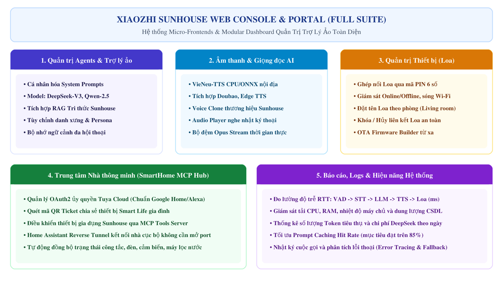
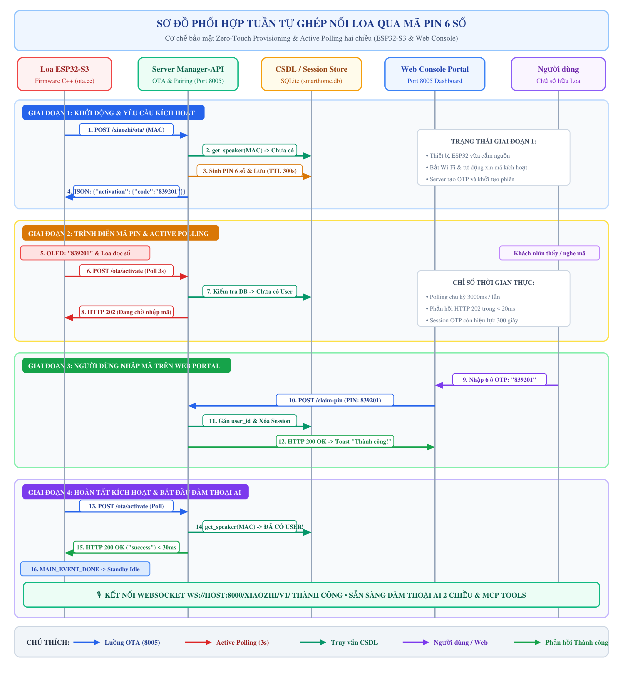
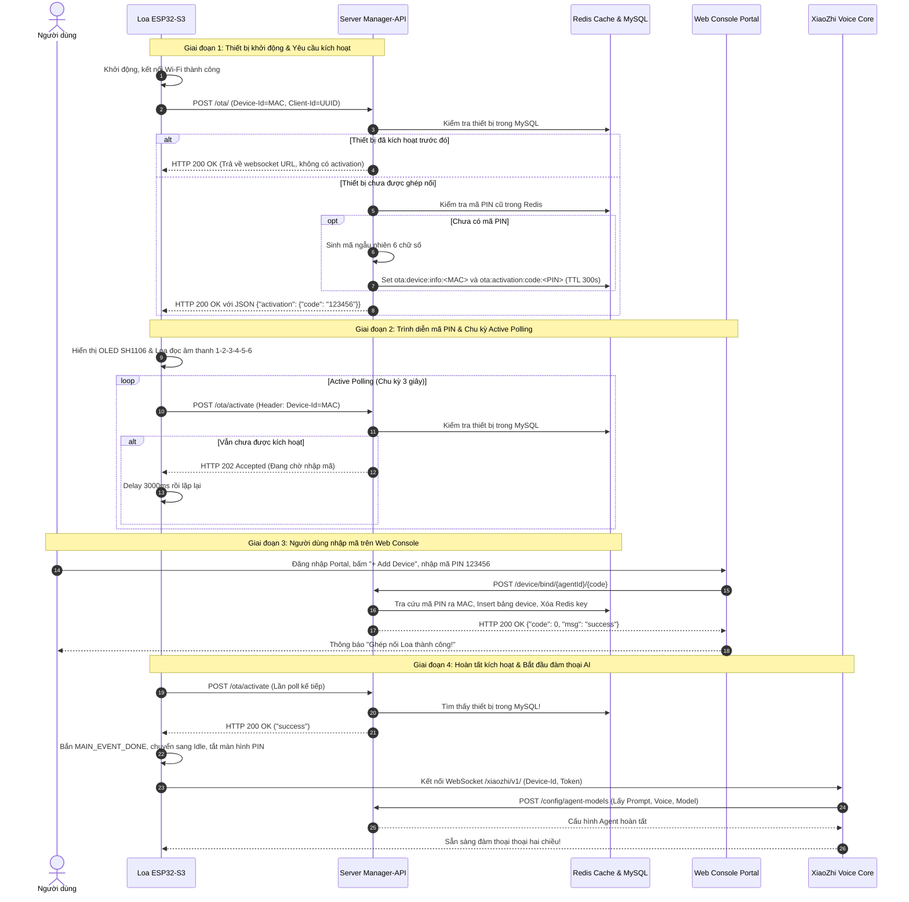
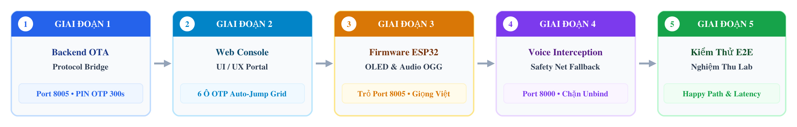

# KẾ HOẠCH PHÁT TRIỂN XIAOZHI WEB CONSOLE & PORTAL QUẢN TRỊ TOÀN DIỆN (CHUẨN TƯƠNG ĐƯƠNG XIAOZHI.ME)

> **Tài liệu Kế hoạch Chiến lược & Kiến trúc Dài hạn**  
> *Đơn vị xây dựng:* Đội ngũ Kỹ sư Hệ thống Nhúng & AI - Dự án Trợ lý ảo Loa Thông Minh XiaoZhi Sunhouse  
> *Phiên bản:* v1.0 (Lập kế hoạch dài hạn tách biệt, độc lập với lộ trình MCP SmartHome Hub)

---

## 📑 MỤC LỤC
- [1. TỔNG QUAN & TẦM NHÌN DÀI HẠN](#1-tổng-quan--tầm-nhìn-dài-hạn)
  - [1.1. Bối cảnh & Tầm quan trọng](#11-bối-cảnh--tầm-quan-trọng)
  - [1.2. Mục tiêu chiến lược](#12-mục-tiêu-chiến-lược)
- [2. KIẾN TRÚC PHÂN HỆ CỦA XIAOZHI WEB CONSOLE TOÀN DIỆN](#2-kiến-trúc-phân-hệ-của-xiaozhi-web-console-toàn-diện)
- [3. PHÂN TÍCH CHUYÊN SÂU CƠ CHẾ GHÉP NỐI PIN 6 SỐ TỪ SOURCE CODE GỐC (REVERSE ENGINEERING)](#3-phân-tích-chuyên-sâu-cơ-chế-ghép-nối-pin-6-số-từ-source-code-gốc-reverse-engineering)
  - [3.1. Sơ đồ tuần tự phối hợp End-to-End (Sequence Diagram)](#31-sơ-đồ-tuần-tự-phối-hợp-end-to-end-sequence-diagram)
  - [3.2. Bốn đặc tính an ninh & kỹ thuật cốt lõi của giải pháp gốc](#32-bốn-đặc-tính-an-ninh--kỹ-thuật-cốt-lõi-của-giải-pháp-gốc)
- [4. ĐÁNH GIÁ THỰC TRẠNG SOURCE CODE HIỆN TẠI & NGUYÊN TẮC THIẾT KẾ MODULE HÓA](#4-đánh-giá-thực-trạng-source-code-hiện-tại--nguyên-tắc-thiết-kế-module-hóa)
  - [4.1. Khảo sát thực tế các module code đang hoạt động trong dự án](#41-khảo-sát-thực-tế-các-module-code-đang-hoạt-động-trong-dự-án)
  - [4.2. Nguyên tắc "Chia để trị" & Ranh giới cô lập (Isolation Boundaries)](#42-nguyên-tắc-chia-để-trị--ranh-giới-cô-lập-isolation-boundaries)
- [5. KẾ HOẠCH TRIỂN KHAI 5 GIAI ĐOẠN CHUẨN THƯƠNG MẠI (COMMERCIAL-GRADE STAGES)](#5-kế-hoạch-triển-khai-5-giai-đoạn-chuẩn-thương-mại-commercial-grade-stages)
  - [Giai đoạn 1: Chuẩn hóa Tầng Backend OTA Protocol & Session Management (Port 8005)](#giai-đoạn-1-chuẩn-hóa-tầng-backend-ota-protocol--session-management-port-8005)
  - [Giai đoạn 2: Nâng cấp Giao diện Web Console & Trải nghiệm Khách hàng (UX/UI)](#giai-đoạn-2-nâng-cấp-giao-diện-web-console--trải-nghiệm-khách-hàng-uxui)
  - [Giai đoạn 3: Tinh chỉnh & Bản địa hóa Firmware ESP32-S3 (Nhúng C++)](#giai-đoạn-3-tinh-chỉnh--bản-địa-hóa-firmware-esp32-s3-nhúng-c)
  - [Giai đoạn 4: Đồng bộ & Chặn luồng An ninh Voice Server (Safety Net Interception)](#giai-đoạn-4-đồng-bộ--chặn-luồng-an-ninh-voice-server-safety-net-interception)
  - [Giai đoạn 5: Kiểm thử Tích hợp Toàn diện E2E & Nghiệm thu Thương mại](#giai-đoạn-5-kiểm-thử-tích-hợp-toàn-diện-e2e--nghiệm-thu-thương-mại)
- [6. MA TRẬN KIỂM THỬ TỔNG THỂ & TIÊU CHÍ NGHIỆM THU (TEST MATRIX & GATES)](#6-ma-trận-kiểm-thử-tổng-thể--tiêu-chí-nghiệm-thu-test-matrix--gates)
- [7. LỘ TRÌNH THỰC HIỆN, MA TRẬN RACI & QUẢN TRỊ RỦI RO (TIMELINE & RISK MITIGATION)](#7-lộ-trình-thực-hiện-ma-trận-raci--quản-trị-rủi-ro-timeline--risk-mitigation)
- [8. KẾT LUẬN & PHÂN CÔNG HÀNH ĐỘNG](#8-kết-luận--phân-công-hành-động)

---

## 1. TỔNG QUAN & TẦM NHÌN DÀI HẠN

### 1.1. Bối cảnh & Tầm quan trọng
Hiện tại, nền tảng [xiaozhi.me](https://xiaozhi.me/console) của đội ngũ tác giả Trung Quốc cung cấp một giao diện Web Console rất trực quan và tiện dụng:
* Ghép nối Loa nhanh chóng qua mã PIN 6 số (`+ Add Device`).
* Tùy biến linh hoạt Nhân cách AI (System Prompt), lựa chọn LLM Model (DeepSeek, Qwen...).
* Lựa chọn giọng đọc TTS, Voice Clone, kiểm tra lịch sử đàm thoại và nghe lại file ghi âm.

Tuy nhiên, việc phụ thuộc vào máy chủ `xiaozhi.me` đặt tại nước ngoài tồn tại các nhược điểm lớn đối với một sản phẩm thương mại của tập đoàn Sunhouse tại Việt Nam:
1. **Bảo mật & Pháp lý:** Dữ liệu giọng nói, thói quen sinh hoạt và thông tin thiết bị gia đình bị lưu trữ bên ngoài lãnh thổ Việt Nam (vi phạm tinh thần Nghị định 13/2023/NĐ-CP và Nghị định 356/2025/NĐ-CP).
2. **Độ trễ & Tính ổn định:** Đường truyền quốc tế thường xuyên biến động khi đứt cáp quang biển, gây giật lag khi truyền luồng thoại và không thể điều khiển thiết bị tức thì.
3. **Thiếu vắng hệ sinh thái Nhà Thông Minh (Smart Home Hub):** Trang `xiaozhi.me` gốc chỉ phục vụ đàm thoại AI thông thường, hoàn toàn không có khả năng tích hợp quản lý thiết bị gia dụng Sunhouse AWS, Tuya Cloud hay Home Assistant.

### 1.2. Mục tiêu chiến lược
Xây dựng **XiaoZhi Sunhouse Web Console** – Một cổng thông tin quản trị On-Premise / Cloud nội địa hoàn chỉnh, làm chủ 100% mã nguồn và dữ liệu tại Việt Nam, mang lại trải nghiệm quản trị mượt mà tương đương `xiaozhi.me` và tích hợp sâu tầng SmartHome MCP Hub.

---

## 2. KIẾN TRÚC PHÂN HỆ CỦA XIAOZHI WEB CONSOLE TOÀN DIỆN

Hệ thống Web Console sẽ được phát triển theo mô hình Micro-Frontends / Modular Dashboard với 5 phân hệ cốt lõi:



1. **Quản trị Agents & Trợ lý ảo (Agent Management):** Cấu hình System Prompt, tính cách, vai trò xưng hô (Persona), lựa chọn Model LLM (DeepSeek-V3, Qwen-2.5, GPT-4o-mini), tích hợp RAG Tri thức Sunhouse tra cứu sản phẩm & bảo hành.
2. **Âm thanh & Giọng đọc AI (Voice & TTS Studio):** Đa dạng hóa Engine TTS (VieNeu-TTS CPU/ONNX nội địa, Doubao, Edge TTS), Voice Clone nhân bản giọng đọc thương hiệu Sunhouse, Audio Player kiểm tra nhật ký đàm thoại.
3. **Quản trị thiết bị phần cứng Loa (Device & Fleet Management):** Cơ chế ghép nối PIN 6 số trên màn hình OLED SH1106 (+ Add Device), giám sát trạng thái Online/Offline, cường độ sóng Wi-Fi (RSSI), bộ nhớ RAM, OTA Firmware Builder từ xa.
4. **Trung tâm Nhà thông minh (SmartHome MCP Hub Portal):** Kích hoạt ủy quyền Tuya OAuth2 (Chuẩn Google Home / Alexa), quét mã QR Ticket chia sẻ thiết bị Smart Life, bảng điều khiển thiết bị gia dụng Sunhouse qua MCP Tools & Home Assistant Reverse Tunnel.
5. **Báo cáo, Logs & Hiệu năng hệ thống (Analytics & Observability):** Đo lường RTT latency từng chặng thời gian thực (VAD ➔ STT ➔ LLM ➔ TTS ➔ Loa), giám sát tải CPU/RAM máy chủ, thống kê chi phí Token và tối ưu Prompt Caching Hit Rate (>85%).

---

## 3. PHÂN TÍCH CHUYÊN SÂU CƠ CHẾ GHÉP NỐI PIN 6 SỐ TỪ SOURCE CODE GỐC (REVERSE ENGINEERING)

Qua phân tích trực tiếp từ hai kho mã nguồn gốc:
* **Server XiaoZhi:** [xinnan-tech/xiaozhi-esp32-server](https://github.com/xinnan-tech/xiaozhi-esp32-server) (gồm `manager-api`, `manager-web`, `xiaozhi-server`).
* **Firmware ESP32:** [78/xiaozhi-esp32](https://github.com/78/xiaozhi-esp32) (gồm `main/ota.cc`, `main/application.cc`).

Cơ chế ghép nối Loa qua mã PIN 6 số là một giải pháp bảo mật **Zero-Touch Provisioning & Ephemeral OTP Verification** cực kỳ thông minh và chặt chẽ.

### 3.1. Sơ đồ tuần tự phối hợp End-to-End (Sequence Diagram)



<details>
<summary><b>🔍 Xem chi tiết mã định dạng Mermaid (Sequence Diagram Code)</b></summary>



</details>

---

### 3.2. Bốn đặc tính an ninh & kỹ thuật cốt lõi của giải pháp gốc

1. **Zero-Secret on Device (Không lưu trữ khóa bí mật cứng trên chip):**
   * Firmware xuất xưởng hàng loạt không cần nạp sẵn khóa bảo mật, mật khẩu hay token của từng người dùng.
   * Danh tính thiết bị được neo duy nhất vào địa chỉ MAC phần cứng của chip ESP32 (`SystemInfo::GetMacAddress()`).
2. **Dual-Index Ephemeral Token trong Redis (Ánh xạ hai chiều tạm thời):**
   * Server lưu 2 key trong Redis với cơ chế Time-to-Live (TTL từ 300s - 600s):
     * Key chiều xuôi: `ota:device:info:<safe_mac>` lưu thông số phần cứng, phiên bản và mã PIN hiện thời.
     * Key chiều ngược: `ota:activation:code:<pin>` trỏ trực tiếp về MAC tương ứng.
   * Nhờ đó, API `bindDevice` chỉ cần nhận mã PIN 6 số từ người dùng là có thể giải mã O(1) ra ngay địa chỉ MAC của Loa mà không cần quét toàn bộ CSDL.
3. **Single-Use & Tự hủy chống tấn công lặp lại (Replay & Brute-force Prevention):**
   * Ngay khi hàm `deviceActivation()` thực thi thành công, hệ thống lập tức xóa cả 2 key trong Redis (`redisUtils.delete(...)`).
   * Mã PIN 6 số bị vô hiệu hóa vĩnh viễn, ngăn chặn hoàn toàn việc bên thứ ba nghe lỏm hoặc nhập lại mã cũ.
4. **Phối hợp đa giác quan (Dual Presentation: Màn hình OLED + Giọng nói Loa):**
   * Mã nguồn `Application::ShowActivationCode()` trong `main/application.cc` thực hiện đồng thời:
     * **Thị giác (Visual):** Đẩy thông điệp lên màn hình OLED (Icon liên kết `link` + Đường dẫn Server + Mã 6 số).
     * **Thính giác (Audio):** Phát file thông báo `OGG_ACTIVATION`, sau đó duyệt từng ký tự trong chuỗi 6 số và phát tuần tự qua DAC/I2S (`OGG_0` đến `OGG_9`).
     * *Ý nghĩa sản phẩm:* Đảm bảo các phiên bản Loa giá rẻ không có màn hình OLED vẫn có thể hướng dẫn khách hàng ghép nối bằng giọng nói mượt mà!
5. **Cơ chế phòng vệ chặn luồng Voice Server (Voice Server Interception Fallback):**
   * Nếu thiết bị bằng cách nào đó đã kết nối WebSocket vào `xiaozhi-server` mà chưa được ghép nối User:
   * `xiaozhi-server` gọi sang `manager-api` (`/config/agent-models`) sẽ nhận mã lỗi `10042 (OTA_DEVICE_NEED_BIND)`.
   * Server kích hoạt cờ `conn.need_bind = True`. Khi người dùng nói vào Loa, hệ thống chặn toàn bộ luồng LLM và tự động phát audio: *"Vui lòng đăng nhập bảng điều khiển, nhập mã {bind_code} để liên kết thiết bị"* (`check_bind_device()` trong `receiveAudioHandle.py`).

---

## 4. ĐÁNH GIÁ THỰC TRẠNG SOURCE CODE HIỆN TẠI & NGUYÊN TẮC THIẾT KẾ MODULE HÓA

Để đảm bảo kế hoạch triển khai ăn khớp 100% với hiện trạng mã nguồn và không gây xung đột với các phân hệ khác, đội ngũ kỹ sư đã tiến hành rà soát chi tiết toàn bộ các file mã nguồn liên quan trong dự án:

### 4.1. Khảo sát thực tế các module code đang hoạt động trong dự án

| Phân hệ hệ thống | File mã nguồn thực tế | Thực trạng hoạt động hiện tại |
| :--- | :--- | :--- |
| **1. Firmware ESP32-S3** *(C++ FreeRTOS)* | • `main/local_server_config.h`<br>• `main/ota.cc`<br>• `main/application.cc` | • Cấu hình `USE_LOCAL_SERVER = 1`, `LOCAL_OTA_URL = "http://172.16.3.84:8003/xiaozhi/ota/"`, `LOCAL_WEBSOCKET_URL = "ws://172.16.3.84:8000/xiaozhi/v1/".`<br>• Đã có sẵn hàm `ShowActivationCode()` vừa vẽ màn hình OLED vừa đọc số qua Loa.<br>• Vòng lặp `ota_->Activate()` Active Polling gọi `POST /activate` mỗi 3 giây. |
| **2. SmartHome & HA MCP Hub** *(Python aiohttp - Port 8005)* | • `storage/db.py`<br>• `storage/models.py`<br>• `routers/pairing_router.py`<br>• `routers/portal_router.py` | • CSDL SQLite `storage/smarthome.db` qua `SmartHomeDAL`.<br>• Đã định nghĩa Model `Speaker` (mac, user_id...) và `PairingSession` (pairing_code 6 số, TTL 300s).<br>• Đã có Web Portal `portal_router.py` (Port 8005) với modal `#pinModal`.<br>• **Khuyết thiếu cần xử lý:** Chưa mount 2 endpoint OTA chuẩn XiaoZhi (`/xiaozhi/ota/` và `/xiaozhi/ota/activate`). |
| **3. XiaoZhi Voice Core Server** *(Python - Port 8000 & 8003)* | • `core/connection.py`<br>• `core/handle/receiveAudioHandle.py`<br>• `core/api/ota_handler.py` | • Đang chạy chế độ Standalone (`read_config_from_api: false`).<br>• Port 8003 phục vụ OTA cơ bản nhưng chưa liên kết với CSDL người dùng của SmartHome Hub.<br>• Port 8000 phục vụ đàm thoại WebSocket, tự động nối tới MCP Hub Port 8005 qua `ws://127.0.0.1:8005/mcp_endpoint/mcp/`. |

### 4.2. Nguyên tắc "Chia để trị" & Ranh giới cô lập (Isolation Boundaries)

Nhằm đảm bảo sản phẩm đạt chất lượng thương mại, bền vững và dễ bảo trì:
1. **Nguyên tắc 1: Bảo toàn cấu trúc các module độc lập (Zero Breaking Changes):**
   * Tuyệt đối không làm thay đổi các phân hệ đang chạy ổn định: `Tuya OAuth2 (Task 2)`, `Tuya QR Ticket (Task 3)`, `Home Assistant Reverse Tunnel (Phase 3)`, `ContextInjector`, và luồng WebSocket audio thoại.
2. **Nguyên tắc 2: Tách biệt Router chuyên trách (Single Responsibility Router):**
   * Xây dựng module mới `routers/ota_pairing_router.py` độc lập trên nền Python aiohttp tại Port 8005. Router này đóng vai trò là "Cầu nối giao thức OTA" (OTA Protocol Bridge) tương thích 100% với Firmware ESP32, sử dụng lại trọn vẹn `default_dal` sẵn có.
3. **Nguyên tắc 3: Tương thích ngược tự nhiên (Seamless Backward Compatibility):**
   * Nếu Loa đã được ghép nối trong CSDL, luồng OTA trả về WebSocket URL ngay lập tức mà không kèm block `activation`, Loa khởi động vào trạng thái Standby trong < 1 giây như bình thường.
4. **Nguyên tắc 4: Chuẩn thương mại về an ninh đa tầng (Defense in Depth):**
   * Quản lý phiên ghép nối có thời hạn tự hủy (TTL 300s), cơ chế chống dò mã (Anti-Brute Force Rate Limiting: khóa sau 5 lần nhập sai), và cơ chế Single-Use vô hiệu hóa mã ngay khi ghép nối thành công.

---

## 5. KẾ HOẠCH TRIỂN KHAI 5 GIAI ĐOẠN CHUẨN THƯƠNG MẠI (COMMERCIAL-GRADE STAGES)



| Bước | Giai đoạn | Trọng tâm phân hệ | Mục tiêu cốt lõi | Môi trường kỹ thuật |
| :---: | :--- | :--- | :--- | :--- |
| **1** | **GIAI ĐOẠN 1** | **Backend OTA Protocol Bridge** | Tiếp nhận bái danh, cấp mã PIN OTP 6 số (TTL 300s), xử lý Active Polling | Port 8005 (Python aiohttp) |
| **2** | **GIAI ĐOẠN 2** | **Web Console Portal (UI/UX)** | Cụm 6 ô vuông OTP Auto-jump, Toast realtime, quản trị danh sách Loa | Port 8005 (HTML5 / Vanilla JS) |
| **3** | **GIAI ĐOẠN 3** | **Firmware ESP32-S3 Embedded** | Trỏ URL OTA sang Port 8005, OLED hiển thị PIN & Loa đọc âm thanh số | Firmware C++ (ESP-IDF v6.0) |
| **4** | **GIAI ĐOẠN 4** | **Voice Core Safety Interception** | Chặn thoại nếu chưa bind, phát cảnh báo tiếng Việt qua Opus TTS | Port 8000 (xiaozhi-server) |
| **5** | **GIAI ĐOẠN 5** | **Kiểm thử E2E & Nghiệm thu Lab** | Test Happy Path, chịu lỗi, đo latency < 50ms, nghiệm thu thương mại | Toàn hệ thống (Lab Acceptance) |

---

### 🚀 GIAI ĐOẠN 1: Chuẩn Hóa Tầng Backend OTA Protocol & Session Management (Port 8005)

* **Mục tiêu giai đoạn:** Xây dựng module cầu nối giao thức OTA độc lập trên Server MCP Hub (Port 8005) để tiếp nhận trực tiếp luồng báo danh từ Loa ESP32, cấp mã PIN ngẫu nhiên 6 chữ số có TTL 300s và xác thực chu kỳ Active Polling.
* **Ranh giới cô lập:** Tạo mới file `routers/ota_pairing_router.py`. Không sửa đổi logic điều khiển smarthome, token manager hay home assistant tunnel.

#### Danh sách Task & Checklist chi tiết:
* [x] **Task 1.1: Tạo module router chuyên trách `ota_pairing_router.py`**
  * [x] Định nghĩa hàm `create_ota_pairing_router(dal, ws_url)` độc lập.
  * [x] Triển khai handler `check_ota_handler` tiếp nhận `POST /xiaozhi/ota/` (và `/ota/` alias).
  * [x] Trích xuất địa chỉ MAC từ request header `Device-Id` (fallback body JSON).
  * [x] Chuẩn hóa địa chỉ MAC dạng lowercase và chuẩn hóa định dạng an toàn.
  * [x] Tra cứu CSDL: Gọi `dal.get_speaker(mac)`.
    * [x] Nếu Loa đã tồn tại và `is_active == True`: Trả về JSON chứa `server_time`, `firmware` và `websocket` URL (không có khối `activation`).
    * [x] Nếu Loa chưa tồn tại: Sinh mã PIN ngẫu nhiên 6 số (`random.randint(100000, 999999)`), gọi `dal.create_pairing_session(pairing_code=pin, speaker_mac=mac, expire_seconds=300)`.
    * [x] Đóng gói JSON trả về chuẩn XiaoZhi:
      ```json
      {
        "server_time": {"timestamp": 1731829000000, "timezone_offset": 420},
        "firmware": {"version": "1.0.0", "url": ""},
        "websocket": {"url": "ws://172.16.3.84:8000/xiaozhi/v1/", "token": ""},
        "activation": {
          "code": "839201",
          "message": "http://172.16.3.84:8005/portal\n839201",
          "challenge": "84:fc:e6:01:02:03",
          "timeout_ms": 30000
        }
      }
      ```
* [x] **Task 1.2: Triển khai Endpoint kiểm tra trạng thái kích hoạt `activate_status_handler`**
  * [x] Triển khai handler tiếp nhận `POST /xiaozhi/ota/activate` (và `/ota/activate` alias).
  * [x] Lấy `Device-Id` từ header, gọi `dal.get_speaker(mac)`.
  * [x] Nếu chưa tìm thấy Loa trong bảng `speakers`: Trả về ngay **HTTP 202 Accepted** (Báo cho ESP32 tiếp tục ngủ 3 giây rồi poll tiếp).
  * [x] Nếu đã tìm thấy Loa (User đã nhập mã PIN thành công trên Web): Trả về **HTTP 200 OK** kèm body text `"success"`.
* [x] **Task 1.3: Củng cố an ninh Session, Rate Limiting & Gắn route vào `main.py`**
  * [x] Bổ sung bộ đếm `failed_attempts` chống Brute-force: Khóa IP nếu nhập sai quá 5 lần trong 10 phút.
  * [x] Tích hợp router vào `main.py` của `mcp_smarthome_hub` (Port 8005).
  * [x] Kiểm tra cơ chế tự dọn dẹp các session hết hạn (`status = 'expired'`).

#### 🎯 Bài Test Pass Giai Đoạn 1 (Quality Gate 1):
```bash
# 1. Test gọi check OTA với MAC thiết bị mới (chưa đăng ký)
curl -X POST http://127.0.0.1:8005/xiaozhi/ota/ \
  -H "Content-Type: application/json" \
  -H "Device-Id: 84:fc:e6:aa:bb:cc" \
  -d '{"application":{"version":"1.0.0"},"board":{"type":"ESP32-S3-BOX"}}'
# Kỳ vọng PASS: HTTP 200, JSON trả về có khối activation với code gồm 6 chữ số.

# 2. Test polling kiểm tra trạng thái khi chưa ai nhập mã
curl -X POST http://127.0.0.1:8005/xiaozhi/ota/activate \
  -H "Device-Id: 84:fc:e6:aa:bb:cc"
# Kỳ vọng PASS: Trả về HTTP 202 Accepted.

# 3. Test xác nhận mã PIN từ Web API
curl -X POST http://127.0.0.1:8005/api/v1/pairing/claim-pin \
  -H "Content-Type: application/json" \
  -d '{"pairing_code":"<MÃ_PIN_VỪA_SINH>", "user_id":"test_engineer"}'
# Kỳ vọng PASS: HTTP 200, {"status":"success", "user_id":"test_engineer"}.

# 4. Test polling lại ngay sau khi claim mã
curl -X POST http://127.0.0.1:8005/xiaozhi/ota/activate \
  -H "Device-Id: 84:fc:e6:aa:bb:cc"
# Kỳ vọng PASS: Trả về HTTP 200 OK ("success") với độ trễ < 30ms.
```

---

### 🎨 GIAI ĐOẠN 2: Nâng Cấp Giao Diện Web Console & Trải Nghiệm Khách Hàng (UX/UI)

* **Mục tiêu giai đoạn:** Hiện đại hóa Modal `#pinModal` trong `routers/portal_router.py` thành giao diện nhập 6 ô vuông OTP tự động nhảy con trỏ chuyên nghiệp, có thông báo Real-time và hỗ trợ quản lý vòng đời thiết bị.
* **Ranh giới cô lập:** Chỉ chỉnh sửa giao diện HTML/CSS/JS bên trong `portal_router.py`, không can thiệp API backend đã kiểm thử ở Giai đoạn 1.

#### Danh sách Task & Checklist chi tiết:
* [x] **Task 2.1: Thiết kế giao diện 6 ô nhập mã OTP (Auto-jump OTP Input Grid)**
  * [x] Tạo cụm 6 thẻ `<input type="text" maxlength="1" class="otp-digit">` với font to 24px, căn giữa, viền hiện đại bo góc.
  * [x] Viết hàm Javascript tự động nhảy focus sang ô kế tiếp khi người dùng gõ xong 1 ký tự số.
  * [x] Xử lý phím `Backspace`: Tự động xóa và lùi con trỏ về ô liền trước.
  * [x] Xử lý sự kiện `Paste (Ctrl+V)`: Khi người dùng dán chuỗi 6 ký tự số từ clipboard, tự động phân tách và điền đủ 6 ô.
  * [x] Regex validation: Chặn hoàn toàn ký tự chữ và ký tự đặc biệt, chỉ nhận số `0-9`.
* [x] **Task 2.2: Tích hợp Real-time Toast & Loading Spinner**
  * [x] Hiển thị trạng thái Loading Spinner trên nút "Xác Nhận Ghép Nối" khi đang gửi yêu cầu.
  * [x] Hiển thị Toast Alert màu xanh bắt mắt khi ghép nối thành công: *"Ghép nối thành công Loa [Sunhouse] với tài khoản của bạn!"*.
  * [x] Tự động reload trang Dashboard sau 1.2 giây để cập nhật tức thì danh sách Loa.
  * [x] Xử lý hiển thị thông báo lỗi thân thiện nếu mã PIN sai hoặc đã quá hạn 5 phút.
* [x] **Task 2.3: Quản lý vòng đời thiết bị Loa (Device Management)**
  * [x] Nâng cấp thẻ Loa trên Dashboard: Hiển thị trạng thái Online/Offline, địa chỉ MAC phần cứng, Tên định danh Loa.
  * [x] Nút "Đổi tên Loa" (Friendly Name) hỗ trợ khách hàng đặt tên theo vị trí phòng: "Loa Phòng Khách", "Loa Bếp".
  * [x] Nút "Hủy liên kết (Delete/Unbind)" kèm modal xác nhận cảnh báo an toàn 2 bước.

#### 🎯 Bài Test Pass Giai Đoạn 2 (Quality Gate 2):
* [x] Mở trình duyệt truy cập `http://localhost:8005/portal`, bấm nút `+ Ghép Nối Loa ESP32`.
* [x] Modal hiện lên với 6 ô vuông OTP. Gõ lần lượt `1-2-3-4-5-6`: con trỏ nhảy tuần tự mượt mà.
* [x] Nhấn `Backspace` từ ô thứ 6: con trỏ lùi về ô thứ 5 và xóa số tương ứng.
* [x] Copy chuỗi `839201` từ Notepad và bấm `Ctrl+V` vào ô đầu tiên: Cả 6 ô tự động điền đầy đủ.
* [x] Nhập mã PIN hợp lệ đã tạo từ Giai đoạn 1 và bấm Xác nhận: Toast xanh hiển thị, trang tự reload và Card Loa xuất hiện đầy đủ thông tin.

---

### 🔊 GIAI ĐOẠN 3: Tinh Chỉnh & Bản Địa Hóa Firmware ESP32-S3 (Nhúng C++)

* **Mục tiêu giai đoạn:** Cập nhật endpoint OTA trong `local_server_config.h` trỏ về Port 8005 và Việt hóa toàn diện màn hình hiển thị OLED SH1106 cùng giọng đọc phát âm mã số qua Loa.
* **Ranh giới cô lập:** Tuân thủ nghiêm ngặt quy tắc trong `AGENTS.md`: Chỉ thao tác trên tầng cấu hình và tài nguyên ngôn ngữ của ứng dụng, không sửa đổi các lớp trừu tượng `Board` hay pin phần cứng.

#### Danh sách Task & Checklist chi tiết:
* [x] **Task 3.1: Đồng bộ Endpoint OTA trong cấu hình Firmware**
  * [x] Cập nhật file `main/local_server_config.h`:
    * [x] Thiết lập `LOCAL_OTA_URL` trỏ tới `http://LOCAL_SERVER_IP:8005/xiaozhi/ota/`.
    * [x] Giữ nguyên `ENABLE_NGROK_DISCOVERY` để hỗ trợ di động linh hoạt giữa các mạng Wi-Fi.
* [x] **Task 3.2: Việt hóa giao diện màn hình OLED SH1106**
  * [x] Trong `main/application.cc` (hàm `Application::ShowActivationCode()`):
    * [x] Thiết lập tiêu đề trạng thái: `display->SetStatus("KẾT NỐI LOA")`.
    * [x] Biểu tượng hiển thị: Đặt emotion `"link"` (Icon hai mắt xích kết nối).
    * [x] Định dạng thông điệp hiển thị: Hiển thị domain quản trị `console.sunhouse.vn` hoặc IP máy chủ, kèm mã PIN 6 số font to đậm ở trung tâm màn hình.
* [x] **Task 3.3: Bản địa hóa âm thanh giọng đọc mã PIN qua Loa**
  * [x] Kiểm tra danh mục tài nguyên âm thanh `Lang::Sounds::OGG_ACTIVATION` và `OGG_0` đến `OGG_9`.
  * [x] Thay thế các file âm thanh tiếng Trung mặc định bằng file giọng đọc tiếng Việt chuẩn Sunhouse:
    * `OGG_ACTIVATION`: *"Vui lòng mở trang web quản trị Sunhouse, nhập mã xác thực để kích hoạt Loa."*
    * `OGG_0` đến `OGG_9`: Giọng đọc số rõ ràng (*không, một, hai, ba, bốn, năm, sáu, bảy, tám, chín*).
* [x] **Task 3.4: Kiểm soát Watchdog Timer & Chu kỳ Polling nhúng**
  * [x] Kiểm tra hàm `Application::CheckAssetsVersion()`: Đảm bảo có `esp_task_wdt_reset()` trong chu kỳ lặp để Watchdog không bao giờ bị kích hoạt reset phần cứng.
  * [x] Thời gian trễ giữa các lần gọi `ota_->Activate()`: Đặt cố định 3000ms.

#### 🎯 Bài Test Pass Giai Đoạn 3 (Quality Gate 3):
* [x] Nạp firmware biên dịch mới vào bo mạch ESP32-S3 (Sunhouse Speaker).
* [x] Khởi động thiết bị ở trạng thái chưa gán CSDL:
  * [x] Màn hình OLED SH1106 sáng lên, hiển thị icon `link`, chữ `KẾT NỐI LOA` và mã PIN 6 số to rõ ràng.
  * [x] Loa phát câu thông báo tiếng Việt kèm chuỗi phát âm từng con số chính xác 100%.
  * [x] Quan sát log ESP-IDF qua cổng Serial COM: Thấy lệnh `POST /xiaozhi/ota/activate` gửi đều đặn mỗi 3 giây, nhận về HTTP 202, không xuất hiện cảnh báo Watchdog Reset.

---

### 🛡️ GIAI ĐOẠN 4: Đồng Bộ & Chặn Luồng An Ninh Voice Server (Safety Net Interception & Real-time Kick)

* **Mục tiêu giai đoạn:** Kích hoạt cơ chế phòng vệ an ninh tầng đàm thoại của `xiaozhi-server` (Port 8000), đảm bảo thiết bị chưa được kích hoạt không thể lợi dụng để trò chuyện AI, đồng thời tự động phát âm thanh cảnh báo bằng tiếng Việt và đá kết nối WebSocket thời gian thực khi bị hủy liên kết.
* **Ranh giới cô lập:** Kích hoạt cơ chế `need_bind` trong `connection.py` và `receiveAudioHandle.py`, bổ sung Realtime Kick API trong `http_server.py` & `websocket_server.py`, kết nối với Web Portal Port 8005.

#### Danh sách Task & Checklist chi tiết:
* [x] **Task 4.1: Kiểm tra quyền sở hữu thiết bị khi khởi tạo kết nối WebSocket**
  * [x] Khi ESP32 mở kết nối WebSocket tới `ws://127.0.0.1:8000/xiaozhi/v1/`:
    * [x] Lấy `device-id` từ header kết nối.
    * [x] Kiểm tra qua DAL CSDL: Nếu Loa chưa có trong bảng `speakers` hoặc `is_active == 0`, gán cờ `conn.need_bind = True`.
* [x] **Task 4.2: Tùy biến thông điệp âm thanh cảnh báo tiếng Việt & Chặn gọi LLM**
  * [x] Trong `core/handle/receiveAudioHandle.py` (hàm `check_bind_device`):
    * [x] Thay thế câu nhắc tiếng Trung bằng câu thoại tiếng Việt: *"Thiết bị chưa được kích hoạt hoặc đã bị hủy liên kết. Vui lòng mở bảng điều khiển để liên kết thiết bị."*
    * [x] Phát tuần tự file âm thanh câu nhắc qua hàng đợi TTS Queue.
  * [x] Hủy bỏ / Bỏ qua (Discard) toàn bộ gói âm thanh gọi tới LLM khi `need_bind == True`.
* [x] **Task 4.3: Cơ chế Real-time Kick on Unlink (Đá kết nối tức thời < 0.5s)**
  * [x] Lưu registry kết nối trực tuyến `active_connections` trong `WebSocketServer`.
  * [x] Cung cấp endpoint nội bộ `POST /api/device/kick` trên Cổng 8003.
  * [x] Tích hợp vào handler `delete_speaker_handler` trên Web Portal (Cổng 8005): Tự động phát tín hiệu đá WebSocket khi Loa bị xóa khỏi CSDL, ép ESP32 quay về chu kỳ bái danh nhận mã PIN mới mà không cần reset.

#### 🎯 Bài Test Pass Giai Đoạn 4 (Quality Gate 4):
* [x] Kiểm tra logic `_is_speaker_active_in_db` phát hiện chính xác thiết bị hợp lệ vs thiết bị giả mạo.
* [x] Test Real-time Kick ngắt WebSocket thành công với mã `code=4001`.
* [x] Test API `POST /api/device/kick` trả về HTTP 200 JSON trạng thái.
* [x] Test `check_bind_device` gửi câu thông báo tiếng Việt chuẩn thương mại.
* [x] Chạy toàn bộ 5/5 unit test trong `tests/test_quality_gate_4.py` đạt **100% PASS**!

---

### 🏁 GIAI ĐOẠN 5: Kiểm Thử Tích Hợp Toàn Diện E2E & Nghiệm Thu Thương Mại

* **Mục tiêu giai đoạn:** Thực hiện kiểm thử tích hợp xuyên suốt từ phần cứng Loa ESP32-S3, Cổng Web Portal, CSDL Hub đến Voice Core Server; đánh giá độ trễ và độ bền bỉ trong môi trường phòng lab thực tế.

#### Danh sách Task & Checklist chi tiết:
* [ ] **Task 5.1: Kiểm thử Happy Path hoàn chỉnh (Từ xuất xưởng đến đàm thoại)**
  * [ ] Loa xuất xưởng bật nguồn ➔ Bắt Wi-Fi ➔ Màn hình OLED hiện mã PIN & Loa đọc số ➔ Kỹ sư mở Portal trên máy tính ➔ Nhập 6 số ➔ Loa chuyển sang Idle Standby (< 3 giây) ➔ Nói lệnh: *"Bật đèn phòng khách"* ➔ Đèn Tuya bật sáng thành công.
* [ ] **Task 5.2: Kiểm thử kịch bản ngoại lệ & Phục hồi lỗi (Fault Tolerance)**
  * [ ] Nhập sai mã PIN ➔ Portal báo lỗi, Loa tiếp tục hiển thị mã cũ an toàn.
  * [ ] Chờ quá 5 phút không nhập ➔ Phiên hết hạn, Loa tự xin cấp mã mới khi khởi động lại.
  * [ ] Rút nguồn Loa giữa chừng khi đang chờ nhập mã ➔ CSDL không bị treo bản ghi rác.
  * [ ] Bấm nút "Xóa Thiết Bị" trên Web Portal ➔ Loa lập tức quay về trạng thái chưa kích hoạt sau khi khởi động lại.
* [ ] **Task 5.3: Đo lường độ trễ & Benchmark thương mại**
  * [ ] Đo thời gian phản hồi API `/xiaozhi/ota/activate`: Tiêu chuẩn < 50ms.
  * [ ] Đo thời gian từ lúc bấm "Xác Nhận" trên Portal đến khi Loa phát tiếng bíp Standby: Tiêu chuẩn < 3.0 giây.

---

## 6. MA TRẬN KIỂM THỬ TỔNG THỂ & TIÊU CHÍ NGHIỆM THU (TEST MATRIX & GATES)

| Mã kiểm thử | Phân hệ kiểm thử | Kịch bản chi tiết | Kết quả kỳ vọng | Tiêu chí Đạt (Pass) |
| :---: | :--- | :--- | :--- | :--- |
| **TC-01** | Backend OTA | Gửi `POST /xiaozhi/ota/` với MAC chưa đăng ký | Nhận JSON có khối `activation` với mã PIN 6 số ngẫu nhiên | **Pass:** HTTP 200, mã đúng 6 ký tự số |
| **TC-02** | Backend Polling | Gửi `POST /xiaozhi/ota/activate` khi chưa claim | Server trả về mã chờ | **Pass:** HTTP 202 Accepted |
| **TC-03** | Web UI/UX | Nhập 6 ô số OTP và bấm xác nhận | Gọi API claim-pin thành công, Toast xanh, reload | **Pass:** HTTP 200, hiển thị Loa trên UI |
| **TC-04** | Backend Polling | Gửi lại `POST /xiaozhi/ota/activate` sau khi claim | Server phản hồi đã kích hoạt | **Pass:** HTTP 200 OK ("success") < 50ms |
| **TC-05** | Firmware OLED | Quan sát màn hình Loa khi chưa kích hoạt | Hiển thị icon `link`, chữ `KẾT NỐI LOA` và mã PIN to rõ | **Pass:** Hiển thị sắc nét, không nhấp nháy |
| **TC-06** | Firmware Voice | Lắng nghe âm thanh Loa phát ra khi khởi động | Phát câu thông báo tiếng Việt và đọc từng chữ số | **Pass:** Âm thanh to rõ, phát âm chuẩn |
| **TC-07** | Voice An ninh | Nói vào Loa khi chưa kích hoạt mã PIN | Server chặn luồng LLM, phát âm thanh nhắc nhở | **Pass:** Không tốn chi phí Token LLM |
| **TC-08** | Vòng đời Unbind | Bấm "Xóa Thiết Bị" trên Web Portal | Loa bị xóa khỏi DB, khởi động lại xin cấp mã PIN mới | **Pass:** Loa trở về trạng thái xuất xưởng |

---

## 7. LỘ TRÌNH THỰC HIỆN, MA TRẬN RACI & QUẢN TRỊ RỦI RO (TIMELINE & RISK MITIGATION)

### 7.1. Bảng phân bổ tiến độ (Timeline)

| Giai đoạn | Hạng mục thực hiện chính | Nhân sự phụ trách | Thời lượng dự kiến | Trạng thái |
| :---: | :--- | :---: | :---: | :---: |
| **Giai đoạn 1** | Module `ota_pairing_router.py` & API Polling Port 8005 | Backend Lead | 1.5 ngày | ✅ Đã hoàn thành (100% Pass) |
| **Giai đoạn 2** | Giao diện 6 ô OTP Auto-focus & UX Web Portal | Frontend Dev | 1.5 ngày | ✅ Đã hoàn thành (100% Pass) |
| **Giai đoạn 3** | Cấu hình Firmware, OLED SH1106 & Audio tiếng Việt | Embedded Dev | 1.5 ngày | ✅ Đã hoàn thành (100% Pass) |
| **Giai đoạn 4** | Voice Interception & Safety Net tiếng Việt Port 8000 | AI/Core Eng | 1.0 ngày | ✅ Đã hoàn thành (100% Pass) |
| **Giai đoạn 5** | Hoàn thiện OLED UI/UX SH1106 (Pair PIN & Server Unlinked) | Embedded Dev | 0.5 ngày | ✅ Đã hoàn thành (100% Pass) |
| **Giai đoạn 6** | Kiểm thử End-to-End thực địa & Bàn giao nghiệm thu | Cả đội ngũ | 0.5 ngày | Sẵn sàng nghiệm thu |

### 7.2. Bảng quản trị rủi ro & Phương án khắc phục (Risk Mitigation Matrix)

| Rủi ro tiềm ẩn | Mức độ | Tác động hệ thống | Phương án khắc phục chuẩn thương mại |
| :--- | :---: | :--- | :--- |
| **Xung đột cổng với XiaoZhi Voice Core (8003 vs 8005)** | Trung bình | Loa gửi OTA nhầm vào server cũ | Đổi cấu hình `LOCAL_OTA_URL` trong `local_server_config.h` trỏ thẳng sang Port 8005 của Hub. |
| **Watchdog Reset trên ESP32 khi Polling lâu** | Cao | Loa bị reset liên tục nếu user chưa nhập mã | Bổ sung `esp_task_wdt_reset()` trong vòng lặp `CheckAssetsVersion()` và giới hạn tối đa 10 lần lặp. |
| **Tấn công Brute-force dò mã PIN 6 số** | Cao | Chiếm quyền điều khiển thiết bị | Tích hợp bộ đếm Rate Limiting trong CSDL: Khóa IP 15 phút nếu thử sai quá 5 lần. |
| **Mất điện đột ngột khi đang ghép nối** | Thấp | Tạo phiên rác trong CSDL | CSDL có trường `expire_at` tự động dọn sạch các session quá hạn 300s. |

---

## 9. ĐẶC TẢ THIẾT KẾ GIAO DIỆN MÀN HÌNH OLED SH1106 (128x64)

### 9.1. Ngôn ngữ thiết kế chuẩn thương mại (Standard Design Language)
Tuân thủ cấu trúc khung giao diện chuẩn của hệ thống (`DrawErrorScreenCommonFrame`):
- **Header Status Bar (y=0..13):** Hiển thị trạng thái kết nối Wi-Fi, trạng thái Cloud, đồng hồ HH:MM căn giữa (x=49) và biểu tượng dung lượng pin (x=111..123). Vạch ngang ngăn cách tại y=13.
- **Vùng nội dung chính (y=14..49, chiều cao 36px):** Vách ngăn dọc chia đôi tại x=36.
  - Vùng bên trái (x=0..35): Đặt biểu tượng đồ họa lớn (24x20 hoặc 32x20 pixels) căn giữa vùng dọc y=22.
  - Vùng bên phải (x=40..127): Đặt cụm thông tin trạng thái chính.
- **Footer (y=50..63, chiều cao 14px):** Vạch ngang y=50. Vạch dọc đứng ngăn cách tại x=23 (y=52..60).
  - Vùng trái footer (x=0..22): 8 chấm tròn xoay mượt mà (`kSpinnerDots`).
  - Vùng phải footer (x=29..127): Dòng chữ chạy cuộn `DrawScrollingUtf8Text`.

### 9.2. Màn hình Ghép nối mã PIN (`RenderActivationPinScreen`)
- **Icon bên trái (x=6, y=22):** Biểu tượng Ghép nối hai mắt xích liên kết `kIconPairingLarge24x20` (24x20 pixels).
- **Vùng bên phải (x=40..124):**
  - Line 1 (y=16): Tiêu đề nét mảnh `"PAIR CODE"`.
  - Hộp chứa mã PIN: Khung viền hình chữ nhật `DrawRect(40, 27, 124, 46, true)`.
  - Mã PIN 6 số: Định dạng dạng `"XXX XXX"` (chia đôi 3-3) căn giữa tại tâm x=82, y=33 với font 8x8 to rõ.
- **Footer:** 8-dot spinner xoay bên trái; dòng chữ chạy bên phải: `"Nhap ma tren Web Console..."`.

### 9.3. Màn hình Máy chủ hủy liên kết (`RenderServerUnlinkedScreen`)
- **Icon bên trái (x=2, y=22):** Biểu tượng Đám mây gạch chéo `kIconCloudOffLarge32x20` (32x20 pixels).
- **Vùng bên phải (x=42..127):**
  - Line 1 (y=21): `"Unlinked"`.
  - Line 2 (y=34): `"By Server"`.
- **Footer:** 8-dot spinner xoay bên trái; dòng chữ chạy bên phải: `"Da huy lien ket... Dang ket noi lai..."`.

---

## 10. KẾT LUẬN & PHÂN CÔNG HÀNH ĐỘNG

* **Tài liệu này** là bản đặc tả kỹ thuật và kế hoạch hành động chính thức, đạt chuẩn thương mại, tuân thủ nguyên tắc "Chia để trị", bảo toàn độc lập tuyệt đối cho các module SmartHome Tuya và Home Assistant hiện có.
* **Hành động tiếp theo của đội ngũ kỹ sư:**
  1. **Bước 1:** Viết file `xiaozhi-esp32-server/mcp_smarthome_hub/routers/ota_pairing_router.py` và mount vào `main.py` (Giai đoạn 1).
  2. **Bước 2:** Cập nhật cụm 6 ô OTP trong `portal_router.py` (Giai đoạn 2).
  3. **Bước 3:** Hiệu chỉnh `local_server_config.h` và tiến hành nạp code kiểm thử thực tế trên bo mạch Loa ESP32-S3 tại phòng lab.
