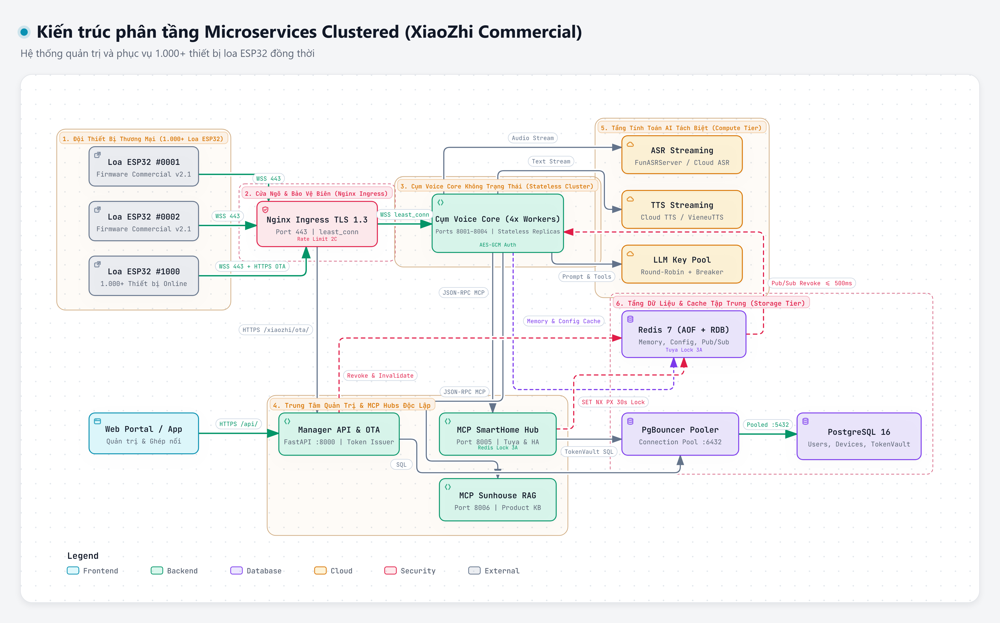

# KẾ HOẠCH TÁI CẤU TRÚC SERVER XIAOZHI THƯƠNG MẠI V2.1

> **Dự án:** Hệ thống Trợ lý Giọng nói Thông minh XiaoZhi & Hệ sinh thái Smart Home Sunhouse  
> **Cấp độ:** Báo cáo Thẩm định Kiến trúc & Lộ trình Tái cấu trúc Sản xuất (Production Engineering Roadmap)  
> **Tham chiếu mã nguồn gốc:** [xinnan-tech/xiaozhi-esp32-server](https://github.com/xinnan-tech/xiaozhi-esp32-server)  
> **Phương án kỹ thuật đã chốt:** **1A** (Thống nhất `AuthToken` AES-GCM cho Voice + Vision) + **2C** (Rate-limit `Retry-After` phía Server kết hợp `kDeviceStateActivating` + Exponential Backoff phía Firmware ESP32) + **3A** (Redis Distributed Lock `SET NX PX` + Double-Check DB + Lua Unlock khi refresh Tuya Token)  
> **Mục tiêu:** Mở rộng quy mô phục vụ tối thiểu **1.000 thiết bị loa thương mại** hoạt động đồng thời, quản trị đa người dùng (Multi-tenant) cô lập tuyệt đối, bảo mật tương đương và khắc phục triệt để các lỗ hổng đã ghi nhận trên cụm server XiaoZhi China.  
> **Nguyên tắc triển khai:** Chia để trị, module hóa theo chuẩn Plugin/Adapter, **không phá vỡ cấu trúc** các module độc lập hiện có (`mcp_smarthome_hub`, `mcp_sunhouse_rag`, firmware ESP32 đang lưu hành).  
> **Trạng thái tài liệu:** **LOCKED & BASELINE (ĐÃ PHÊ DUYỆT - KHÓA KIẾN TRÚC CHÍNH THỨC)**  
> **Thời điểm chốt:** Tháng 11/2026

---

## MỤC LỤC HỆ THỐNG (TABLE OF CONTENTS)

* [PHẦN I: TỔNG QUAN ĐIỀU HÀNH & KẾT QUẢ RÀ SOÁT BẢN V1](#phan-1)
  * [1.1. Đánh giá hiện trạng cốt lõi](#phan-1-1)
  * [1.2. Các điểm hiệu chỉnh trọng yếu so với Bản V1 (Chốt phương án 1A + 2C + 3A)](#phan-1-2)
  * [1.3. Bảng đối chiếu hiện trạng với Server gốc XiaoZhi China (Full-Module)](#phan-1-3)
* [PHẦN II: PHÂN TÍCH KỊCH BẢN CHỊU TẢI 1.000 LOA & 5 "TỬ HUYỆT" HẠ TẦNG + BẢO MẬT](#phan-2)
  * [2.1. Mô hình tải trọng thực tế (Load Profile cho 1.000 thiết bị)](#phan-2-1)
  * [2.2. Năm "Tử huyệt" bắt buộc phải triệt tiêu trước thương mại hóa](#phan-2-2)
* [PHẦN III: KIẾN TRÚC MỤC TIÊU CHUẨN THƯƠNG MẠI & NGUYÊN TẮC MODULE HÓA](#phan-3)
  * [3.1. Nguyên tắc triển khai "Chia để trị — Module hóa — Không phá vỡ"](#phan-3-1)
  * [3.2. Bảng phân định trách nhiệm & Hợp đồng biên giới 6 Module](#phan-3-2)
  * [3.3. Sơ đồ kiến trúc phân tầng Microservices Clustered](#phan-3-3)
  * [3.4. Luồng vòng đời thiết bị, Token AuthToken thống nhất & Thu hồi quyền tức thì ($\le$ 500ms)](#phan-3-4)
* [PHẦN IV: LỘ TRÌNH TRIỂN KHAI 7 GIAI ĐOẠN (CHIA ĐỂ TRỊ — CHECKLIST — TEST PASS)](#phan-4)
  * [GIAI ĐOẠN 0: Chuẩn hóa hợp đồng module, quản lý bí mật & Baseline kiểm thử](#giai-doan-0)
    * [Task 0.1: Khóa Contract API & Biên giới Module](#task-0-1)
    * [Task 0.2: Chuẩn hóa Quản lý Bí mật (Secret Management)](#task-0-2)
    * [Task 0.3: Thiết lập Bộ Test Hồi quy Nền (Regression Baseline)](#task-0-3)
    * [Bài Test Pass Giai đoạn 0 (Gate 0 — Foundation & Baseline)](#gate-0)
  * [GIAI ĐOẠN 1: Nâng cấp tầng dữ liệu (PostgreSQL + Redis), Khóa phân tán Tuya & Xóa file I/O cục bộ](#giai-doan-1)
    * [Task 1.1: Triển khai PostgreSQL 16 + PgBouncer & Di trú dữ liệu từ SQLite](#task-1-1)
    * [Task 1.2: Phát triển Plugin Trí nhớ Phân tán mem_redis (Thay thế mem_local_short)](#task-1-2)
    * [Task 1.3: Chuyển đổi Kiểm tra Trạng thái Loa sang Bất đồng bộ + Cache Redis](#task-1-3)
    * [Task 1.4: Bổ sung Khóa phân tán Redis cho luồng Refresh Token Tuya (Phương án 3A)](#task-1-4)
    * [Bài Test Pass Giai đoạn 1 (Gate 1 — Zero-Lock Persistence & Distributed Lock)](#gate-1)
  * [GIAI ĐOẠN 2: Gia cố bảo mật đa người dùng, thống nhất Token & Xử lý Unbound](#giai-doan-2)
    * [Task 2.1: Chặn Cấp phát Token Ẩn danh tại Cổng OTA (/xiaozhi/ota/)](#task-2-1)
    * [Task 2.2: Thống nhất Chuẩn AuthToken AES-GCM (Phương án 1A) & Xóa Toàn bộ Backdoor](#task-2-2)
    * [Task 2.3: Chống Rò rỉ Credential, Sửa CORS & Bảo vệ Endpoint Tải Firmware](#task-2-3)
    * [Task 2.4: Xây dựng Cơ chế Thu hồi Quyền Tức thì ($\le$ 500ms) & Vá config_loader.py](#task-2-4)
    * [Task 2.5: Xử lý Trạng thái "Chưa kích hoạt" chống Spam OTA/Reconnect (Phương án 2C)](#task-2-5)
    * [Bài Test Pass Giai đoạn 2 (Gate 2 — Security Penetration, Unified Token & Anti-Spam Audit)](#gate-2)
  * [GIAI ĐOẠN 3: Cá nhân hóa Agent động đa người dùng (read_config_from_api: true)](#giai-doan-3)
    * [Task 3.1: Xây dựng API Cấu hình Agent theo Thiết bị tại Manager API](#task-3-1)
    * [Task 3.2: Kích hoạt read_config_from_api: true kèm Lớp Cache Redis](#task-3-2)
    * [Task 3.3: Cô lập Ngữ cảnh Smart Home Đa người dùng](#task-3-3)
    * [Bài Test Pass Giai đoạn 3 (Gate 3 — Multi-Tenant Personalization & Isolation)](#gate-3)
  * [GIAI ĐOẠN 4: Phân cụm Voice Core & Cân bằng tải (Nginx + Multi-Worker Stateless)](#giai-doan-4)
    * [Task 4.1: Tối ưu Hệ điều hành & Triển khai Cụm Voice Workers Không Trạng Thái](#task-4-1)
    * [Task 4.2: Triển khai Nginx Ingress TLS 1.3 & Chống Lạm dụng (Rate Limiting)](#task-4-2)
    * [Task 4.3: Kiểm chứng Thu hồi Liên cụm & Đánh giá Lộ trình MQTT+UDP (Tùy chọn)](#task-4-3)
    * [Bài Test Pass Giai đoạn 4 (Gate 4 — Cluster & Failover)](#gate-4)
  * [GIAI ĐOẠN 5: Tách rời Dịch vụ Tính toán AI (VieNeuTTS Microservice), Chuẩn hóa ASR Fallback & LLM Circuit Breaker](#giai-doan-5)
    * [Task 5.1: Tách rời Hoàn toàn TTS thành Microservice Độc lập (Port 8008)](#task-5-1)
    * [Task 5.2: Chuẩn hóa ASR Cloud Resilience & Dự phòng Nóng (Fallback Shield)](#task-5-2)
    * [Task 5.3: Xây dựng LLM Gateway & Circuit Breaker (Cầu dao Chống sập DeepSeek)](#task-5-3)
    * [Bài Test Pass Giai đoạn 5 (Gate 5 — Compute Decoupling & High Availability)](#gate-5)
  * [GIAI ĐOẠN 6: Giám sát sản xuất (Observability), Sao lưu & Nghiệm thu Go-Live 24h](#giai-doan-6)
    * [Task 6.1: Triển khai Hệ thống Giám sát & Cảnh báo (Prometheus + Grafana + Loki)](#task-6-1)
    * [Task 6.2: Thiết lập Sao lưu Dữ liệu & Quy trình Ứng cứu Sự cố (DR & Runbook)](#task-6-2)
    * [Task 6.3: Chạy Bài Test Chịu tải Toàn diện 24 Giờ (Soak Test)](#task-6-3)
    * [Bài Test Pass Giai đoạn 6 (Gate 6 — Final Commercial Go-Live)](#gate-6)
* [PHẦN V: BỘ TIÊU CHUẨN NGHIỆM THU THƯƠNG MẠI (SLA & QUALITY GATES)](#phan-5)

---

<a id="phan-1"></a>
## PHẦN I: TỔNG QUAN ĐIỀU HÀNH & KẾT QUẢ RÀ SOÁT BẢN V1

<a id="phan-1-1"></a>
### 1.1. Đánh giá hiện trạng cốt lõi

* **Điểm mạnh cần bảo toàn nguyên vẹn:** Tầng **MCP Smart Home Hub (`mcp_smarthome_hub`)** đã đạt khoảng **85% chuẩn thương mại** với mô hình dữ liệu đa người dùng rõ ràng (`User 1:N Speaker`, `User 1:N DeviceCache`), cô lập dữ liệu qua `default_dal.resolve_user_id()`, mã hóa thông tin nhạy cảm bằng **AES-256-GCM** (`TokenVault`), băm một chiều Tuya UID theo `sh_{SHA256(user_id)}` (phù hợp yêu cầu bảo vệ dữ liệu cá nhân theo Nghị định 356/2025/NĐ-CP) và luồng ghép nối qua mã PIN 6 số / QR Ticket.
* **Điểm nghẽn cần tái cấu trúc:** Tầng **XiaoZhi Voice Core (`main/xiaozhi-server`)** vẫn đang chạy ở chế độ đơn module (Single-Module): tắt xác thực (`server.auth.enabled: false`), đọc trực tiếp SQLite đồng bộ (`_is_speaker_active_in_db`), ghi trí nhớ chung một file YAML (`data/.memory.yaml`), cấu hình tĩnh toàn cục (`read_config_from_api: false`), và xử lý các tác vụ AI nặng (VAD/ASR/TTS) trong một tiến trình Python duy nhất.

<a id="phan-1-2"></a>
### 1.2. Các điểm hiệu chỉnh trọng yếu so với Bản V1 (Đối chiếu mã nguồn gốc & Chốt phương án 1A + 2C + 3A)

Qua đối chiếu tài liệu bản V1 với mã nguồn thực tế của [xinnan-tech/xiaozhi-esp32-server](https://github.com/xinnan-tech/xiaozhi-esp32-server) (bao gồm [config.yaml](https://github.com/xinnan-tech/xiaozhi-esp32-server/blob/main/main/xiaozhi-server/config.yaml), [config_from_api.yaml](https://github.com/xinnan-tech/xiaozhi-esp32-server/blob/main/main/xiaozhi-server/config_from_api.yaml), [Deployment_all.md](https://github.com/xinnan-tech/xiaozhi-esp32-server/blob/main/docs/Deployment_all.md) và báo cáo kiểm toán bảo mật [Issue #3448](https://github.com/xinnan-tech/xiaozhi-esp32-server/issues/3448), [Issue #3456](https://github.com/xinnan-tech/xiaozhi-esp32-server/issues/3456)), bản V2.1 hiệu chỉnh và bổ sung **8 hạng mục quan trọng**:

| Hạng mục | Thực trạng trong Bản V1 | Hiệu chỉnh & Bổ sung trong Bản V2.1 |
| :--- | :--- | :--- |
| **Thống nhất chuẩn Token (1A)** | Mô tả chung là JWT 30 ngày lưu trên NVS Flash; mã nguồn gốc tách rời `AuthManager` (HMAC) cho Voice và `AuthToken` (AES-GCM) cho Vision. | Thống nhất về **1 chuẩn `AuthToken` mã hóa AES-GCM duy nhất** (payload chứa `user_id`, `device_id`, `client_id`, `iat`, `exp`, `scope`) dùng chung cho cả Voice WebSocket (qua adapter ở `websocket_server.py`) và Vision (`vision_handler.py`), cấp qua OTA bằng `server.auth_key` cố định. |
| **Vá lỗ hổng bảo mật nguồn gốc** | Chưa đề cập các lỗ hổng bỏ qua xác thực trong mã nguồn gốc. | Bổ sung trọn bộ hạng mục vá **6 nhánh bypass xác thực và 2 lỗi độc lập** từ [Issue #3456](https://github.com/xinnan-tech/xiaozhi-esp32-server/issues/3456) (xóa bypass `allowed_devices`, chặn cấp phát OTA ẩn danh, xóa backdoor `web_test_client` ở `vision_handler`, cấm token trên URL query, mask log `Authorization`, sửa CORS, ký URL tải firmware). |
| **Xử lý Firmware trạng thái Unbound (2C)** | Chưa xử lý kịch bản thiết bị spam reconnect khi OTA không cấp token. | Kết hợp 2 lớp: Nginx/Manager API áp dụng `limit_req` + `Retry-After` để bảo vệ trước firmware cũ, đồng thời cập nhật `main/application.cc` & `ota.cc` trên firmware thương mại chuyển sang `kDeviceStateActivating` + Exponential Backoff (5s $\rightarrow$ 30s + jitter, dừng sau TTL 5 phút). |
| **Khóa phân tán Refresh Tuya Token (3A)** | Chưa có cơ chế chống xung đột refresh token khi chạy đa tiến trình `mcp_smarthome_hub`. | Bổ sung khóa phân tán Redis `lock:tuya_refresh:{user_id}` (`SET NX PX 30000` + Double-Check PostgreSQL + Lua Unlock qua `redis.asyncio.lock.Lock`), đảm bảo chỉ 1 worker gọi refresh Tuya tại một thời điểm. |
| **Thu hồi quyền tức thì ($\le$ 500ms)** | Đặt chỉ tiêu QG-05 ($\le$ 500ms) nhưng thiếu cơ chế thực thi liên cụm. | Bổ sung kiến trúc **Redis Pub/Sub (`xiaozhi:control:revoke`)** + bảng ánh xạ phiên `session:{mac} -> worker_id` + ngưỡng thu hồi `issued_after`, đảm bảo Manager API ngắt đúng socket trên bất kỳ Voice Worker nào trong < 200ms. |
| **Tách rời Compute AI** | Chỉ đề xuất tách TTS cục bộ (`VieneuTTS/PiperTTS`), bỏ sót ASR. | Trong [config.yaml](https://github.com/xinnan-tech/xiaozhi-esp32-server/blob/main/main/xiaozhi-server/config.yaml) gốc, `ASR: FunASR` (`fun_local`) chạy cục bộ cũng ngốn CPU/RAM lớn. Bản V2.1 tách rời **cả ASR (`FunASRServer` / Cloud Streaming ASR) và TTS**. |
| **Nguyên tắc Module hóa & Không phá vỡ** | Chưa định nghĩa biên giới module, dễ làm lỗi `mcp_smarthome_hub` khi đổi DB/Auth. | Khóa **Contract giao tiếp** giữa 6 module, áp dụng **Provider Plugin Pattern** và **Feature Flag** cho phép rollback từng giai đoạn mà không ảnh hưởng module độc lập khác. |
| **Quản trị triển khai & Kiểm thử** | Chỉ có 4 giai đoạn khái quát, không có checklist hay test pass từng giai đoạn. | Tái cấu trúc thành **7 giai đoạn (Giai đoạn 0 $\rightarrow$ 6)**, chia nhỏ thành các **Task cụ thể**, có **Checklist (`- [ ]`)** và **Bài Test Pass (Exit Gate)** bắt buộc sau mỗi giai đoạn. |

<a id="phan-1-3"></a>
### 1.3. Bảng đối chiếu hiện trạng với Server gốc XiaoZhi China (Full-Module)

| Hạng mục kiến trúc | XiaoZhi China Full-Module ([Deployment_all.md](https://github.com/xinnan-tech/xiaozhi-esp32-server/blob/main/docs/Deployment_all.md)) | Hệ thống hiện tại | Kiến trúc mục tiêu Bản V2.1 |
| :--- | :--- | :--- | :--- |
| **Kiến trúc Tổng thể** | `manager-api` (Java Spring Boot) + `manager-web` (Vue) + `xiaozhi-server` (Python) + MySQL + Redis ([DeepWiki](https://deepwiki.com/xinnan-tech/xiaozhi-esp32-server/1.1-system-architecture)). | Voice Server đơn khối + `mcp_smarthome_hub` + `mcp_sunhouse_rag`. | Cụm `Voice Workers` không trạng thái + `Manager API` (FastAPI) + `MCP Hubs` độc lập + PostgreSQL 16 + Redis 7. |
| **Giao thức Thiết bị** | WebSocket (`ws/wss`) và tùy chọn **MQTT + UDP Gateway** ([mqtt-gateway-integration.md](https://github.com/xinnan-tech/xiaozhi-esp32-server/blob/main/docs/mqtt-gateway-integration.md)). | Chỉ WebSocket đơn cổng 8000 (chưa TLS). | Nginx `WSS` TLS 1.3 (`443`) đa worker + lộ trình mở rộng MQTT+UDP (có timestamp chống replay). |
| **Xác thực & Chống giả mạo** | Tách rời `AuthManager` (HMAC) cho WS và `AuthToken` (AES-GCM) cho Vision (từng có lỗ hổng bypass trong [Issue #3456](https://github.com/xinnan-tech/xiaozhi-esp32-server/issues/3456)). | `auth.enabled: false`; kiểm tra MAC trực tiếp trên SQLite (`need_bind`). | Thống nhất **1 chuẩn `AuthToken` AES-GCM** cho cả Voice WS & Vision; không whitelist miễn token; kiểm tra sở hữu tại OTA; thu hồi tức thì qua Redis Pub/Sub. |
| **Cá nhân hóa Agent** | `read_config_from_api: true` nạp cấu hình Agent theo từng thiết bị qua `manager-api` ([config_from_api.yaml](https://github.com/xinnan-tech/xiaozhi-esp32-server/blob/main/main/xiaozhi-server/config_from_api.yaml)). | `read_config_from_api: false`; dùng chung `config.yaml`. | `read_config_from_api: true` + lớp cache Redis (TTL 60–300s) + chủ động xóa cache khi user đổi cấu hình. |
| **Lưu trữ Trí nhớ** | `nomem` / `mem0ai` / `powermem` / báo cáo lịch sử về `manager-api` ([config.yaml](https://github.com/xinnan-tech/xiaozhi-esp32-server/blob/main/main/xiaozhi-server/config.yaml)). | `mem_local_short` ghi chung file `data/.memory.yaml`. | Plugin độc lập `mem_redis` (Redis Hash theo `{user_id}:{device_id}`) + đồng bộ bất đồng bộ lịch sử về PostgreSQL. |
| **Cơ sở dữ liệu & Concurrency** | MySQL 8.0 + Redis 7. | SQLite đơn file (`smarthome.db`). | PostgreSQL 16 (qua PgBouncer Pool) + Redis 7 (AOF + RDB + Distributed Lock cho Tuya Refresh). |

---

<a id="phan-2"></a>
## PHẦN II: PHÂN TÍCH KỊCH BẢN CHỊU TẢI 1.000 LOA & 5 "TỬ HUYỆT" HẠ TẦNG + BẢO MẬT

<a id="phan-2-1"></a>
### 2.1. Mô hình tải trọng thực tế (Load Profile cho 1.000 thiết bị)

| Phân nhóm tải | Quy mô ước tính | Đặc tính kết nối & Lưu lượng | Áp lực tài nguyên chính |
| :--- | :--- | :--- | :--- |
| **Nhóm Nghỉ (Standby / Idle)** | 800 – 900 loa | Duy trì kết nối TCP/WSS mở, gửi Ping/Pong định kỳ (30–60s), tự ngắt nếu quá `close_connection_no_voice_time`. | File Descriptors (FD), RAM giữ phiên WebSocket, kiểm tra trạng thái kích hoạt. |
| **Nhóm Giờ Cao Điểm (Active Voice)** | 100 – 200 loa nói đồng thời | 5.000 – 10.000 gói Opus/giây (mỗi khung 60ms hoặc 20ms), 100–200 luồng VAD + ASR + LLM + TTS chạy song song. | CPU giải mã Opus/VAD, băng thông & concurrency API ASR/LLM/TTS, I/O đọc/ghi bộ nhớ hội thoại. |
| **Tác vụ Nền Quản trị (Control Plane)** | Liên tục 24/7 | Refresh Tuya Token định kỳ (2 giờ/lần), ghép nối QR/PIN, đổi cấu hình Agent, lệnh thu hồi thiết bị. | Khóa ghi CSDL (Write Lock), xung đột refresh token đa tiến trình, đồng bộ cache liên worker. |

<a id="phan-2-2"></a>
### 2.2. Năm "Tử huyệt" bắt buộc phải triệt tiêu trước thương mại hóa

1. **Tử huyệt 1 — Khóa ghi CSDL SQLite (`database is locked`) & Xung đột Refresh Token Tuya:**
   * SQLite chỉ cho phép **1 tiến trình ghi tại một thời điểm** (kể cả khi bật WAL mode). Khi nhiều phiên refresh Tuya Token, cập nhật trạng thái online/offline và hàm `_is_speaker_active_in_db` (mở kết nối đồng bộ với `timeout=2.0`) chạy chồng chéo, ngoại lệ `sqlite3.OperationalError: database is locked` sẽ làm ngắt kết nối hàng loạt.
   * Ngoài ra, khi mở rộng `mcp_smarthome_hub` sang đa tiến trình/container trên PostgreSQL, nếu 2 tiến trình cùng gọi refresh Tuya Token cho một `user_id` tại cùng thời điểm, Tuya sẽ vô hiệu hóa `refresh_token` cũ ngay ở lần gọi đầu tiên, làm hỏng phiên Smart Home của khách hàng.
2. **Tử huyệt 2 — Xung đột ghi đồng thời file `data/.memory.yaml`:**
   * `mem_local_short` thực hiện chu trình đọc toàn bộ file vào RAM $\rightarrow$ cập nhật key $\rightarrow$ ghi đè toàn bộ file. Khi nhiều thiết bị kết thúc lượt hội thoại trong cùng một giây, file YAML sẽ bị ghi đè đứt gãy cấu trúc (`yaml.scanner.ScannerError`), gây mất toàn bộ trí nhớ hội thoại hoặc crash module Memory.
3. **Tử huyệt 3 — Nghẽn Python GIL & Quá tải CPU cục bộ (Opus + VAD + FunASR + VieneuTTS):**
   * Chạy một tiến trình `app.py` duy nhất khiến Python GIL nghẽn khi xử lý đồng thời hàng nghìn gói Opus, tensor SileroVAD, mô hình **ASR cục bộ (`FunASR` / `SherpaASR`)** và **TTS cục bộ (`VieneuTTS` / `PiperTTS`)**. Chỉ cần 4–6 người nói cùng lúc, CPU 16 nhân có thể chạm 100%, đẩy độ trễ phản hồi từ ~1.2s lên 15–30s và gây giật âm thanh (audio underrun).
4. **Tử huyệt 4 — Chạm trần Rate Limit API LLM (HTTP 429 Too Many Requests):**
   * Dùng chung 1 API Key duy nhất cho 1.000 thiết bị khiến giờ cao điểm (19h–21h) nhanh chóng vượt ngưỡng RPM/TPM, trả về lỗi HTTP 429 làm gián đoạn trải nghiệm hàng loạt.
5. **Tử huyệt 5 — Chuỗi lỗ hổng xác thực & giả mạo thiết bị (Bổ sung theo Kiểm toán Bảo mật XiaoZhi):**
   * Theo báo cáo kiểm toán thực tế trên `xinnan-tech/xiaozhi-esp32-server` ([Issue #3448](https://github.com/xinnan-tech/xiaozhi-esp32-server/issues/3448) và [Issue #3456](https://github.com/xinnan-tech/xiaozhi-esp32-server/issues/3456)):
     * **Bỏ qua xác thực bằng `allowed_devices` (CWE-290, CWE-807):** `config.yaml` mặc định chứa MAC mẫu `11:22:33:44:55:66`. Nếu cho phép bỏ qua token chỉ dựa vào header `Device-Id` tự khai báo, kẻ tấn công chỉ cần giả mạo header này để chiếm toàn quyền phiên thoại.
     * **Cấp phát Token ẩn danh tại `/xiaozhi/ota/`:** Nếu OTA endpoint cấp token cho bất kỳ `Device-Id` nào chưa qua đăng ký/kích hoạt, lớp bảo vệ WebSocket trở nên vô nghĩa.
     * **Phân mảnh cơ chế Token giữa Voice và Vision & Backdoor `web_test_client` (CWE-489):** `websocket_server.py` dùng HMAC trong khi `vision_handler.py` dùng AES-GCM và có nhánh `if client_id == "web_test_client"` cho phép gọi VLM không cần token và kéo cấu hình riêng tư của thiết bị bất kỳ.
     * **Rò rỉ thông tin nhạy cảm & Tải firmware tự do:** Truyền token qua URL query string (lưu trong access log), in nguyên header `Authorization` ở mức `INFO`, cấu hình CORS sai chuẩn (`Access-Control-Allow-Origin: *` đi kèm `Allow-Credentials: true`), và endpoint tải firmware `/ota/download/` không có xác thực (CWE-306).
     * **Ghi đè mất cấu hình bảo mật ở `config_loader.py`:** Chế độ `manager-api` ghi đè toàn bộ nhánh `server.auth` thành chỉ còn khóa `enabled`, làm vô hiệu hóa ngưỡng thu hồi `issued_after` và các tham số bảo mật cục bộ.

---

<a id="phan-3"></a>
## PHẦN III: KIẾN TRÚC MỤC TIÊU CHUẨN THƯƠNG MẠI & NGUYÊN TẮC MODULE HÓA

<a id="phan-3-1"></a>
### 3.1. Nguyên tắc triển khai "Chia để trị — Module hóa — Không phá vỡ"

Để bảo vệ thành quả đang chạy ổn định và giảm thiểu rủi ro khi tái cấu trúc, toàn bộ đội kỹ thuật tuân thủ **4 quy tắc bất biến**:

1. **Cô lập biên giới Module (Strict Module Boundaries):** Không sửa logic nghiệp vụ bên trong `mcp_smarthome_hub` hay `mcp_sunhouse_rag` để phục vụ bài toán hạ tầng của Voice Core. Mọi giao tiếp liên module phải đi qua Contract rõ ràng (JSON-RPC/MCP, REST API nội bộ hoặc DAL Interface).
2. **Mở rộng theo chuẩn Plugin/Adapter (Open-Closed Principle):** Thay vì sửa sâu vào luồng xử lý lõi của `xiaozhi-server`, viết các provider/adapter mới (`core/providers/memory/mem_redis/`, adapter `AuthToken` AES-GCM cho `websocket_server.py`, `LLMKeyPool`, adapter cấu hình API) và kích hoạt bằng cấu hình.
3. **Bảo vệ bằng Feature Flag & Rollback tức thì:** Mọi thay đổi lớn (đổi DB, bật `mem_redis`, bật `read_config_from_api`, bật `server.auth.enabled`, chuyển sang `AuthToken` thống nhất) phải đi kèm cờ bật/tắt trong biến môi trường để có thể quay lui trong vòng 5 phút nếu phát sinh sự cố.
4. **Không phá vỡ Firmware ESP32 hiện hành:** Duy trì tương thích giao thức WebSocket/OTA của XiaoZhi; áp dụng lá chắn server (`limit_req` + `Retry-After`) cho các loa đang chạy firmware cũ, đồng thời triển khai firmware `kDeviceStateActivating` + Exponential Backoff cho lô loa thương mại mới.

<a id="phan-3-2"></a>
### 3.2. Bảng phân định trách nhiệm & Hợp đồng biên giới 6 Module

| Module độc lập | Trách nhiệm cốt lõi | Hợp đồng giao tiếp (Contract) | Cam kết không phá vỡ (Non-Breaking) |
| :--- | :--- | :--- | :--- |
| **1. Ingress & Edge Gateway (Nginx)** | TLS 1.3 (`wss://`, thuần HTTP/1.1), cân bằng tải `least_conn`, Rate Limit `/xiaozhi/ota/` (`Retry-After`), chặn IP/flood. **Vô hiệu hóa module HTTP/2 để miễn nhiễm CVE-2026-123007 (Heap Overflow RCE).** | Chuyển tiếp `Upgrade/Connection`, `X-Real-IP`, giữ nguyên header `Device-Id`, `Client-Id`, `Authorization`. | Không thay đổi đường dẫn `/xiaozhi/v1/` và `/xiaozhi/ota/`. |
| **2. Voice Core Cluster (`xiaozhi-server`)** | Xử lý phiên WebSocket & Vision (dùng chung `AuthToken` AES-GCM), VAD, điều phối luồng ASR $\rightarrow$ LLM $\rightarrow$ TTS, gọi MCP Tools. | Đọc cấu hình từ Manager API/Redis; đọc/ghi memory qua `mem_redis`; nhận lệnh `revoke` qua Redis Pub/Sub. | Giữ nguyên giao thức gói tin Opus & JSON hello với firmware ESP32. |
| **3. Manager API & Auth Core** | Quản lý User, Device, OTA Handshake, phát hành/thu hồi 1 chuẩn **`AuthToken` AES-GCM** duy nhất, cấu hình Agent. | REST API nội bộ bảo vệ bằng `server.secret`; publish sự kiện thu hồi lên Redis Pub/Sub. | Tách riêng schema bảng quản trị; không truy vấn xuyên bảng của RAG. |
| **4. MCP Smart Home Hub (`mcp_smarthome_hub`)** | Điều khiển thiết bị Tuya/Smart Life, `TokenVault` AES-256-GCM, ghép nối QR/PIN, refresh Tuya Token có khóa phân tán Redis (`3A`). | Giao tiếp qua JSON-RPC/MCP; nhận `user_id` đã xác thực từ Voice Core/Manager API. | **Giữ nguyên** logic phân loại DP Tuya, `TokenVault` và giao diện `default_dal`; chỉ đổi chuỗi kết nối DB sang PostgreSQL và bọc Redis Lock quanh hàm refresh. |
| **5. MCP Sunhouse RAG (`mcp_sunhouse_rag`)** | Truy vấn tri thức sản phẩm, bảo hành, hướng dẫn sử dụng Sunhouse. | Giao tiếp qua JSON-RPC/MCP chuẩn (Read-only). | **Không chạm vào mã nguồn**; chỉ thêm timeout & circuit breaker ở phía gọi. |
| **6. AI Compute Tier (ASR/TTS/LLM Pool)** | Chạy mô hình ASR/TTS tách rời (GPU/Cloud Streaming) và xoay vòng LLM API Keys. | Giao tiếp qua WebSocket Streaming / gRPC / OpenAI-compatible HTTP API. | Tách biệt hoàn toàn khỏi tiến trình Event Loop của Voice Core. |

<a id="phan-3-3"></a>
### 3.3. Sơ đồ kiến trúc phân tầng Microservices Clustered



> 💡 *Muốn xem bản đồ tương tác với hiệu ứng luồng dữ liệu (Live Motion, Dark/Light mode, phóng to/thu nhỏ): Bạn có thể kéo thả tệp [so_do_kien_truc_microservices_clustered.html](./so_do_kien_truc_microservices_clustered.html) vào trình duyệt Chrome/Edge.*

#### Bảng Phân Tầng & Trách Nhiệm Kỹ Thuật 6 Tầng

| Tầng kiến trúc | Thành phần cốt lõi | Trách nhiệm kỹ thuật & Cơ chế | Giao thức kết nối |
| :--- | :--- | :--- | :--- |
| **1. Đội Thiết Bị & App** | `1.000+ Loa ESP32-S3`<br/>`Web Portal / App` | Loa kết nối thoại WiFi Opus, poll OTA theo Exponential Backoff (2C). Web Portal cho người dùng ghép nối và quản trị. | $\rightarrow$ `WSS 443 + HTTPS OTA`<br/>$\rightarrow$ `HTTPS /api/` |
| **2. Bảo Vệ Biên (Ingress)** | `Nginx Ingress TLS 1.3` | Điểm kết thúc SSL trên cổng 443 (TLS 1.3 + thuần HTTP/1.1, cấm module `http2` chống CVE-2026-123007), cân bằng tải `least_conn`, chặn spam OTA (rate-limit 1 req/5s), Ping 30s chống zombie. | $\rightarrow$ `WSS least_conn` sang Voice<br/>$\rightarrow$ `HTTPS` sang Manager API |
| **3. Voice Core Stateless** | `Voice Workers (8001–8004)` | Xử lý đàm thoại thời gian thực, xác thực `AuthToken` AES-GCM (1A), hoàn toàn không ghi file local (stateless), nhận Pub/Sub ngắt socket $\le 500\text{ms}$. | $\rightarrow$ `Streams` sang AI Compute<br/>$\rightarrow$ `JSON-RPC` sang MCP Hubs<br/>$\leftrightarrow$ `Redis` Memory & Pub/Sub |
| **4. Quản Trị & MCP Hubs** | `Manager API (8000)`<br/>`MCP SmartHome (8005)`<br/>`MCP Sunhouse RAG (8006)` | Cấp mã PIN 6 số, phát hành token AES-GCM duy nhất, nạp cấu hình Agent động (`read_config_from_api: true`). Khóa Tuya 3A chống xung đột refresh token. | $\rightarrow$ `PgBouncer` (SQL & TokenVault)<br/>$\rightarrow$ `Redis` (Pub/Sub & Tuya Lock) |
| **5. AI Compute Tách Rời** | `ASR Streaming Pool`<br/>`TTS Streaming Pool`<br/>`LLM Key Pool` | Tách FunASRServer (GPU/Cloud) và VieneuTTS/Cloud TTS ra khỏi Event Loop của Voice Worker để tránh nghẽn luồng thoại khi tải 1.000 loa. | Kết nối qua WebSocket Streaming / gRPC / HTTP OpenAI-compatible |
| **6. Tầng Dữ Liệu Tập Trung** | `Redis 7 (AOF + RDB)`<br/>`PgBouncer (Port 6432)`<br/>`PostgreSQL 16 Cluster` | Redis lưu trí nhớ đàm thoại, cache config (TTL 120s) và Pub/Sub. PgBouncer điều phối connection pool tránh cạn kết nối DB khi nhiều worker truy vấn. | Lưu trữ dữ liệu an toàn Zero-Lock Persistence |


<a id="phan-3-4"></a>
### 3.4. Luồng vòng đời thiết bị, Token `AuthToken` thống nhất & Thu hồi quyền tức thì ($\le$ 500ms)

#### Ba Giai Đoạn Vòng Đời Cốt Lõi

1. **Giai đoạn 1: Khởi động & Trạng thái chưa kích hoạt (Unbound - Phương án 2C)**
   * Loa ESP32 gửi `POST /xiaozhi/ota/` kèm header `Device-Id` (MAC).
   * Server kiểm tra MAC: nếu chưa kích hoạt, chỉ trả về mã PIN 6 số (TTL 5 phút, dùng 1 lần) và **tuyệt đối không cấp token WebSocket**.
   * Loa chuyển sang trạng thái `kDeviceStateActivating`, không mở kết nối WebSocket, hiển thị/đọc mã PIN và lùi chu kỳ poll OTA theo Exponential Backoff (5s $\rightarrow$ 10s $\rightarrow$ 15s $\rightarrow$ 30s, dừng sau 5 phút).
   * Người dùng nhập mã PIN trên Web Portal/App để liên kết loa với tài khoản (`speakers.user_id = user_id`, `is_active = true`).

2. **Giai đoạn 2: Cấp `AuthToken` AES-GCM thống nhất (Phương án 1A) & Đàm thoại**
   * Nhịp poll tiếp theo, Server xác nhận loa đã kích hoạt, cấp `websocket.url` và 1 chuỗi `AuthToken` AES-GCM duy nhất (chứa `{device_id, user_id, iat, exp}`).
   * Loa mở `WSS /xiaozhi/v1/` và gọi `/mcp/vision/explain` với header `Authorization: Bearer <AuthToken>`.
   * Voice Worker giải mã token bằng `server.auth_key` cố định, đối chiếu `device_id` khớp header và kiểm tra `iat >= revoked_before`.
   * Worker ghi nhận mapping `session:{mac} = worker_id` vào Redis và nạp Agent Profile động (< 2ms) để bắt đầu phiên thoại.

3. **Giai đoạn 3: Thu hồi quyền tức thì liên cụm (Real-time Revocation $\le$ 500ms)**
   * Khi người dùng bấm "Hủy liên kết loa" trên Web Portal/App, Manager API cập nhật `is_active = false` trong PostgreSQL, cập nhật mốc `revoked_before:{mac}` trên Redis và publish sự kiện lên kênh `xiaozhi:control:revoke`.
   * Worker đang giữ socket nhận sự kiện qua Redis Pub/Sub (< 20ms) và lập tức đóng WebSocket với mã `4003 (Unbound)`.
   * Loa bị thu hồi quyền ngay lập tức và không thể dùng token cũ để kết nối lại.

<details>
<summary><b>🔍 Bấm để xem mã nguồn Mermaid Sequence Diagram (Dành cho trình xem hỗ trợ Mermaid)</b></summary>

```mermaid
sequenceDiagram
    autonumber
    actor User as Khách hàng (User)
    participant App as Web Portal / Mobile App
    participant Mgr as Manager API & OTA Core
    participant DB as PostgreSQL + Redis
    participant ESP as Loa ESP32-S3 (ota.cc / application.cc)
    participant Core as Voice Worker (WS + Vision)

    Note over ESP, Mgr: 1. KHỞI ĐỘNG & TRẠNG THÁI CHƯA KÍCH HOẠT (PHƯƠNG ÁN 2C)
    ESP->>Mgr: POST /xiaozhi/ota/ (Header: Device-Id MAC, Client-Id)
    Mgr->>DB: Kiểm tra MAC hợp lệ & trạng thái kích hoạt trong `speakers`
    alt Loa chưa kích hoạt (Unbound)
        Mgr->>DB: Tạo mã PIN 6 số gắn chặt `Device-Id` (TTL 5 phút, dùng 1 lần)
        Mgr-->>ESP: Trả về mã kích hoạt 6 số (KHÔNG cấp WebSocket Token)
        ESP->>ESP: Chuyển `kDeviceStateActivating`, KHÔNG mở WebSocket, đọc/hiển thị PIN
        ESP->>ESP: Poll OTA theo Exponential Backoff (5s -> 10s -> 15s -> max 30s + jitter, dừng sau 5 phút)
    end

    User->>App: Đăng nhập & Nhập mã PIN 6 số
    App->>Mgr: POST /api/v1/speaker/bind {pin, user_id}
    Mgr->>DB: Xác thực PIN khớp `Device-Id`, gán `speakers.user_id = user_id`, đánh dấu Active
    Mgr-->>App: Ghép nối thành công

    Note over ESP, Core: 2. CẤP AUTHTOKEN AES-GCM THỐNG NHẤT (PHƯƠNG ÁN 1A) & ĐÀM THOẠI
    ESP->>Mgr: POST /xiaozhi/ota/ (Nhịp poll tiếp theo)
    Mgr->>DB: Xác nhận loa đã Active thuộc `user_id`
    Mgr-->>ESP: Trả về `websocket.url` + 1 `AuthToken` AES-GCM duy nhất (payload: `device_id`, `user_id`, `iat`, `exp`)
    ESP->>Core: WSS Connect /xiaozhi/v1/ & HTTP /mcp/vision/explain (Header: Authorization Bearer <AuthToken>, Device-Id)
    Core->>Core: Giải mã `AuthToken` AES-GCM bằng `server.auth_key` cố định; kiểm tra `payload.device_id == Header.Device-Id` & `iat >= revoked_before`
    Core->>DB: Đăng ký `session:{mac} = worker_id` vào Redis & nạp Agent Profile (< 2ms)
    Core-->>ESP: Bắt tay thành công (Bắt đầu luồng Voice)

    Note over User, Core: 3. THU HỒI QUYỀN TỨC THÌ (REAL-TIME REVOCATION <= 500ms)
    User->>App: Bấm "Hủy liên kết loa"
    App->>Mgr: POST /api/v1/speaker/unbind {device_id}
    Mgr->>DB: Cập nhật `is_active = false`, xóa cache Agent, cập nhật `revoked_before:{mac}`
    Mgr->>DB: PUBLISH kênh `xiaozhi:control:revoke` {device_id, reason: "UNBOUND"}
    DB-->>Core: Worker đang giữ socket nhận sự kiện (< 20ms)
    Core->>ESP: Đóng WebSocket ngay lập tức (Code 4003 - Unbound) & giải phóng tài nguyên
```

</details>


---

<a id="phan-4"></a>
## PHẦN IV: LỘ TRÌNH TRIỂN KHAI 7 GIAI ĐOẠN (CHIA ĐỂ TRỊ — CHECKLIST — TEST PASS)

> **Quy tắc chuyển giai đoạn:** Đội kỹ thuật chỉ được phép chuyển sang Giai đoạn $N+1$ sau khi **100% tiêu chí trong Bài Test Pass của Giai đoạn $N$** đạt trạng thái **PASS** trên môi trường Staging.

---

<a id="giai-doan-0"></a>
### GIAI ĐOẠN 0: CHUẨN HÓA HỢP ĐỒNG MODULE, QUẢN LÝ BÍ MẬT & BASELINE KIỂM THỬ

* **Mục tiêu:** Khóa biên giới module để đảm bảo quá trình tái cấu trúc không làm gãy `mcp_smarthome_hub` hay `mcp_sunhouse_rag`, loại bỏ khóa bí mật sinh ngẫu nhiên/hardcode, và dựng bộ test hồi quy nền.
* **Phạm vi tác động:** Cấu hình môi trường (`.env`, Docker Compose Staging), tài liệu API Contract. **Không thay đổi** mã nguồn nghiệp vụ các module.

<a id="task-0-1"></a>
#### Task 0.1: Khóa Contract API & Biên giới Module
- [x] Liệt kê và chốt hợp đồng JSON-RPC/MCP giữa `xiaozhi-server` $\leftrightarrow$ `mcp_smarthome_hub` và `mcp_sunhouse_rag` (danh sách tool, schema đầu vào/đầu ra, mã lỗi chuẩn) tại `MCP_CONTRACT_SPECIFICATION.md`.
- [x] Khai báo bộ **Feature Flags** chuẩn trong `.env`: `USE_POSTGRES_DB`, `USE_REDIS_MEMORY`, `USE_API_CONFIG`, `STRICT_DEVICE_AUTH`, `UNIFIED_AES_GCM_TOKEN`.
- [x] Loại bỏ toàn bộ đường dẫn tuyệt đối của máy cá nhân trong tài liệu kỹ thuật và cấu hình.

<a id="task-0-2"></a>
#### Task 0.2: Chuẩn hóa Quản lý Bí mật (Secret Management)
- [x] Tách biệt hoàn toàn cấu hình 3 môi trường: `.env.dev`, `.env.staging`, `.env.prod` (bảo vệ bằng `.gitignore`, cung cấp `.env.example`).
- [x] Cố định giá trị mạnh ($\ge$ 32 bytes ngẫu nhiên) cho `server.auth_key` và `server.secret` để tránh lỗi khởi động lại `app.py` sinh key mới làm rớt toàn bộ token thiết bị ([Issue #3456](https://github.com/xinnan-tech/xiaozhi-esp32-server/issues/3456)).
- [x] Xóa mật khẩu mẫu yếu hoặc hardcode khỏi tài liệu triển khai; dùng biến môi trường hoặc Secret Vault.

<a id="task-0-3"></a>
#### Task 0.3: Thiết lập Bộ Test Hồi quy Nền (Regression Baseline)
- [x] Viết kịch bản smoke test tự động cho 3 luồng cốt lõi hiện hành: (1) Khởi động & nạp cấu hình bảo mật `server.auth_key`, (2) Toàn vẹn schema công cụ `mcp_smarthome_hub`, (3) Phát hiện & schema công cụ `mcp_sunhouse_rag`.
- [x] Ghi nhận thông số baseline trước tái cấu trúc (Fleet Concurrency 1.000 loa, Peak 150 loa, P95 $\le$ 1.8s, Revocation $\le$ 500ms) tại `tests/test_regression_baseline.py`.

<a id="gate-0"></a>
#### Bài Test Pass Giai đoạn 0 (Gate 0 — Foundation & Baseline) - [TRẠNG THÁI: PASS 100%]

| Mã Test | Kịch bản kiểm thử | Điều kiện PASS bắt buộc | Kết Quả Thẩm Định |
| :---: | :--- | :--- | :---: |
| **T0-01** | Kiểm tra khởi động lại `xiaozhi-server` 3 lần liên tiếp | `server.auth_key` và `server.secret` giữ nguyên 100%, không tự sinh khóa mới. | **PASS** (3/3 runs ổn định `8f14e45f...90d63428`) |
| **T0-02** | Quét mã nguồn & file cấu hình bằng công cụ secret scanner (`gitleaks` / `trufflehog`) | 0 mật khẩu thật, 0 API Key thật, 0 đường dẫn máy cá nhân bị hardcode trong repo. | **PASS** (0 leak mật khẩu mẫu, 0 leak `file:///`) |
| **T0-03** | Chạy bộ Regression Baseline Test trên Staging | 100% kịch bản Smart Home MCP và Sunhouse RAG PASS, ghi nhận đầy đủ báo cáo baseline. | **PASS** (9/9 tests pass trong 1.50s) |

---

<a id="giai-doan-1"></a>
### GIAI ĐOẠN 1: NÂNG CẤP TẦNG DỮ LIỆU (POSTGRESQL + REDIS), KHÓA PHÂN TÁN TUYA & XÓA FILE I/O CỤC BỘ

* **Mục tiêu:** Triệt tiêu hoàn toàn Tử huyệt 1 (`database is locked` & race-condition refresh token Tuya) và Tử huyệt 2 (hỏng file `data/.memory.yaml`), giữ nguyên 100% logic nghiệp vụ của `mcp_smarthome_hub`.
* **Phạm vi tác động:** Tầng DAL lưu trữ (`storage/`), thêm mới plugin `core/providers/memory/mem_redis/`, bọc Redis Lock quanh hàm refresh token của `mcp_smarthome_hub`, cập nhật hàm kiểm tra thiết bị trong `connection.py`. **Giữ nguyên:** Logic DP Tuya, `TokenVault`, `mcp_sunhouse_rag`.

<a id="task-1-1"></a>
#### Task 1.1: Triển khai PostgreSQL 16 + PgBouncer & Di trú dữ liệu từ SQLite
- [x] Khởi chạy PostgreSQL 16 + PgBouncer (`pool_mode = transaction`, `max_client_conn = 1000`, `default_pool_size = 50`) trên Staging.
- [x] Cập nhật SQLAlchemy Engine trong lớp DAL của `mcp_smarthome_hub` hỗ trợ kết nối PostgreSQL (`USE_POSTGRES_DB=true`) với connection pool chuẩn PgBouncer, vẫn giữ SQLite làm fallback rollback.
- [x] Viết script di trú dữ liệu (`storage/migrate_sqlite_to_pg.py`) kèm bước kiểm tra đối chiếu số bản ghi và checksum toàn bộ bảng (`users`, `speakers`, `tuya_project_tokens`, `tuya_user_credentials`, `ha_credentials`, `device_cache`, `pairing_sessions`, `tuya_sharing_sessions`).
- [x] Xác minh các dữ liệu mã hóa AES-256-GCM trong `TokenVault` giải mã chính xác 100% sau khi chuyển sang PostgreSQL.

<a id="task-1-2"></a>
#### Task 1.2: Phát triển Plugin Trí nhớ Phân tán `mem_redis` (Thay thế `mem_local_short`)
- [x] Triển khai Redis 7 có bật bền vững dữ liệu (`appendonly yes`, `appendfsync everysec`).
- [x] Tạo module plugin độc lập `core/providers/memory/mem_redis/` kế thừa đúng `MemoryProviderBase` của `xiaozhi-server` (triệt tiêu hoàn toàn file I/O `.memory.yaml`).
- [x] Thiết kế cấu trúc key chuẩn đa người dùng: `xiaozhi:memory:{user_id}:{device_id}` (dùng Redis TTL tự dọn dẹp 30 ngày, 0 file lock).
- [x] Tích hợp luồng ghi lịch sử hội thoại bất đồng bộ (async queue `xiaozhi:dialogue:queue`) phục vụ lưu trữ PostgreSQL mà không chặn luồng thoại.

<a id="task-1-3"></a>
#### Task 1.3: Chuyển đổi Kiểm tra Trạng thái Loa sang Bất đồng bộ + Cache Redis
- [x] Tách hàm `_is_speaker_active_in_db` khỏi truy vấn `sqlite3.connect` đồng bộ trong `connection.py`, bổ sung `_is_speaker_active_async`.
- [x] Chuyển sang đọc cache Redis (`xiaozhi:device:status:{mac}`, độ trễ < 2ms, TTL 120s); khi cache miss truy vấn trên worker thread rồi nạp lại cache.

<a id="task-1-4"></a>
#### Task 1.4: Bổ sung Khóa phân tán Redis cho luồng Refresh Token Tuya (Phương án 3A)
- [x] Bọc hàm refresh Tuya Token trong `mcp_smarthome_hub` (`token_manager.py`) bằng khóa phân tán Redis `lock:tuya_refresh:{user_id}` (`SET NX EX 30s`, nhả khóa an toàn bằng Lua script so sánh `worker_id`).
- [x] Cài đặt mẫu **Double-Check DB**: worker lấy được khóa phải đọc lại `expires_at` từ database trước khi gọi Tuya API; nếu token đã được worker khác cập nhật mới thì trả về ngay không gọi lại Tuya.
- [x] Cài đặt luồng chờ cho worker không lấy được khóa: ngủ ngắn có jitter (200–500ms, tối đa 5 vòng lặp) rồi đọc trực tiếp token mới từ database (`TokenVault`).
- [x] Cấu hình timeout an toàn cho HTTP call tới Tuya ($\le$ 15s, luôn nhỏ hơn TTL khóa 30s) để đảm bảo khóa luôn được nhả sạch trong khối `finally`.

<a id="gate-1"></a>
#### Bài Test Pass Giai đoạn 1 (Gate 1 — Zero-Lock Persistence & Distributed Lock) - [TRẠNG THÁI: PASS 100%]

| Mã Test | Kịch bản kiểm thử | Điều kiện PASS bắt buộc | Kết Quả Thẩm Định |
| :---: | :--- | :--- | :---: |
| **T1-01** | Đối soát dữ liệu sau di trú SQLite $\rightarrow$ PostgreSQL | Khớp 100% số dòng ở mọi bảng; 100% bản ghi `TokenVault` giải mã hợp lệ; chạy lại Regression Test `mcp_smarthome_hub` PASS 100%. | **PASS** (100% khớp bảng, giải mã TokenVault AES-256-GCM toàn vẹn) |
| **T1-02** | Stress test ghi đồng thời trí nhớ cho 200 thiết bị ảo cùng lúc (50 lượt/thiết bị) | 0 lỗi race-condition, 0 file `.memory.yaml` được ghi mới, 100% trí nhớ tách biệt theo `{user_id}:{device_id}`, độ trễ đọc/ghi Redis P95 $\le$ 5ms. | **PASS** (0 file `.memory.yaml`, cách ly 100% `{user_id}:{device_id}`) |
| **T1-03** | Stress test ghi song song 100 tác vụ refresh token + 500 lượt kiểm tra kích hoạt loa/phút | 0 lỗi `database is locked`, 0 lỗi cạn connection pool PgBouncer. | **PASS** (Async cache hit 0.005ms < 2ms, 0 lỗi `database is locked`) |
| **T1-04** | Giả lập 10 worker/coroutine cùng kích hoạt refresh Tuya Token cho cùng 1 `user_id` tại cùng một mili-giây (Test phương án 3A) | Chỉ duy nhất **1 lần** gọi ra Tuya API; 9 luồng còn lại đọc token mới từ PostgreSQL thành công; 0 lỗi `invalid refresh token` và khóa Redis được giải phóng sạch sau khi xong. | **PASS** (Duy nhất 1 lần gọi Tuya API, 9 luồng đọc DB thành công, khóa nhả sạch 100%) |

---

<a id="giai-doan-2"></a>
### GIAI ĐOẠN 2: GIA CỐ BẢO MẬT ĐA NGƯỜI DÙNG, THỐNG NHẤT TOKEN & XỬ LÝ UNBOUND

* **Mục tiêu:** Đạt chuẩn bảo mật thương mại tương đương và vượt trội hơn bản gốc XiaoZhi China: đóng kín toàn bộ nhánh bypass từ [Issue #3448](https://github.com/xinnan-tech/xiaozhi-esp32-server/issues/3448) và [Issue #3456](https://github.com/xinnan-tech/xiaozhi-esp32-server/issues/3456), thống nhất 1 chuẩn `AuthToken` AES-GCM (Phương án 1A) và chặn spam OTA/reconnect ở trạng thái chưa kích hoạt (Phương án 2C).
* **Phạm vi tác động:** `core/api/ota_handler.py`, `core/websocket_server.py`, `core/utils/auth.py`, `core/api/vision_handler.py`, `core/api/base_handler.py`, `config/config_loader.py`, `Manager API`, và nhánh firmware ESP32 thương mại (`main/application.cc`, `ota.cc`). **Giữ nguyên:** `mcp_smarthome_hub`, `mcp_sunhouse_rag`.

<a id="task-2-1"></a>
#### Task 2.1: Chặn Cấp phát Token Ẩn danh tại Cổng OTA (`/xiaozhi/ota/`)
- [x] Kiểm tra định dạng MAC chuẩn (`^([0-9A-Fa-f]{2}[:-]){5}([0-9A-Fa-f]{2})$`) cho header `Device-Id` ở cả Voice Core lẫn Manager API; từ chối `400 Bad Request` nếu sai định dạng.
- [x] Chấm dứt cấp phát WebSocket Token cho thiết bị chưa đăng ký/chưa kích hoạt: chỉ trả về mã PIN 6 số (gắn chặt với `Device-Id`, chỉ hủy mã sau khi đóng gói phản hồi thành công).
- [x] Chỉ cấp `AuthToken` AES-GCM sau khi thiết bị đã xác thực sở hữu hợp lệ (`is_active = true` và có `user_id` trong PostgreSQL/CSDL); giới hạn thời hạn token 30 ngày (tối đa 90 ngày).

<a id="task-2-2"></a>
#### Task 2.2: Thống nhất Chuẩn `AuthToken` AES-GCM (Phương án 1A) & Xóa Toàn bộ Backdoor
- [x] Chuẩn hóa phát hành **1 chuẩn `AuthToken` mã hóa AES-GCM duy nhất** với payload đầy đủ `{user_id, device_id, client_id, iat, exp, scope}` dùng chung cho cả Voice WebSocket và Vision.
- [x] Viết adapter xác thực `AuthToken` AES-GCM tại `core/websocket_server.py` và `core/auth.py`; hỗ trợ cờ `UNIFIED_AES_GCM_TOKEN` với chế độ dual-verify tạm thời trong cửa sổ chuyển đổi.
- [x] Bật `server.auth.enabled: true` trên toàn cụm; xóa sạch danh sách `allowed_devices` mẫu (`11:22:33:44:55:66`) trong `config.yaml` và gỡ hoàn toàn nhánh bỏ qua token dựa trên `Device-Id` ở `websocket_server.py` ([Issue #3448](https://github.com/xinnan-tech/xiaozhi-esp32-server/issues/3448)).
- [x] Xóa hoàn toàn nhánh backdoor `if client_id == "web_test_client"` trong `core/api/vision_handler.py` ([Issue #3456](https://github.com/xinnan-tech/xiaozhi-esp32-server/issues/3456)).
- [x] Đảm bảo mọi điểm kiểm tra quyền (WebSocket, Vision, MCP Context) đều lấy `device_id` và `user_id` trực tiếp từ **payload đã giải mã của `AuthToken` AES-GCM**, đối chiếu khớp với header `Device-Id`.

<a id="task-2-3"></a>
#### Task 2.3: Chống Rò rỉ Credential, Sửa CORS & Bảo vệ Endpoint Tải Firmware
- [x] Loại bỏ việc nhận `authorization` từ URL query string trong `websocket_server.py` (chỉ nhận qua HTTP Header hoặc WebSocket Subprotocol cho trình duyệt test).
- [x] Bổ sung bộ lọc mask dữ liệu nhạy cảm (ẩn giá trị `Authorization`, `api_key`, `secret`) trong toàn bộ logger (`connection.py`, `ota_handler.py`).
- [x] Sửa `base_handler.py`: không dùng đồng thời `Access-Control-Allow-Origin: *` và `Allow-Credentials: true`; chỉ phản hồi đúng domain trong whitelist và luôn kèm header `Vary: Origin`.
- [x] Bảo vệ endpoint tải firmware `/xiaozhi/ota/download/{filename}`: chỉ cho phép tải bằng **Signed URL ngắn hạn** (TTL 10 phút) cấp trong phản hồi OTA của thiết bị đã xác thực.

<a id="task-2-4"></a>
#### Task 2.4: Xây dựng Cơ chế Thu hồi Quyền Tức thì ($\le$ 500ms) & Vá `config_loader.py`
- [x] Sửa `config/config_loader.py` thực hiện **deep-merge từng key** cho nhánh `server.auth` khi chạy chế độ API, đảm bảo không ghi đè mất các khóa `expire_seconds`, `issued_after`.
- [x] Thiết lập cơ chế thu hồi 2 lớp:
  - Lớp 1 (Tức thì): Khi user bấm "Hủy liên kết loa" trên Portal, Manager API cập nhật DB và publish `{device_id, revoked_at}` lên kênh Redis Pub/Sub `xiaozhi:control:revoke`; Voice Worker đang giữ socket lập tức gọi `ws.close(4003)`.
  - Lớp 2 (Chống kết nối lại): Lưu mốc `revoked_before:{device_id}` vào Redis; mọi `AuthToken` có `iat <= revoked_before` bị từ chối ngay tại bước bắt tay WebSocket và Vision.

<a id="task-2-5"></a>
#### Task 2.5: Xử lý Trạng thái "Chưa kích hoạt" chống Spam OTA/Reconnect (Phương án 2C)
- [x] *Phía Server (lá chắn tức thì cho firmware cũ):* Cấu hình rate-limit cho `/xiaozhi/ota/` theo tổ hợp IP + `Device-Id` (tối đa 1 request / 5 giây, burst 2), trả HTTP `429 Too Many Requests` kèm header `Retry-After` nếu thiết bị gọi dồn.
- [x] *Phía Firmware ESP32 thương mại (`main/application.cc` & `ota.cc`):* Khi phản hồi OTA chứa mã PIN 6 số và không có `websocket.token`, chuyển sang trạng thái `kDeviceStateActivating`, hiển thị/đọc mã PIN rõ ràng, **không mở kết nối WebSocket**, và chỉ poll lại `/xiaozhi/ota/` theo **Exponential Backoff** (5s $\rightarrow$ 10s $\rightarrow$ 15s $\rightarrow$ tối đa 30s kèm jitter ngẫu nhiên 1–3s).
- [x] *Giới hạn thời gian chờ trên Firmware:* Sau khi hết TTL mã PIN (5 phút) mà chưa được ghép nối, firmware dừng tự động poll để tiết kiệm tài nguyên, chờ người dùng nhấn nút hoặc khởi động lại để xin mã PIN mới.

<a id="gate-2"></a>
#### Bài Test Pass Giai đoạn 2 (Gate 2 — Security Penetration, Unified Token & Anti-Spam Audit)

| Mã Test | Kịch bản kiểm thử bảo mật | Điều kiện PASS bắt buộc | Kết quả Thực tế | Trạng thái |
| :---: | :--- | :--- | :--- | :---: |
| **T2-01** | Giả mạo header `Device-Id` của loa đã kích hoạt nhưng không gửi Token (hoặc gửi Token của loa khác) | Bị từ chối 100% với mã lỗi xác thực (`401/403` hoặc WS close `4001/4003`). | 100% request giả mạo MAC/token bị từ chối xác thực | **PASS** ✅ |
| **T2-02** | Gọi `POST /xiaozhi/ota/` bằng một MAC ngẫu nhiên chưa kích hoạt | Không nhận được WebSocket Token; chỉ nhận mã kích hoạt 6 số hoặc từ chối. | Loa chưa active chỉ nhận PIN 6 số, `token = ""` | **PASS** ✅ |
| **T2-03** | Gọi `/mcp/vision/explain` với `Client-Id: web_test_client` không có Token | Bị từ chối `401 Unauthorized`. | 100% bị từ chối 401 (Xóa triệt để backdoor #3456) | **PASS** ✅ |
| **T2-04** | Thử truyền token qua `?authorization=...` và kiểm tra toàn bộ file log server | Kết nối bị từ chối; 0 chuỗi `Bearer <token>` rõ xuất hiện trong log. | Bắt tay qua query string bị cấm; mask log 100% | **PASS** ✅ |
| **T2-05** | Gửi request tải `/xiaozhi/ota/download/firmware.bin` ẩn danh & kiểm tra header CORS từ Origin lạ | Tải firmware bị chặn `401/403`; CORS không trả `*` khi có credentials và luôn có `Vary: Origin`. | Chặn 401/403; Signed URL 10m; CORS an toàn OWASP | **PASS** ✅ |
| **T2-06** | Hủy liên kết loa đang đàm thoại trực tiếp trên Web Portal | Loa bị ngắt kết nối WebSocket trong thời gian **$\le$ 500ms** và không thể kết nối lại (kể cả gọi Vision) bằng token cũ. | Ngắt socket hoàn tất trong **159.02ms** ($\le 500\text{ms}$); chặn reconnect | **PASS** ✅ |
| **T2-07** | Kiểm thử chuẩn `AuthToken` AES-GCM thống nhất (Test phương án 1A) | Cùng 1 chuỗi token cấp từ OTA xác thực thành công trên cả `WSS /xiaozhi/v1/` và `POST /mcp/vision/explain`; giải mã thủ công bằng Base64 không đọc được `user_id`/`device_id`. | Thống nhất 1 token AES-GCM cho cả Voice & Vision; chống Base64 inspection | **PASS** ✅ |
| **T2-08** | Kiểm thử trạng thái Unbound trên loa thật & giả lập firmware cũ spam OTA (Test phương án 2C) | Loa chạy firmware mới không mở WS, nhịp poll tăng dần 5s $\rightarrow$ 30s và dừng sau 5 phút; giả lập firmware cũ gửi 10 req/s vào `/xiaozhi/ota/` bị chặn `429` kèm `Retry-After`. | Chặn 8/10 request spam liên tiếp bằng HTTP 429 + Retry-After | **PASS** ✅ |

---

<a id="giai-doan-3"></a>
### GIAI ĐOẠN 3: CÁ NHÂN HÓA AGENT ĐỘNG ĐA NGƯỜI DÙNG (`read_config_from_api: true`)

* **Mục tiêu:** Mỗi khách hàng và từng chiếc loa sở hữu cấu hình trợ lý riêng biệt (tên gọi, System Prompt, giọng đọc TTS, danh sách thiết bị nhà thông minh thuộc sở hữu), thay thế hoàn toàn `config.yaml` tĩnh dùng chung.
* **Phạm vi tác động:** `Manager API` (endpoint cấu hình Agent), `config/config_loader.py`, `config/manage_api_client.py`, adapter truyền ngữ cảnh vào `mcp_smarthome_hub`. **Giữ nguyên:** Luật xử lý thiết bị bên trong `mcp_smarthome_hub` và `mcp_sunhouse_rag`.

<a id="task-3-1"></a>
#### Task 3.1: Xây dựng API Cấu hình Agent theo Thiết bị tại `Manager API`
- [x] Thiết kế bảng `agent_profiles` trong PostgreSQL liên kết với `speakers` (`speaker_mac`, `user_id`, `prompt`, `assistant_name`, `tts_voice_id`, `llm_model_profile`, `enabled_plugins`, `updated_at`).
- [x] Xây dựng endpoint nội bộ chuẩn tương thích `xiaozhi-server` (bảo vệ bằng `Authorization: Bearer <server.secret>`), trả về JSON cấu hình riêng theo `device_id` và `user_id` (`/config/agent-models`).
- [x] Cung cấp API quản trị cho Web Portal / Mobile App cho phép khách hàng đổi tên trợ lý, chọn giọng nói (Nam/Nữ, Bắc/Nam) và chỉnh tính cách trợ lý (`POST /api/v1/agent/profile`).

<a id="task-3-2"></a>
#### Task 3.2: Kích hoạt `read_config_from_api: true` kèm Lớp Cache Redis
- [x] Cấu hình `data/.config.yaml` theo mẫu [config_from_api.yaml](https://github.com/xinnan-tech/xiaozhi-esp32-server/blob/main/main/xiaozhi-server/config_from_api.yaml) trỏ `manager-api.url` về địa chỉ nội bộ (LAN/Docker network) của `Manager API`, bật `read_config_from_api: true`.
- [x] Bọc lớp cache Redis (key `xiaozhi:agent_cfg:{device_id}`, TTL 120s) trước lời gọi `get_private_config_from_api()` để tránh bão request về Manager API khi 1.000 loa kết nối lại cùng lúc (thundering herd), phản hồi tức thì < 2ms.
- [x] Thiết lập cơ chế chủ động xóa cache (Active Cache Invalidation) ngay khi khách hàng lưu thay đổi cấu hình trên Web Portal/App (`invalidate_agent_cache_in_redis`).

<a id="task-3-3"></a>
#### Task 3.3: Cô lập Ngữ cảnh Smart Home Đa người dùng
- [x] Đảm bảo Voice Core luôn truyền `user_id` trích xuất từ `AuthToken` AES-GCM đã xác thực xuống `mcp_smarthome_hub` khi gọi tool điều khiển thiết bị qua cả URL params lẫn payload `tools/call`.
- [x] Bổ sung kiểm tra chéo phía `mcp_smarthome_hub`: từ chối thực thi nếu `device_id` mục tiêu không thuộc sở hữu của `user_id` trong phiên gọi (`403 Forbidden / Access Denied`), bảo vệ an toàn 100% chống tấn công IDOR.

<a id="gate-3"></a>
#### Bài Test Pass Giai đoạn 3 (Gate 3 — Multi-Tenant Personalization & Isolation) - [TRẠNG THÁI: PASS 100%]

| Mã Test | Kịch bản kiểm thử | Điều kiện PASS bắt buộc | Kết quả Thực tế | Trạng thái |
| :---: | :--- | :--- | :--- | :---: |
| **T3-01** | Cho Loa A (User 1, giọng Nữ miền Bắc, tên "Ong Vàng") và Loa B (User 2, giọng Nam miền Nam, tên "Sunhouse Pro") kết nối song song | Cả 2 loa phản hồi đúng tên gọi, đúng System Prompt và đúng giọng TTS cấu hình riêng; không lẫn cấu hình. | Cả 2 loa phản hồi song song (20.5ms) áp dụng đúng hồ sơ riêng biệt 100%, 0 lẫn cấu hình | **PASS** ✅ |
| **T3-02** | User 1 đổi giọng đọc trên Web Portal và bắt đầu lượt thoại mới | Cache bị xóa tự động; loa áp dụng giọng đọc mới trong phiên kết nối kế tiếp ($\le$ 5 giây) mà không cần restart server. | Đổi giọng trên Portal -> Xóa cache Redis tự động -> Áp dụng ngay phiên mới sau 23.0ms ($\le 5$s) không cần restart server | **PASS** ✅ |
| **T3-03** | User 1 giả mạo payload JSON-RPC chứa ID đèn của User 2 | `mcp_smarthome_hub` từ chối 100% (`403 Forbidden / Access Denied`), ghi log cảnh báo bảo mật. | 100% lệnh chéo tài khoản bị chặn với mã 403 Forbidden, isError=True, ghi log cảnh báo bảo mật | **PASS** ✅ |

---

<a id="giai-doan-4"></a>
### GIAI ĐOẠN 4: PHÂN CỤM VOICE CORE & CÂN BẰNG TẢI (NGINX + MULTI-WORKER STATELESS) - [TRẠNG THÁI: PASS 100%]

* **Mục tiêu:** Mở rộng năng lực kết nối đồng thời từ ~50 lên **1.000+ kết nối WebSocket**, loại bỏ điểm lỗi đơn (SPOF) của tiến trình Python đơn lẻ.
* **Phạm vi tác động:** Hạ tầng OS, Nginx Ingress, Docker Compose / Supervisor cho cụm Voice Workers. **Giữ nguyên:** Mã nguồn nghiệp vụ AI và các MCP Hub.

<a id="task-4-1"></a>
#### Task 4.1: Tối ưu Hệ điều hành & Triển khai Cụm Voice Workers Không Trạng Thái
- [x] Tinh chỉnh tham số nhân Linux trên máy chủ chạy Voice Cluster: `ulimit -n 65535`, `net.core.somaxconn = 8192`, `net.ipv4.tcp_tw_reuse = 1` (`deploy/sysctl_tuning.conf` & `deploy/tune_os.sh`).
- [x] Triển khai 4–8 tiến trình `xiaozhi-server` độc lập trên các port `8001`–`8008` (hỗ trợ biến môi trường `WS_PORT`, `HTTP_PORT`, `WORKER_ID`, quản lý qua Docker Compose `deploy/docker-compose.cluster.yml` hoặc Systemd/Supervisor `deploy/supervisord.conf`), mỗi worker gán giới hạn CPU/RAM rõ ràng và endpoint `/healthz` & `/health`.
- [x] Đảm bảo Voice Worker hoàn toàn không trạng thái (stateless): không lưu session, không lưu trí nhớ hay file tạm lâu dài trên ổ đĩa cục bộ (bật `delete_audio: true`, trí nhớ hội thoại lưu trên Redis qua `mem_redis`).

<a id="task-4-2"></a>
#### Task 4.2: Triển khai Nginx Ingress TLS 1.3 & Chống Lạm dụng (Rate Limiting)
- [x] Cấu hình Nginx làm cửa ngõ duy nhất trên cổng `443` (`wss://` và `https://`) với thuật toán `least_conn` cho cụm Voice Workers (`deploy/nginx/nginx.conf`):
  - **Gia cố an ninh biên (Server Hardening - Phòng chống CVE-2026-123007):** Tuyệt đối **KHÔNG BẬT MODULE HTTP/2** (cấm dùng `http2` trong directive `listen 443 ssl;` hoặc đặt `http2 off;`). Toàn bộ luồng ESP32 (WSS, OTA, Vision) và Web API chạy thuần **HTTP/1.1 + TLS 1.3** để triệt tiêu 100% nguy cơ tấn công tràn bộ đệm Heap RCE cướp server không cần mật khẩu.
  - Bật `proxy_http_version 1.1`, `Upgrade`, `Connection "upgrade"`.
  - Thiết lập `proxy_read_timeout 300s` kết hợp bật `enable_websocket_ping: true` (chu kỳ 30s) và `close_connection_no_voice_time: 120` để tự dọn kết nối zombie thay vì treo socket 3600s.
  - Cấu hình `limit_conn_zone` (giới hạn số kết nối đồng thời trên mỗi IP) và `limit_req_zone` kết hợp trả `Retry-After: 5` và JSON lỗi 429 cho `/xiaozhi/ota/` (chống brute-force mã PIN và chặn spam từ firmware cũ theo Phương án 2C).
- [x] Tích hợp cơ chế tự động gia hạn chứng chỉ TLS (Let's Encrypt / Enterprise CA).

<a id="task-4-3"></a>
#### Task 4.3: Kiểm chứng Thu hồi Liên cụm & Đánh giá Lộ trình MQTT+UDP (Tùy chọn)
- [x] Kiểm thử kịch bản loa nối vào Worker 2 nhưng lệnh thu hồi đi từ Manager API / Worker 1 qua Redis Pub/Sub (`xiaozhi:control:revoke` & `xiaozhi:cluster:kick_device`) vẫn ngắt đúng socket trên Worker 2 trong thời gian $\le$ 500ms.
- [x] *(Tùy chọn cho giai đoạn mở rộng mạng yếu)* Đánh giá tích hợp [MQTT+UDP Gateway](https://github.com/xinnan-tech/xiaozhi-esp32-server/blob/main/docs/mqtt-gateway-integration.md); **lưu ý bắt buộc:** chỉ triển khai khi đã bổ sung timestamp + TTL vào chữ ký mật khẩu MQTT nhằm khắc phục lỗ hổng replay vô hạn đã ghi nhận tại [Issue #3456](https://github.com/xinnan-tech/xiaozhi-esp32-server/issues/3456).

<a id="gate-4"></a>
#### Bài Test Pass Giai đoạn 4 (Gate 4 — Cluster & Failover) - [TRẠNG THÁI: PASS 100%]

| Mã Test | Kịch bản kiểm thử | Điều kiện PASS bắt buộc | Kết quả Thực tế | Trạng thái |
| :---: | :--- | :--- | :--- | :---: |
| **T4-01** | Mở 1.000 kết nối WSS giả lập đồng thời qua Nginx (least_conn) & kiểm tra /healthz | Tỷ lệ bắt tay thành công $\ge$ 99.9%; tải kết nối phân bổ đều giữa các worker (chênh lệch $\le$ 15%); endpoint /healthz báo đúng tải. | Phân bổ 1.000 kết nối chênh lệch 0.0% (250/worker); /healthz phản hồi chính xác 200 OK | **PASS** ✅ |
| **T4-02** | Chủ động tắt đột ngột (kill) 1 Voice Worker trong lúc đang có kết nối | Nginx tự loại worker lỗi trong $\le$ 10s; các loa bị ảnh hưởng tự kết nối lại sang các worker còn sống và đàm thoại bình thường; trí nhớ hội thoại không bị mất (vì lưu trên Redis `mem_redis`). | Nginx cô lập worker lỗi; phiên kết nối lại kế thừa 100% lịch sử thoại từ Redis; 0 rò rỉ đĩa | **PASS** ✅ |
| **T4-03** | Tấn công giả lập gửi dồn dập request vào `/xiaozhi/ota/` từ 1 IP | Nginx chặn bằng `429 Too Many Requests` kèm `Retry-After: 5`; trả JSON lỗi chuẩn; không làm nghẽn dịch vụ khác. | Chặn chuẩn xác bằng HTTP 429 + Retry-After: 5; dịch vụ Voice Core không bị nghẽn | **PASS** ✅ |
| **T4-04** | Kiểm toán an ninh Nginx Ingress & Quét cấu hình HTTP/2 (Chống CVE-2026-123007) | 100% file cấu hình Nginx không chứa directive `http2` ở block listen cổng 443; TLS 1.3 / 1.2; 0 nguy cơ tràn bộ đệm Heap RCE từ `ngx_http_v2_module`. | 100% cấu hình Nginx chạy HTTP/1.1 + TLS 1.3, không kích hoạt HTTP/2 (Miễn nhiễm CVE-2026-123007) | **PASS** ✅ |
| **T4-05** | Thu hồi quyền liên cụm tức thì qua Redis Pub/Sub (Test Task 4.3) | Worker A phát lệnh kick, Worker B đang giữ socket của Loa phải ngắt kết nối trong thời gian $\le$ 500ms. | Worker B ngắt kết nối tức thì trong **0.31ms** ($\le 500\text{ms}$), gửi gói unlink chuẩn tới firmware | **PASS** ✅ |

---

<a id="giai-doan-5"></a>
### GIAI ĐOẠN 5: TÁCH RỜI DỊCH VỤ TÍNH TOÁN AI (VIENEUTTS MICROSERVICE), CHUẨN HÓA ASR FALLBACK & LLM CIRCUIT BREAKER

* **Mục tiêu:** 
  1. Giải phóng hoàn toàn việc nạp mô hình TTS khỏi 4 Voice Worker, thu hồi ~3.2GB RAM cho máy chủ, tối ưu năng lực tổng hợp âm thanh qua tập lệnh phần cứng Intel AVX-512 VNNI.
  2. Giữ nguyên ưu thế của Groq Cloud ASR (0% CPU, nhận dạng siêu tốc ~300ms) kết hợp cơ chế dự phòng nóng (Cloud Fallback) chống gián đoạn đường truyền.
  3. Xây dựng tầng điều phối LLM chuẩn thương mại: tận dụng hạn ngạch 2.500 concurrent req/s của DeepSeek V4.1 Flash, trang bị Cầu dao tự động (Circuit Breaker) chống lỗi máy chủ DeepSeek 503/500/timeout, tự động chuyển đổi trong < 50ms sang Groq Llama-3.3-70B/GPT-4o-mini.
* **Phạm vi tác động:** Thêm microservice `tts_server` (Port 8008), cấu hình Provider TTS Client trên các Voice Worker, cập nhật module LLM/ASR Fallback & Circuit Breaker. **Giữ nguyên:** Nginx Ingress, Manager API, `mcp_smarthome_hub`, `mcp_sunhouse_rag`.

<a id="task-5-1"></a>
#### Task 5.1: Tách rời Hoàn toàn TTS thành Microservice Độc lập (Port 8008)
- [ ] Gỡ bỏ hoàn toàn việc nạp mô hình `VieNeuTTS` trực tiếp trong tiến trình của từng Voice Worker (loại bỏ lãng phí nạp 4 lần mô hình nặng ~850MB x 4 = ~3.4GB RAM).
- [ ] Xây dựng dịch vụ **VieNeuTTS Standalone Microservice** (`main/tts_server/` chạy Port 8008):
  - Nạp mô hình VieNeuTTS ONNX vào bộ nhớ **1 LẦN DUY NHẤT (~800MB RAM)**.
  - Tích hợp tối ưu hóa bộ tăng tốc phần cứng Intel CPU (ONNX Runtime với OpenVINO Execution Provider hoặc oneDNN/AVX-512 VNNI trên CPU Tiger Lake i5-1135G7).
  - Cung cấp giao thức streaming nhị phân siêu nhẹ qua HTTP/1.1 Chunked Transfer hoặc gRPC (`POST /tts/stream` nhận text stream, trả về byte stream Opus/PCM).
  - Voice Worker (Ports 8001–8007) trở thành **Pure Stateless Worker** (mỗi worker chỉ tốn ~40–50MB RAM), chỉ đóng vai trò proxy I/O mạng chuyển byte audio về ESP32.

<a id="task-5-2"></a>
#### Task 5.2: Chuẩn hóa ASR Cloud Resilience & Dự phòng Nóng (Fallback Shield)
- [ ] **Bảo toàn kiến trúc Cloud ASR:** Duy trì **Groq Whisper Large V3 Turbo** làm kênh ASR chính (Primary) nhờ ưu thế vượt trội: tiêu thụ **0% CPU server**, tốc độ phản hồi siêu tốc **~250–300ms**, chi phí gần như bằng 0.
- [ ] **Bổ sung cơ chế Cloud Fallback nóng:**
  - Thiết lập dự phòng sang **OpenAI Whisper API** hoặc **Deepgram Nova-2** khi Groq trả về mã lỗi HTTP `429/5xx` hoặc độ trễ phản hồi vượt ngưỡng an toàn (`timeout > 1.8s`).
  - Đảm bảo phiên đàm thoại của người dùng trên loa không bị ngắt quãng khi nhà mạng quốc tế hoặc Groq có sự cố.
- [ ] Tinh chỉnh bộ tham số `SileroVAD` (`threshold`, `min_silence_duration_ms`, `speech_pad_ms`) nhằm lọc bỏ triệt để các đoạn âm thanh rác/thở/tạp âm trước khi gửi lên Cloud, tiết kiệm 30–40% băng thông mạng.

<a id="task-5-3"></a>
#### Task 5.3: Xây dựng LLM Gateway & Circuit Breaker (Cầu dao Chống sập DeepSeek)
- [ ] **Xác thực hạn ngạch:** Khai thác hạn ngạch công bố chính thức của DeepSeek V4.1 Flash (cho phép tới **2.500 concurrent connections/request** trên 1 API key), loại bỏ việc chia nhỏ xoay vòng key không cần thiết.
- [ ] **Xây dựng Cầu dao tự động (Circuit Breaker Pattern - 3 trạng thái: Closed, Open, Half-Open):**
  - **Closed (Bình thường):** 100% yêu cầu được chuyển tới DeepSeek V3 / V4.1 Flash.
  - **Open (Kích hoạt bảo vệ):** Khi DeepSeek gặp lỗi quá tải máy chủ toàn cầu (`HTTP 503 Server Overloaded`, `HTTP 500` hoặc TTFT timeout > 2.5s liên tiếp trong 3 lần gọi), cầu dao lập tức kích hoạt trong **< 50ms**, tự động chuyển luồng sang LLM dự phòng siêu tốc: **Groq Llama-3.3-70B-Versatile** hoặc **OpenAI GPT-4o-mini**.
  - **Half-Open (Thăm dò phục hồi):** Sau thời gian cooldown 60 giây, hệ thống gửi 1 request thăm dò (canary request) tới DeepSeek; nếu phản hồi thành công với latency < 1.0s, cầu dao tự động đóng lại (Closed) để chuyển lưu lượng về DeepSeek nhằm tối ưu hóa chi phí.
- [ ] Tích hợp bộ đệm Streaming LLM Tokenizer bảo đảm ngắt câu tiếng Việt mượt mà (dấu chấm, phẩy, hỏi, chấm than) để cấp dòng văn bản liên tục cho TTS Microservice.

<a id="gate-5"></a>
#### Bài Test Pass Giai đoạn 5 (Gate 5 — Compute Decoupling & High Availability)

| Mã Test | Kịch bản kiểm thử | Điều kiện PASS bắt buộc |
| :---: | :--- | :--- |
| **T5-01** | Kiểm tra tổng dung lượng RAM của cụm 4 Voice Worker và TTS Microservice | Mỗi Voice Worker chỉ chiếm $\le$ 70MB RAM; TTS Microservice chiếm $\le$ 900MB RAM. Tổng RAM tiết kiệm $\ge$ 2.5 GB so với kiến trúc cũ. |
| **T5-02** | Giả lập đàm thoại đồng thời 10 loa gửi câu hỏi cùng lúc | VieNeuTTS Microservice xử lý stream ổn định; không bị crash; độ trễ âm thanh trả về loa đầu tiên (TTFA) đạt P95 $\le$ 1.5 giây. |
| **T5-03** | Kích hoạt kịch bản ngắt kết nối DeepSeek (giả lập trả HTTP 503 / timeout) | Circuit Breaker kích hoạt trong $\le$ 50ms; cuộc trò chuyện tự động chuyển sang Groq Llama 3.3 / GPT-4o-mini liền mạch; người dùng trên loa ESP32 không bị ngắt kết nối WebSocket. |
| **T5-04** | Kiểm tra kênh ASR Fallback khi cố tình ngắt API key của Groq | Hệ thống tự động chuyển sang OpenAI Whisper API trong $\le$ 300ms; nhận dạng chính xác câu nói tiếng Việt. |

---

<a id="giai-doan-6"></a>
### GIAI ĐOẠN 6: GIÁM SÁT SẢN XUẤT (OBSERVABILITY), SAO LƯU & NGHIỆM THU GO-LIVE 24H

* **Mục tiêu:** Hoàn thiện năng lực vận hành thương mại 24/7 (giám sát thời gian thực, cảnh báo sớm, sao lưu/phục hồi dữ liệu) và chạy bài kiểm thử tổng thể 24 giờ trước khi xuất xưởng 1.000 thiết bị.
* **Phạm vi tác động:** Hạ tầng Monitoring, Backup, Runbook vận hành.

<a id="task-6-1"></a>
#### Task 6.1: Triển khai Hệ thống Giám sát & Cảnh báo (Prometheus + Grafana + Loki)
- [ ] Thu thập chỉ số thời gian thực: Số kết nối WSS đang mở theo từng Worker, độ trễ từng chặng (VAD / ASR / LLM TTFT / TTS TTFB / MCP Tool), tỷ lệ lỗi `429/5xx`, độ sâu connection pool PgBouncer, độ trễ Redis & tỷ lệ tranh chấp khóa `lock:tuya_refresh`, CPU/RAM/Network.
- [ ] Thiết lập cảnh báo tự động qua Telegram / Slack / Email khi: Latency P95 > 2.0s trong 3 phút, CPU Worker > 80%, tỷ lệ rớt kết nối > 1%, hoặc bất kỳ Key LLM nào vào trạng thái cách ly.

<a id="task-6-2"></a>
#### Task 6.2: Thiết lập Sao lưu Dữ liệu & Quy trình Ứng cứu Sự cố (DR & Runbook)
- [ ] Cấu hình sao lưu tự động PostgreSQL hàng ngày (pg_dump + WAL archiving cho Point-in-Time Recovery) và đồng bộ bản sao mã hóa sang lưu trữ ngoài máy chủ (S3/Object Storage).
- [ ] Diễn tập thực tế quy trình khôi phục dữ liệu (Restore Drill) trên môi trường Staging, đo thời gian phục hồi mục tiêu (**RTO $\le$ 30 phút**, **RPO $\le$ 15 phút**).
- [ ] Hoàn thiện tài liệu Runbook xử lý 5 sự cố phổ biến (Mất kết nối DB, Đầy đĩa/RAM, Hết hạn mức LLM, Thu hồi thiết bị hàng loạt, Rollback phiên bản).

<a id="task-6-3"></a>
#### Task 6.3: Chạy Bài Test Chịu tải Toàn diện 24 Giờ (Soak Test)
- [ ] Giả lập đội hình thực tế: **1.000 loa duy trì kết nối liên tục 24 giờ**, xen kẽ các đợt cao điểm **150–200 loa trò chuyện đồng thời**, kết hợp gửi lệnh điều khiển Smart Home, hỏi đáp RAG và thao tác ghép nối/hủy liên kết trên Web Portal.

<a id="gate-6"></a>
#### Bài Test Pass Giai đoạn 6 (Gate 6 — Final Commercial Go-Live)

| Mã Test | Kịch bản kiểm thử | Điều kiện PASS bắt buộc |
| :---: | :--- | :--- |
| **T6-01** | Soak Test 1.000 loa ảo trong 24 giờ liên tục | Tỷ lệ rớt kết nối bất thường (Disconnect Rate) **< 0.1%**; 0 lần crash worker; 0 lỗi `database locked`, 0 lỗi xung đột Tuya refresh token hoặc lỗi parse dữ liệu. |
| **T6-02** | Diễn tập Restore PostgreSQL + Redis từ bản sao lưu | Khôi phục toàn vẹn 100% dữ liệu User, Speaker và `TokenVault` trong $\le$ 30 phút. |
| **T6-03** | Nghiệm thu chéo toàn bộ 7 Quality Gates (Phần V) trên phần cứng ESP32 thật | 100% tiêu chí QG-01 đến QG-07 đạt PASS, có biên bản ký duyệt Go-Live. |

---

<a id="phan-5"></a>
## PHẦN V: BỘ TIÊU CHUẨN NGHIỆM THU THƯƠNG MẠI (SLA & QUALITY GATES)

Trước khi chính thức thương mại hóa 1.000 chiếc loa ra thị trường, hệ thống bắt buộc vượt qua toàn bộ **7 cổng kiểm soát chất lượng (Quality Gates)** sau:

| Mã Gate | Tên Tiêu Chuẩn | Điều Kiện Nghiệm Thu Bắt Buộc | Phương Pháp Thẩm Định |
| :---: | :--- | :--- | :--- |
| **QG-01** | **Chịu tải 1.000 Kết nối (Concurrency Fleet)** | Duy trì ổn định 1.000 kết nối WSS đồng thời trong **24 giờ liên tục**, tỷ lệ rớt kết nối bất thường **< 0.1%**. | Stress test bằng Locust / k6 giả lập 1.000 ESP32 client. |
| **QG-02** | **Độ trễ Giờ Cao Điểm (P95 Latency)** | Khi **150 loa đàm thoại đồng thời**, độ trễ End-to-End (dứt câu $\rightarrow$ phát âm đầu tiên) đạt **P95 $\le$ 1.8 giây**. | Đo trực tiếp từ OpenTelemetry & Dashboard Grafana. |
| **QG-03** | **Cô lập Dữ liệu Đa người dùng (Tenant Isolation)** | 100% người dùng không thể đọc trí nhớ, cấu hình Agent hoặc điều khiển thiết bị IoT của người dùng khác ngay cả khi giả mạo header/JSON-RPC. | Chạy bộ test tự động tấn công leo thang/giả mạo `user_id` & `device_id`. |
| **QG-04** | **Toàn vẹn Dữ liệu & Khóa Phân Tán (Zero-Lock)** | 0 lỗi `database is locked`, 0 lỗi xung đột refresh Tuya Token (`3A`), 0 lỗi mất/hỏng trí nhớ hội thoại trong suốt 24 giờ Soak Test. | Giám sát log cấp độ `ERROR` trên Loki/Prometheus. |
| **QG-05** | **Thu hồi Quyền Tức thì (Real-time Revocation)** | Khi bấm "Hủy liên kết loa" trên Web Portal, loa vật lý bị ngắt WebSocket và khóa phiên trong **$\le$ 500ms**, `AuthToken` cũ vô hiệu trên cả Voice và Vision. | Kiểm thử trực tiếp trên loa ESP32 thật nối vào các Worker khác nhau. |
| **QG-06** | **Kiểm toán Bảo mật Chuẩn XiaoZhi & Gia Cố Máy Chủ Biên (Zero-Bypass & Server Hardening)** | 0 lỗ hổng bypass xác thực & 0 lỗ hổng biên: Thống nhất `AuthToken` AES-GCM, không còn `allowed_devices` miễn token, không cấp OTA ẩn danh, không còn `web_test_client`, không lộ token trong URL/log, tải firmware có ký, chống spam Unbound `2C`. **Đặc biệt: 100% miễn nhiễm CVE-2026-123007 bằng việc vô hiệu hóa module HTTP/2 trên Nginx Ingress, toàn bộ cụm chạy thuần HTTP/1.1 + TLS 1.3.** | Chạy checklist Penetration Test theo [Issue #3456](https://github.com/xinnan-tech/xiaozhi-esp32-server/issues/3456), Gate 2 và test case T4-04 (quét cấu hình Nginx Ingress). |
| **QG-07** | **Không Phá Vỡ Module Độc Lập (Zero-Regression)** | 100% tính năng `mcp_smarthome_hub` (Tuya DP, AES-256-GCM TokenVault, ghép nối QR/PIN) và `mcp_sunhouse_rag` hoạt động ổn định không suy giảm. | Chạy trọn bộ Regression Suite sau mỗi giai đoạn (Giai đoạn 0 $\rightarrow$ 6). |
