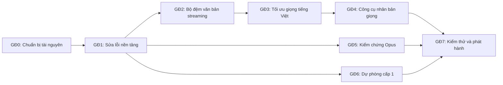

# TÌM HIỂU HẠ TẦNG TTS XIAOZHI & KẾ HOẠCH TÁI CẤU TRÚC THEO CHUẨN VOLCENGINE DOUBAO TTS (SEED-TTS / DOUBLE-STREAM)

> **Tài liệu kỹ thuật nội bộ hệ thống XiaoZhi Voice Assistant**  
> **Cơ sở phân tích:** Nền tảng đám mây `xiaozhi.me`, Web Trí Khống Đài (ZhiKongTai), tài liệu `huoshan-streamTTS-voice-cloning.md` và mã nguồn `core/providers/tts/huoshan_double_stream.py`.  
> **Thời gian khởi tạo:** Tháng 10/2026  
> **Trạng thái:** Bản thiết kế kiến trúc chuẩn (Architectural Blueprint) - Có thể mở rộng và cập nhật liên tục.

---

## MỤC LỤC CHI TIẾT

- [I. Bức Tranh Toàn Cảnh Về Hệ Thống TTS Trong Hệ Sinh Thái XiaoZhi](#i-bức-tranh-toàn-cảnh-về-hệ-thống-tts-trong-hệ-sinh-thái-xiaozhi)
  - [1. Hai phân hệ hạ tầng song song của XiaoZhi](#1-hai-phân-hệ-hạ-tầng-song-song-của-xiaozhi)
    - [1.1. Phân hệ Local Server (Self-hosted Python Server)](#11-phân-hệ-local-server-self-hosted-python-server)
    - [1.2. Phân hệ Official Cloud (`xiaozhi.me` & Bảng điều khiển Trí Khống Đài)](#12-phân-hệ-official-cloud-xiaozhime--bảng-điều-khiển-trí-khống-đài)
  - [2. Giải mã bí mật các giọng tiếng Việt trên `xiaozhi.me/console/agents`](#2-giải-mã-bí-mật-các-giọng-tiếng-việt-trên-xiaozhimeconsoleagents)
- [II. Bản Chất Công Nghệ Của Volcengine Doubao TTS (Seed-TTS 2.0)](#ii-bản-chất-công-nghệ-của-volcengine-doubao-tts-seed-tts-20)
  - [1. Nền tảng mô hình lớn giọng nói (Large Speech Model - Seed-TTS)](#1-nền-tảng-mô-hình-lớn-giọng-nói-large-speech-model---seed-tts)
  - [2. Cơ chế song luồng thời gian thực (Bi-directional Double-Stream WebSocket)](#2-cơ-chế-song-luồng-thời-gian-thực-bi-directional-double-stream-websocket)
  - [3. Công nghệ nhân bản giọng nói xuyên ngôn ngữ (Cross-lingual Zero-shot Voice Cloning)](#3-công-nghệ-nhân-bản-giọng-nói-xuyên-ngôn-ngữ-cross-lingual-zero-shot-voice-cloning)
- [III. Bảng So Sánh Đối Đầu Toàn Diện Các Giải Pháp TTS](#iii-bảng-so-sánh-đối-đầu-toàn-diện-các-giải-pháp-tts)
- [IV. Bóc Tách Kiến Trúc Mã Nguồn Backend Hiện Tại (`huoshan_double_stream.py`)](#iv-bóc-tách-kiến-trúc-mã-nguồn-backend-hiện-tại-huoshan_double_streampy)
  - [1. Luồng vận hành WebSocket nhị phân giao thức Volcano V3](#1-luồng-vận-hành-websocket-nhị-phân-giao-thức-volcano-v3)
  - [2. Cơ chế đóng gói và gửi nhận khung dữ liệu (Frame Protocol)](#2-cơ-chế-đóng-gói-và-gửi-nhận-khung-dữ-liệu-frame-protocol)
- [V. Kế Hoạch & Lộ Trình Tái Cấu Trúc (Refactoring Roadmap)](#v-kế-hoạch--lộ-trình-tái-cấu-trúc-refactoring-roadmap)
  - [1. Nguyên tắc thiết kế và phạm vi tác động](#1-nguyên-tắc-thiết-kế-và-phạm-vi-tác-động)
    - [1.1. Bộ nguyên tắc bắt buộc](#11-bộ-nguyên-tắc-bắt-buộc)
    - [1.2. Bản đồ module và ranh giới tác động](#12-bản-đồ-module-và-ranh-giới-tác-động)
    - [1.3. Kết quả đối chiếu tài liệu với mã nguồn hiện tại](#13-kết-quả-đối-chiếu-tài-liệu-với-mã-nguồn-hiện-tại)
    - [1.4. Danh sách lỗi và rủi ro phát hiện trong code](#14-danh-sách-lỗi-và-rủi-ro-phát-hiện-trong-code)
  - [2. Giai đoạn 0: Chuẩn bị tài nguyên và môi trường](#2-giai-đoạn-0-chuẩn-bị-tài-nguyên-và-môi-trường)
    - [2.1. Khởi tạo tài nguyên Volcengine](#21-khởi-tạo-tài-nguyên-volcengine)
    - [2.2. Bổ sung khối cấu hình vào data/.config.yaml](#22-bổ-sung-khối-cấu-hình-vào-dataconfigyaml)
    - [2.3. Kiểm thử khói (smoke test) độc lập](#23-kiểm-thử-khói-smoke-test-độc-lập)
  - [3. Giai đoạn 1: Sửa lỗi nền tảng trong module Volcengine](#3-giai-đoạn-1-sửa-lỗi-nền-tảng-trong-module-volcengine)
    - [3.1. Sửa bộ phân tích gói tin parser_response](#31-sửa-bộ-phân-tích-gói-tin-parser_response)
    - [3.2. Xử lý các sự kiện lỗi từ máy chủ](#32-xử-lý-các-sự-kiện-lỗi-từ-máy-chủ)
    - [3.3. Đồng bộ định dạng hàng đợi âm thanh](#33-đồng-bộ-định-dạng-hàng-đợi-âm-thanh)
    - [3.4. Dọn dẹp các điểm nhỏ](#34-dọn-dẹp-các-điểm-nhỏ)
  - [4. Giai đoạn 2: Tiền xử lý văn bản an toàn cho luồng streaming tiếng Việt](#4-giai-đoạn-2-tiền-xử-lý-văn-bản-an-toàn-cho-luồng-streaming-tiếng-việt)
    - [4.1. Phân tích nguyên nhân gốc](#41-phân-tích-nguyên-nhân-gốc)
    - [4.2. Giải pháp module hóa](#42-giải-pháp-module-hóa)
    - [4.3. Gom từ theo ranh giới an toàn](#43-gom-từ-theo-ranh-giới-an-toàn)
  - [5. Giai đoạn 3: Tối ưu giọng đọc tiếng Việt](#5-giai-đoạn-3-tối-ưu-giọng-đọc-tiếng-việt)
    - [5.1. Truyền tham số ngôn ngữ qua cấu hình](#51-truyền-tham-số-ngôn-ngữ-qua-cấu-hình)
    - [5.2. Ma trận đánh giá giọng đọc](#52-ma-trận-đánh-giá-giọng-đọc)
  - [6. Giai đoạn 4: Công cụ nhân bản giọng nói độc lập](#6-giai-đoạn-4-công-cụ-nhân-bản-giọng-nói-độc-lập)
    - [6.1. Hiện trạng luồng nhân bản giọng](#61-hiện-trạng-luồng-nhân-bản-giọng)
    - [6.2. Thiết kế công cụ dòng lệnh](#62-thiết-kế-công-cụ-dòng-lệnh)
    - [6.3. Gắn giọng đã nhân bản vào cấu hình](#63-gắn-giọng-đã-nhân-bản-vào-cấu-hình)
  - [7. Giai đoạn 5: Kiểm chứng đường truyền âm thanh Opus](#7-giai-đoạn-5-kiểm-chứng-đường-truyền-âm-thanh-opus)
  - [8. Giai đoạn 6: Cơ chế dự phòng nhiều tầng](#8-giai-đoạn-6-cơ-chế-dự-phòng-nhiều-tầng)
    - [8.1. Cấp độ 1: Chọn nhà cung cấp khi mở kết nối](#81-cấp-độ-1-chọn-nhà-cung-cấp-khi-mở-kết-nối)
    - [8.2. Cấp độ 2: Chuyển đổi khi đang hội thoại (hoãn lại)](#82-cấp-độ-2-chuyển-đổi-khi-đang-hội-thoại-hoãn-lại)
  - [9. Giai đoạn 7: Kiểm thử, đo đạc và phát hành](#9-giai-đoạn-7-kiểm-thử-đo-đạc-và-phát-hành)
    - [9.1. Ma trận kịch bản kiểm thử](#91-ma-trận-kịch-bản-kiểm-thử)
    - [9.2. Chỉ số đo đạc](#92-chỉ-số-đo-đạc)
    - [9.3. Phương án quay lui](#93-phương-án-quay-lui)
  - [10. Tổng hợp lộ trình và thứ tự phụ thuộc](#10-tổng-hợp-lộ-trình-và-thứ-tự-phụ-thuộc)
- [VI. Hướng Dẫn Cấu Hình Thực Chiến & Khắc Phục Sự Cố](#vi-hướng-dẫn-cấu-hình-thực-chiến--khắc-phục-sự-cố)
  - [1. Thiết lập tham số trong `.config.yaml`](#1-thiết-lập-tham-số-trong-configyaml)
  - [2. Bảng mã lỗi thường gặp của Volcano Engine và cách xử lý](#2-bảng-mã-lỗi-thường-gặp-của-volcano-engine-và-cách-xử-lý)
- [VII. Không Gian Mở Rộng Dành Cho Nghiên Cứu Tương Lai](#vii-không-gian-mở-rộng-dành-cho-nghiên-cứu-tương-lai)

---

## I. Bức Tranh Toàn Cảnh Về Hệ Thống TTS Trong Hệ Sinh Thái XiaoZhi

### 1. Hai phân hệ hạ tầng song song của XiaoZhi

Khi tìm hiểu sâu vào dự án XiaoZhi, cần phân định rạch ròi 2 hình thái vận hành:

```
                               ┌────────────────────────────────────────────────────────┐
                               │             HỆ SINH THÁI XIAOZHI ASSISTANT             │
                               └──────────────────────────┬─────────────────────────────┘
                                                          │
                    ┌─────────────────────────────────────┴─────────────────────────────────────┐
                    ▼                                                                           ▼
┌───────────────────────────────────────┐                                   ┌───────────────────────────────────────┐
│     HẠ TẦNG LOCAL / SELF-HOSTED       │                                   │       HẠ TẦNG OFFICIAL CLOUD          │
│        (Mã nguồn GitHub mở)           │                                   │      (xiaozhi.me & Trí Khống Đài)     │
├───────────────────────────────────────┤                                   ├───────────────────────────────────────┤
│ • Người dùng tự chạy server Python    │                                   │ • Cụm máy chủ đám mây thương mại      │
│ • Thiết lập cấu hình qua YAML cục bộ  │                                   │ • Giao diện Web Console quản trị      │
│ • Ưu tiên giải pháp miễn phí/offline: │                                   │ • Hợp tác chiến lược với Big Tech:    │
│   - Microsoft EdgeTTS (miễn phí)      │                                   │   - ByteDance Volcano Engine          │
│   - PiperTTS (Offline ONNX 60MB)      │                                   │   - Seed-TTS 2.0 Đa ngôn ngữ          │
│   - Whisper LPU / FunASR              │                                   │ • Tích hợp Voice Cloning công nghiệp  │
└───────────────────────────────────────┘                                   └───────────────────────────────────────┘
```

#### 1.1. Phân hệ Local Server (Self-hosted Python Server)
- Là bộ mã nguồn chạy trên máy tính cá nhân qua lệnh `start_xiaozhi_server.bat`.
- Được thiết kế linh hoạt, hỗ trợ nhiều provider: EdgeTTS, PiperTTS, SiliconFlow CosyVoice, OpenAI TTS, Xunfei...
- Mặc định sử dụng các công nghệ miễn phí để người dùng cộng đồng có thể dễ dàng tiếp cận mà không cần trả phí thẻ quốc tế.

#### 1.2. Phân hệ Official Cloud (`xiaozhi.me` & Bảng điều khiển Trí Khống Đài)
- Là hạ tầng máy chủ thương mại do đội ngũ XiaoZhi vận hành.
- Sử dụng giải pháp công nghiệp của **ByteDance (Volcengine)** làm nền tảng cốt lõi cho cả LLM (Doubao) và TTS (Volcano Double-Stream).

### 2. Giải mã bí mật các giọng tiếng Việt trên `xiaozhi.me/console/agents`

Trên giao diện web quản trị `xiaozhi.me/console/agents` (như trong ảnh thực tế), khi chọn ngôn ngữ **Vietnamese**, danh sách hiển thị các giọng đọc:
- `Giọng nữ (Female Voice)`
- `giọng nam (Male Voice)`
- `cô gái trẻ (Young Girl)`
- `chủ nhà nam (Male Host)`
- `chàng trai trẻ (Young Man)`
- `Beta · Hoài My`

**Bản chất kỹ thuật:**
- Các giọng như `cô gái trẻ`, `chàng trai trẻ`, `chủ nhà nam` chính là các bộ âm sắc (Timbre Presets) của mô hình giọng nói lớn **Seed-TTS / Doubao TTS** (Volcengine). 
- Động cơ Seed-TTS của ByteDance sở hữu khả năng **xuyên ngôn ngữ (Cross-lingual)**: Mô hình lấy phong cách diễn cảm và âm sắc gốc, sau đó ép dữ liệu ngữ âm tiếng Việt vào để tạo ra giọng nói tự nhiên, có hồn, biểu cảm vượt bậc.
- Mục `Beta · Hoài My` ở cuối danh sách chính là giọng thử nghiệm được tích hợp từ Microsoft EdgeTTS (`vi-VN-HoaiMyNeural`) để làm phương án so sánh bổ trợ.

---

## II. Bản Chất Công Nghệ Của Volcengine Doubao TTS (Seed-TTS 2.0)

### 1. Nền tảng mô hình lớn giọng nói (Large Speech Model - Seed-TTS)

Khác với các công nghệ TTS truyền thống (vốn sử dụng từ điển âm vị hoặc mô hình tham số nhỏ như VITS, FastSpeech2):
- **Seed-TTS** của ByteDance được xây dựng dựa trên kiến trúc **Autoregressive Transformer + Diffusion Model** quy mô hàng tỷ tham số.
- Được huấn luyện trên hàng triệu giờ âm thanh chất lượng cao của hệ sinh thái ByteDance (TikTok, Douyin, CapCut).
- Mô hình không chỉ đọc từng chữ, mà còn phân tích ngữ nghĩa của cả câu để tự động sinh ra:
  * **Hơi thở tự nhiên (Natural Breathing):** Tiếng lấy hơi nhẹ ở đầu câu hoặc giữa các vế ngắt nghỉ.
  * **Cảm xúc ngữ cảnh (Contextual Emotion):** Tự động chuyển tông vui tươi, trầm ngâm hoặc hào hứng tùy theo câu chuyện LLM tạo ra.
  * **Trọng âm và ngữ điệu câu (Prosody & Intonation):** Luyến láy dấu thanh điệu tiếng Việt (sắc, huyền, hỏi, ngã, nặng) không bị cứng nhắc.

### 2. Cơ chế song luồng thời gian thực (Bi-directional Double-Stream WebSocket)

Đây là điểm khác biệt sống còn mang lại độ trễ siêu thấp cho XiaoZhi:

```
CƠ CHẾ TRUYỀN THỐNG (Độ trễ cao: ~1500ms - 3000ms):
[User nói] ──► [ASR] ──► [LLM sinh cả câu] ──► [Gửi HTTP POST sang TTS] ──► [TTS xuất file WAV/MP3] ──► [Gửi về ESP32]
                                             ▲                                                    ▲
                                             └─── Chờ sinh xong cả câu ───────────────────────────┴─── Khựng tiếng!

CƠ CHẾ SONG LUỒNG VOLCANO V3 (Độ trễ tức thì: ~200ms - 350ms):
[User nói] ──► [ASR] ──► [LLM nhả Token...] 
                               │ (Đẩy từng ký tự qua WebSocket song công)
                               ▼
            ┌───────────────────────────────────────────────┐
            │   VOLCENGINE DOUBLE-STREAM WEBSOCKET ENGINE   │
            │   - Nhận Token tức thì (Input Stream)         │
            │   - Tổng hợp âm thanh song song ngay lập tức  │
            │   - Đẩy Audio Frame ngược lại (Output Stream) │
            └──────────────────────┬────────────────────────┘
                                   │ (Stream nhị phân PCM/Opus từng gói 20ms)
                                   ▼
                              [Loa ESP32 cất tiếng tức thì!]
```

* **Full-Duplex WebSocket:** Kết nối WebSocket được duy trì thường trực (`wss://openspeech.bytedance.com/api/v3/tts/bidirection`).
* **Không cần chờ câu kết thúc:** Ngay khi LLM sinh ra 3 - 5 từ đầu tiên, luồng Input Stream đẩy chữ lên, Volcengine lập tức bắn các gói âm thanh nhị phân (Binary Audio Chunks) về lại server, server đóng gói chuyển thẳng tới ESP32 qua giao thức Opus.

### 3. Công nghệ nhân bản giọng nói xuyên ngôn ngữ (Cross-lingual Zero-shot Voice Cloning)

Tài liệu `huoshan-streamTTS-voice-cloning.md` mô tả quy trình clone giọng:
1. **Thu âm mẫu:** Chỉ cần 1 đoạn âm thanh từ 10 - 30 giây của người dùng nói bất kỳ câu gì.
2. **Trích xuất Voice Embedding:** Mô hình trích xuất vector đặc trưng âm sắc (Speaker Embedding) chứa dấu vân tay giọng nói (âm vực, độ dày, tần số formant của thanh quản).
3. **Gán ID tài nguyên (`S_xxxxx`):** Volcengine gán vector này vào một Voice Resource ID duy nhất.
4. **Tổng hợp đa ngữ (Cross-lingual Synthesis):** Khi gửi văn bản Tiếng Việt lên WebSocket kèm tham số `speaker: S_xxxxx`, hệ thống sẽ áp dụng chất giọng đó để đọc tiếng Việt chuẩn xác, mang lại cảm giác chính người đó đang nói tiếng Việt!

---

## III. Bảng So Sánh Đối Đầu Toàn Diện Các Giải Pháp TTS

| Tiêu Chí Kỹ Thuật | Volcengine Doubao (Seed-TTS) | Microsoft EdgeTTS | PiperTTS (Local ONNX) | OpenAI TTS (`tts-1`) |
| :--- | :---: | :---: | :---: | :---: |
| **Độ trễ phản hồi (First Audio Byte)** | **~200ms - 350ms** (Siêu tốc) | ~400ms - 600ms | ~300ms - 500ms (tùy CPU) | ~800ms - 1500ms |
| **Giao thức truyền dữ liệu** | **Full-Duplex Double WebSocket** | Half-Duplex WebSocket | In-Memory Engine (Direct) | HTTP REST Stream |
| **Độ tự nhiên & Cảm xúc** | ⭐️⭐️⭐️⭐️⭐️ (Đỉnh cao, có hơi thở) | ⭐️⭐️⭐️⭐️ (Rất mượt mà) | ⭐️⭐️⭐️ (Đều giọng, hơi cứng) | ⭐️⭐️⭐️⭐️ (Khá tốt) |
| **Khả năng đọc Tiếng Việt** | ⭐️⭐️⭐️⭐️⭐️ (Chuẩn xác, linh hoạt) | ⭐️⭐️⭐️⭐️⭐️ (Chuẩn phát thanh viên) | ⭐️⭐️⭐️ (Chuẩn âm vị) | ⭐️⭐️⭐️⭐️ (Chuẩn ngữ điệu) |
| **Nhân bản giọng nói (Voice Clone)** | ✅ **CÓ (Cực nhanh qua `S_xxxxx`)** | ❌ Không hỗ trợ | ❌ Phải train lại model | ❌ Không hỗ trợ |
| **Chi phí sử dụng** | Có gói miễn phí ban đầu, sau đó tính phí | **100% Miễn phí** | **100% Miễn phí** | Thu phí theo ký tự |
| **Khả năng hoạt động Offline** | ❌ Cần kết nối Internet | ❌ Cần kết nối Internet | ✅ **100% Offline trên máy tính** | ❌ Cần kết nối Internet |
| **Mức độ phức tạp tích hợp** | Trung bình (cần đăng ký AppId) | Cực dễ (sẵn trong code) | Dễ (đã cấu hình ONNX) | Dễ (chỉ cần API Key) |

---

## IV. Bóc Tách Kiến Trúc Mã Nguồn Backend Hiện Tại (`huoshan_double_stream.py`)

Trong thư mục [`core/providers/tts/`](file:///e:/Espressif/frameworks/esp-idf-v5.5.3/examples/xiaozhi-esp32-main/xiaozhi-esp32-server/main/xiaozhi-server/core/providers/tts/), backend XiaoZhi đã xây dựng sẵn file [`huoshan_double_stream.py`](file:///e:/Espressif/frameworks/esp-idf-v5.5.3/examples/xiaozhi-esp32-main/xiaozhi-esp32-server/main/xiaozhi-server/core/providers/tts/huoshan_double_stream.py) với hơn 700 dòng lệnh xử lý giao thức nhị phân của ByteDance.

### 1. Luồng vận hành WebSocket nhị phân giao thức Volcano V3

Mỗi kết nối tới `wss://openspeech.bytedance.com/api/v3/tts/bidirection` tuân thủ giao thức nhị phân riêng của ByteDance (Volcano Binary Protocol V3):

```
CẤU TRÚC GÓI TIN NHỊ PHÂN VOLCANO V3:
┌─────────────────┬─────────────────┬─────────────────┬──────────────────────────────────┐
│ Header (4 bytes)│ Payload Size (4)│ Gzip Flag (1)   │ Payload Data (JSON hoặc Audio)   │
└─────────────────┴─────────────────┴─────────────────┴──────────────────────────────────┘
```

### 2. Cơ chế đóng gói và gửi nhận khung dữ liệu (Frame Protocol)

1. **Khởi tạo phiên (`StartSynthesis`):**
   - Client gửi gói tin Header + JSON chứa cấu hình:
     ```json
     {
       "app": {"appid": "your_app_id", "token": "your_token", "cluster": "volcano_tts"},
       "user": {"uid": "xiaozhi_user"},
       "audio": {"voice_type": "S_xxxxx", "encoding": "pcm", "rate": 24000},
       "request": {"reqid": "uuid", "operation": "submit"}
     }
     ```
2. **Bơm luồng văn bản (`TextStream`):**
   - Khi LLM sinh token, server gọi `send_text()` để đẩy dữ liệu văn bản vào phiên đang mở.
3. **Nhận luồng âm thanh (`AudioPackets`):**
   - Server lắng nghe luồng nhị phân trả về, bóc tách payload audio (PCM 24kHz), đẩy vào hàng đợi `tts_audio_queue`.
4. **Kết thúc câu (`StopSynthesis`):**
   - Gửi lệnh kết thúc phiên để giải phóng tài nguyên.

---

## V. Kế Hoạch & Lộ Trình Tái Cấu Trúc (Refactoring Roadmap)

> **Mục tiêu:** Đưa Volcengine Doubao TTS (Seed-TTS 1.0 / 2.0, Double-Stream) vào vận hành ổn định trên Local Server XiaoZhi, nói tiếng Việt chuẩn, hỗ trợ giọng nhân bản (`S_xxxxx`) và có cơ chế dự phòng — **mà không phá vỡ bất kỳ module nào khác**.
>
> **Cơ sở lập kế hoạch:** Đối chiếu trực tiếp với mã nguồn hiện tại (`huoshan_double_stream.py`, `base.py`, `core/utils/tts.py`, `textUtils.py`, `modules_initialize.py`, `connection.py`, `config.yaml`, `data/.config.yaml`).

### 1. Nguyên tắc thiết kế và phạm vi tác động

#### 1.1. Bộ nguyên tắc bắt buộc

| # | Nguyên tắc | Diễn giải áp dụng |
| :---: | :--- | :--- |
| P1 | **Module hóa** | Mọi logic mới đặt trong file/hàm mới có ranh giới rõ ràng (vd. `core/utils/stream_text.py`, `tools/volc_voice_clone.py`). |
| P2 | **Chia để trị** | Mỗi giai đoạn giải quyết đúng 1 nhóm vấn đề, có thể merge và kiểm thử độc lập. |
| P3 | **Không phá vỡ module khác** | Không sửa chữ ký hàm, không đổi hành vi của `TTSProviderBase`, `MarkdownCleaner.clean_markdown()`, `connection.py`, các provider khác (EdgeTTS, PiperTTS...). |
| P4 | **Tương thích ngược qua cấu hình** | Tính năng mới bật bằng khóa cấu hình mới; thiếu khóa ⇒ hành vi giữ nguyên như cũ. |
| P5 | **Quay lui tức thì** | Bất kỳ lúc nào cũng có thể đổi `selected_module.TTS` về `EdgeTTS`/`PiperTTS` mà không cần sửa code. |
| P6 | **Không sửa file gốc của dự án nếu có lớp ghi đè** | Cấu hình cá nhân chỉ ghi vào `data/.config.yaml`, không sửa `config.yaml`. |

#### 1.2. Bản đồ module và ranh giới tác động

| Module / File | Vai trò | Mức tác động |
| :--- | :--- | :---: |
| [`connection.py`](file:///e:/Espressif/frameworks/esp-idf-v5.5.3/examples/xiaozhi-esp32-main/xiaozhi-esp32-server/main/xiaozhi-server/core/connection.py) | Đẩy token LLM vào `tts_text_queue` | ⛔ **Không đụng** |
| [`base.py`](file:///e:/Espressif/frameworks/esp-idf-v5.5.3/examples/xiaozhi-esp32-main/xiaozhi-esp32-server/main/xiaozhi-server/core/providers/tts/base.py) | Lớp cha của mọi TTS, luồng phát âm thanh | ⛔ **Không đụng** |
| [`core/utils/tts.py`](file:///e:/Espressif/frameworks/esp-idf-v5.5.3/examples/xiaozhi-esp32-main/xiaozhi-esp32-server/main/xiaozhi-server/core/utils/tts.py) | `MarkdownCleaner` dùng chung cho mọi provider | ⛔ **Không đụng** |
| Các provider khác (`edge.py`, `piper.py`...) | TTS thay thế / dự phòng | ⛔ **Không đụng** |
| [`huoshan_double_stream.py`](file:///e:/Espressif/frameworks/esp-idf-v5.5.3/examples/xiaozhi-esp32-main/xiaozhi-esp32-server/main/xiaozhi-server/core/providers/tts/huoshan_double_stream.py) | Provider Volcengine Double-Stream | ✏️ Sửa cục bộ (Giai đoạn 1, 2, 6) |
| `core/utils/stream_text.py` | Tiền xử lý văn bản streaming | 🆕 Tạo mới (Giai đoạn 2) |
| `tools/volc_voice_clone.py` | Công cụ CLI nhân bản giọng | 🆕 Tạo mới, nằm ngoài runtime (Giai đoạn 4) |
| [`modules_initialize.py`](file:///e:/Espressif/frameworks/esp-idf-v5.5.3/examples/xiaozhi-esp32-main/xiaozhi-esp32-server/main/xiaozhi-server/core/utils/modules_initialize.py#L101-L115) | Khởi tạo TTS theo cấu hình | ✏️ Sửa 1 hàm `initialize_tts`, tương thích ngược (Giai đoạn 6) |
| `data/.config.yaml` | Cấu hình cá nhân | ✏️ Bổ sung khối cấu hình |

#### 1.3. Kết quả đối chiếu tài liệu với mã nguồn hiện tại

| Nội dung trong tài liệu (bản cũ) | Thực tế trong code | Kết luận |
| :--- | :--- | :--- |
| Xác thực bằng JSON `"app": {appid, token, cluster}` | Xác thực qua **HTTP header** `X-Api-App-Key`, `X-Api-Access-Key`, `X-Api-Resource-Id`, `X-Api-Connect-Id` ([L236-L244](file:///e:/Espressif/frameworks/esp-idf-v5.5.3/examples/xiaozhi-esp32-main/xiaozhi-esp32-server/main/xiaozhi-server/core/providers/tts/huoshan_double_stream.py#L236-L244)); payload JSON dùng `namespace: BidirectionalTTS` + `req_params` ([L681-L710](file:///e:/Espressif/frameworks/esp-idf-v5.5.3/examples/xiaozhi-esp32-main/xiaozhi-esp32-server/main/xiaozhi-server/core/providers/tts/huoshan_double_stream.py#L681-L710)) | Mục IV cần cập nhật lại |
| Âm thanh trả về cố định PCM 24kHz | `audio_params.sample_rate = conn.sample_rate` ([L213](file:///e:/Espressif/frameworks/esp-idf-v5.5.3/examples/xiaozhi-esp32-main/xiaozhi-esp32-server/main/xiaozhi-server/core/providers/tts/huoshan_double_stream.py#L213)) — theo đúng tần số thiết bị | Không cần resample |
| Cần xây dựng mới bộ mã hóa Opus (frame 20ms) | **Đã có sẵn**: PCM → `OpusEncoderUtils` frame **60ms** ([base.py L317-L320](file:///e:/Espressif/frameworks/esp-idf-v5.5.3/examples/xiaozhi-esp32-main/xiaozhi-esp32-server/main/xiaozhi-server/core/providers/tts/base.py#L317-L320)), không ghi file | Chỉ cần kiểm chứng (Giai đoạn 5) |
| Script nhân bản giọng tự ghi vào YAML | Nhân bản giọng hiện chỉ có trên **Trí Khống Đài** (manager-api); Local Server chỉ tiêu thụ `speaker` / `private_voice` ([L154-L157](file:///e:/Espressif/frameworks/esp-idf-v5.5.3/examples/xiaozhi-esp32-main/xiaozhi-esp32-server/main/xiaozhi-server/core/providers/tts/huoshan_double_stream.py#L154-L157)) | Cần công cụ độc lập (Giai đoạn 4) |
| Chỉ có 1 cấu hình `HuoshanDoubleStreamTTS` | `config.yaml` có **2 khối**: `HuoshanDoubleStreamTTS` (`volc.service_type.10029`, TTS 1.0) và `HuoshanDoubleStreamTTSV2` (`seed-tts-2.0`) | Ưu tiên dùng khối V2 |
| Có cơ chế dự phòng 3 tầng | `initialize_tts()` chỉ tạo **1** instance, không có fallback | Cần xây dựng (Giai đoạn 6) |
| `data/.config.yaml` đã có Volcengine | Hiện chỉ có EdgeTTS, PiperTTS, OpenAITTS, AliBLTTS...; `selected_module.TTS: PiperTTS` | Cần bổ sung (Giai đoạn 0) |

#### 1.4. Danh sách lỗi và rủi ro phát hiện trong code

| Mã | Mức độ | Vị trí | Mô tả |
| :---: | :---: | :--- | :--- |
| **B1** | 🔴 Cao | [L633](file:///e:/Espressif/frameworks/esp-idf-v5.5.3/examples/xiaozhi-esp32-main/xiaozhi-esp32-server/main/xiaozhi-server/core/providers/tts/huoshan_double_stream.py#L633) | `if header.message_type == FULL_SERVER_RESPONSE or AUDIO_ONLY_RESPONSE:` luôn đúng ⇒ nhánh `ERROR_INFORMATION` **không bao giờ chạy**, lỗi từ server bị nuốt mất. |
| **B2** | 🟡 Thấp | [L627](file:///e:/Espressif/frameworks/esp-idf-v5.5.3/examples/xiaozhi-esp32-main/xiaozhi-esp32-server/main/xiaozhi-server/core/providers/tts/huoshan_double_stream.py#L627) | `res[2] >> num` (dịch 15 bit) — phải là `>> 4`. Hiện chưa gây hỏng vì giá trị không được dùng. |
| **B3** | 🔴 Cao (riêng tiếng Việt) | [L378](file:///e:/Espressif/frameworks/esp-idf-v5.5.3/examples/xiaozhi-esp32-main/xiaozhi-esp32-server/main/xiaozhi-server/core/providers/tts/huoshan_double_stream.py#L378) + [tts.py L139-L147](file:///e:/Espressif/frameworks/esp-idf-v5.5.3/examples/xiaozhi-esp32-main/xiaozhi-esp32-server/main/xiaozhi-server/core/utils/tts.py#L139-L147) | `clean_markdown()` được gọi trên **từng token** LLM và kết thúc bằng `.strip()` (chỉ giữ khoảng trắng nếu toàn ASCII). Token tiếng Việt `" làng"` bị cắt thành `"làng"` ⇒ **dính chữ** (`điđến làng`). |
| **B4** | 🟠 Trung bình | [L499-L545](file:///e:/Espressif/frameworks/esp-idf-v5.5.3/examples/xiaozhi-esp32-main/xiaozhi-esp32-server/main/xiaozhi-server/core/providers/tts/huoshan_double_stream.py#L499-L545) | Không xử lý `EVENT_SessionFailed` (153), `EVENT_ConnectionFailed` (51): không log `response_meta_json`, thiết bị im lặng không rõ lý do. |
| **B5** | 🟡 Thấp | [L520](file:///e:/Espressif/frameworks/esp-idf-v5.5.3/examples/xiaozhi-esp32-main/xiaozhi-esp32-server/main/xiaozhi-server/core/providers/tts/huoshan_double_stream.py#L520), [L533](file:///e:/Espressif/frameworks/esp-idf-v5.5.3/examples/xiaozhi-esp32-main/xiaozhi-esp32-server/main/xiaozhi-server/core/providers/tts/huoshan_double_stream.py#L533) | Đẩy tuple 3 phần tử vào `tts_audio_queue`, trong khi `handle_opus` của lớp cha dùng 4 phần tử (có `sentence_id`). |
| **B6** | 🟡 Thấp | [L200](file:///e:/Espressif/frameworks/esp-idf-v5.5.3/examples/xiaozhi-esp32-main/xiaozhi-esp32-server/main/xiaozhi-server/core/providers/tts/huoshan_double_stream.py#L200), [L240](file:///e:/Espressif/frameworks/esp-idf-v5.5.3/examples/xiaozhi-esp32-main/xiaozhi-esp32-server/main/xiaozhi-server/core/providers/tts/huoshan_double_stream.py#L240) | `self.header` (Authorization) không được dùng; `X-Api-Connect-Id` truyền đối tượng `UUID` thay vì `str`. |
| **R1** | 🟠 Rủi ro | `enable_ws_reuse: True` | Kết nối được giữ cả khi thiết bị đang nghe ⇒ chiếm suất đồng thời (tài khoản miễn phí thường rất ít). |
| **R2** | 🟠 Rủi ro | Provider không đọc tham số ngôn ngữ | Seed-TTS có thể tự nhận diện, nhưng nên ép ngôn ngữ tiếng Việt qua `additions` để ổn định. |

---

### 2. Giai đoạn 0: Chuẩn bị tài nguyên và môi trường

#### 2.1. Khởi tạo tài nguyên Volcengine
1. Truy cập [Volcengine Speech Console](https://console.volcengine.com/speech/app), tạo ứng dụng, tích chọn:
   - **语音合成大模型** (Đại mô hình tổng hợp giọng nói).
   - **声音复刻大模型** (Đại mô hình phục chế giọng nói) — nếu dùng Voice Clone.
2. Kích hoạt gói **豆包语音合成模型2.0** (`seed-tts-2.0`) tại `console.volcengine.com/speech/service/10035`.
3. Thu thập: `App Id`, `Access Token`, danh sách giọng (`speaker`) hỗ trợ đa ngôn ngữ, và các mã giọng nhân bản `S_xxxxx` (nếu có).

#### 2.2. Bổ sung khối cấu hình vào data/.config.yaml
Chỉ ghi đè các trường bí mật lên khối `HuoshanDoubleStreamTTSV2` đã có sẵn trong `config.yaml` (giữ nguyên `selected_module.TTS` hiện tại cho tới khi Giai đoạn 1 xong):

```yaml
TTS:
  HuoshanDoubleStreamTTSV2:
    appid: "<APP_ID>"
    access_token: "<ACCESS_TOKEN>"
    resource_id: seed-tts-2.0
    speaker: "<SPEAKER_ĐA_NGÔN_NGỮ hoặc S_xxxxx>"
    enable_ws_reuse: false        # Tắt khi test để không chiếm suất đồng thời
```

#### 2.3. Kiểm thử khói (smoke test) độc lập
- Viết script thử trong thư mục `tools/` gọi `TTSProvider.to_tts("Xin chào, tôi là Tiểu Trí.")` (hàm non-stream có sẵn tại [L741](file:///e:/Espressif/frameworks/esp-idf-v5.5.3/examples/xiaozhi-esp32-main/xiaozhi-esp32-server/main/xiaozhi-server/core/providers/tts/huoshan_double_stream.py#L741)) để xác nhận kết nối, xác thực và chất lượng giọng **trước khi** đưa vào hội thoại thật.

**✅ Checklist hoàn thành Giai đoạn 0**
- [ ] Đã có `App Id`, `Access Token`, đã kích hoạt `seed-tts-2.0`.
- [ ] Đã chọn được ít nhất 1 `speaker` đọc tiếng Việt chấp nhận được.
- [ ] Khối `HuoshanDoubleStreamTTSV2` trong `data/.config.yaml` đã điền đủ, không sửa `config.yaml`.
- [ ] Smoke test `to_tts()` trả về danh sách gói Opus khác rỗng.

---

### 3. Giai đoạn 1: Sửa lỗi nền tảng trong module Volcengine

> **Phạm vi:** Chỉ sửa trong `huoshan_double_stream.py`. Không đổi giao diện công khai của lớp.

#### 3.1. Sửa bộ phân tích gói tin parser_response
- **B1:** Đổi điều kiện thành `if header.message_type in (FULL_SERVER_RESPONSE, AUDIO_ONLY_RESPONSE):` để nhánh `ERROR_INFORMATION` hoạt động.
- **B2:** Đổi `res[2] >> num` thành `(res[2] >> 4) & 0x0F`.

#### 3.2. Xử lý các sự kiện lỗi từ máy chủ
- Trong `_start_monitor_tts_response()` bổ sung nhánh:
  - `EVENT_SessionFailed` / `EVENT_ConnectionFailed`: log **mức ERROR** kèm `response_meta_json`, đặt `activate_session = False`.
  - `header.message_type == ERROR_INFORMATION`: log `errorCode` + payload, đóng kết nối để lần sau tạo mới.
- Kết quả mong đợi: các lỗi 401/403, hết quota, sai `resource_id` hiện rõ trong log thay vì im lặng.

#### 3.3. Đồng bộ định dạng hàng đợi âm thanh
- **B5:** Đổi `(SentenceType.FIRST, [], text)` thành `(SentenceType.FIRST, [], text, self.conn.sentence_id)` tại 2 vị trí. Lớp cha đã hỗ trợ cả 2 dạng nên đây là thay đổi an toàn.

#### 3.4. Dọn dẹp các điểm nhỏ
- **B6:** `"X-Api-Connect-Id": str(uuid.uuid4())` (cả trong `_ensure_connection` và `to_tts`); đánh dấu `self.header` là không dùng hoặc xóa.

**✅ Checklist hoàn thành Giai đoạn 1**
- [ ] B1, B2, B5, B6 đã sửa; `git diff` chỉ chạm `huoshan_double_stream.py`.
- [ ] Cố ý điền sai `access_token` ⇒ log hiện lỗi xác thực rõ ràng.
- [ ] Cố ý điền sai `resource_id` ⇒ log hiện `SessionFailed`/`ConnectionFailed` kèm thông điệp.
- [ ] Hội thoại bình thường vẫn chạy, phụ đề hiển thị đúng trên thiết bị.

---

### 4. Giai đoạn 2: Tiền xử lý văn bản an toàn cho luồng streaming tiếng Việt

#### 4.1. Phân tích nguyên nhân gốc
```
connection.py ──(token LLM: "Sứ giả", " đi", " đến", " làng")──► tts_text_queue
                                                                     │
huoshan.text_to_speak() ──► MarkdownCleaner.clean_markdown(token) ───┘
                              └─► repair_vietnamese_spacing() ─► .strip()
                              └─► (không toàn ASCII) ─► .strip()
Kết quả gửi lên Volcengine:  "Sứ giả" + "đi" + "đến" + "làng"  ⇒  "Sứ giảđiđếnlàng"
```
`clean_markdown()` được thiết kế cho **cả câu hoàn chỉnh** (provider non-stream), không phù hợp với **từng token**. Không được sửa hàm này vì mọi provider khác đang dùng (nguyên tắc P3).

#### 4.2. Giải pháp module hóa
Tạo module mới `core/utils/stream_text.py`, chỉ provider Double-Stream sử dụng:

```python
class StreamTextBuffer:
    """Gom token LLM và chỉ nhả ra các đoạn kết thúc tại ranh giới an toàn,
    giữ nguyên khoảng trắng biên để không dính chữ."""

    SAFE_BOUNDARY = re.compile(r"[\s,.;:!?。，！？；：]")

    def __init__(self):
        self._buf = ""

    def push(self, token: str) -> str:
        self._buf += token
        # Tìm ranh giới an toàn cuối cùng
        last = max((m.end() for m in self.SAFE_BOUNDARY.finditer(self._buf)), default=0)
        ready, self._buf = self._buf[:last], self._buf[last:]
        return self._clean(ready)

    def flush(self) -> str:
        ready, self._buf = self._buf, ""
        return self._clean(ready)

    @staticmethod
    def _clean(segment: str) -> str:
        if not segment.strip():
            return segment
        trailing = " " if segment[-1].isspace() else ""
        cleaned = MarkdownCleaner.clean_markdown(segment)   # tái sử dụng, không sửa
        return cleaned + trailing if cleaned else ""
```

#### 4.3. Gom từ theo ranh giới an toàn
- Trong `huoshan_double_stream.py`:
  - Khởi tạo `self._stream_buf = StreamTextBuffer()` tại `SentenceType.FIRST` (cạnh `reset_stream_state()`).
  - `text_to_speak()`: thay `MarkdownCleaner.clean_markdown(text)` bằng `self._stream_buf.push(text)`.
  - Tại `SentenceType.LAST`, **trước** `finish_session`: gửi phần còn lại `self._stream_buf.flush()`.
- Lợi ích phụ: markdown bị tách qua nhiều token (`**đậm**`) được làm sạch đúng; giảm số gói gửi lên WebSocket.
- Độ trễ tăng thêm chỉ bằng thời gian sinh 1 từ (~vài chục ms).

**✅ Checklist hoàn thành Giai đoạn 2**
- [ ] `core/utils/stream_text.py` có unit test: token có/không khoảng trắng đầu, dấu câu, markdown bị chia cắt, emoji.
- [ ] `MarkdownCleaner` và các provider khác không bị thay đổi.
- [ ] Log `开始发送TTS文本` không còn chuỗi dính chữ khi kể chuyện dài (vd. Thánh Gióng).
- [ ] Phần đuôi câu không bị mất khi kết thúc lượt (đã `flush()` trước `finish_session`).

---

### 5. Giai đoạn 3: Tối ưu giọng đọc tiếng Việt

#### 5.1. Truyền tham số ngôn ngữ qua cấu hình
- Provider đã gộp sẵn `additions` từ cấu hình ([L179](file:///e:/Espressif/frameworks/esp-idf-v5.5.3/examples/xiaozhi-esp32-main/xiaozhi-esp32-server/main/xiaozhi-server/core/providers/tts/huoshan_double_stream.py#L179)) ⇒ **không cần sửa code**, chỉ thêm khóa vào YAML:
  ```yaml
      additions:
        explicit_language: vi     # Cần đối chiếu tên khóa và mã ngôn ngữ chính thức trong tài liệu Volcengine
        post_process:
          pitch: 0
  ```
- Nếu tài liệu chính thức yêu cầu đặt ở `audio_params` hoặc `req_params`, chỉ cần đổi vị trí trong YAML (`audio_params` cũng được gộp tự do).

#### 5.2. Ma trận đánh giá giọng đọc

| Tiêu chí | Cách đánh giá |
| :--- | :--- |
| Đúng thanh điệu (sắc, huyền, hỏi, ngã, nặng) | Đọc bộ câu mẫu chứa đủ 6 thanh |
| Số, ngày tháng, đơn vị | "Ngày 7/10/2026, nhiệt độ 32°C" |
| Từ mượn / tên riêng | "ESP32", "XiaoZhi", "Thánh Gióng" |
| Câu dài, ngắt nghỉ | Đoạn kể chuyện > 300 ký tự |
| Tốc độ / âm lượng | `speech_rate`, `loudness_rate` trong khoảng -50 ~ 100 |

- Kết hợp `correct_words` (đã có trong lớp cha) để sửa cách đọc các từ đặc thù.

**✅ Checklist hoàn thành Giai đoạn 3**
- [ ] Đã xác minh tên khóa ngôn ngữ trên tài liệu Volcengine và ghi lại vào mục VI.
- [ ] Đã chấm điểm ≥ 3 giọng theo ma trận, chọn 1 giọng chính + 1 giọng dự bị.
- [ ] Đã bổ sung `correct_words` cho các từ đọc sai.

---

### 6. Giai đoạn 4: Công cụ nhân bản giọng nói độc lập

#### 6.1. Hiện trạng luồng nhân bản giọng
- Tài liệu `huoshan-streamTTS-voice-cloning.md` mô tả quy trình qua **Trí Khống Đài** (Web + manager-api): upload audio ⇒ "立即复刻" ⇒ nhận giọng `S_xxxxx` ⇒ gán cho agent.
- Local Server không chạy Trí Khống Đài ⇒ cần một công cụ thay thế, **không** nhúng vào runtime hội thoại.

#### 6.2. Thiết kế công cụ dòng lệnh
Tạo `tools/volc_voice_clone.py` (độc lập, không được import từ `core/`):

| Lệnh | Chức năng |
| :--- | :--- |
| `upload --speaker-id S_xxx --audio sample.wav` | Gửi mẫu giọng 10–30 giây lên API phục chế |
| `status --speaker-id S_xxx` | Truy vấn trạng thái huấn luyện cho tới khi thành công |
| `test --speaker-id S_xxx --text "..."` | Gọi lại smoke test Giai đoạn 0 với giọng mới |

- Endpoint tham khảo (cần đối chiếu tài liệu chính thức trước khi viết code): `POST /api/v1/mega_tts/audio/upload`, `POST /api/v1/mega_tts/status` trên `openspeech.bytedance.com`.
- Công cụ **chỉ in ra kết quả**, không tự sửa YAML (tránh ghi đè ngoài ý muốn).

#### 6.3. Gắn giọng đã nhân bản vào cấu hình
- Điền `speaker: S_xxxxx` (hoặc `private_voice`, provider đã ưu tiên trường này) trong `data/.config.yaml`.
- Kiểm tra `resource_id` tương ứng với loại giọng nhân bản trên console (giọng clone có thể dùng resource khác với giọng hệ thống).

**✅ Checklist hoàn thành Giai đoạn 4**
- [ ] Công cụ chạy độc lập, không thay đổi file nào trong `core/`.
- [ ] Đã nhân bản thành công ít nhất 1 giọng, trạng thái "训练成功".
- [ ] Giọng nhân bản đọc tiếng Việt qua hội thoại thật trên thiết bị.

---

### 7. Giai đoạn 5: Kiểm chứng đường truyền âm thanh Opus

> **Không viết lại** — chuỗi PCM ⇒ Opus đã tồn tại và hoạt động trong RAM.

| Hạng mục kiểm chứng | Điểm cần xác nhận |
| :--- | :--- |
| Tần số mẫu | `audio_params.sample_rate` = `conn.sample_rate` (16kHz hoặc 24kHz theo firmware) |
| Đóng gói | `wav_to_opus_data_audio_raw_stream()` ⇒ `OpusEncoderUtils.encode_pcm_to_opus_stream()` frame 60ms |
| An toàn luồng | Phát file nhạc dùng encoder tạm riêng ([L712-L724](file:///e:/Espressif/frameworks/esp-idf-v5.5.3/examples/xiaozhi-esp32-main/xiaozhi-esp32-server/main/xiaozhi-server/core/providers/tts/huoshan_double_stream.py#L712-L724)), không tranh chấp encoder của TTS |
| Ngắt lời | `client_abort` ⇒ `cancel_session()` (reuse) hoặc `finish_connection()` (không reuse) |

**✅ Checklist hoàn thành Giai đoạn 5**
- [ ] Âm thanh trên loa MAX98357A không rè, không sai tốc độ.
- [ ] Ngắt lời giữa câu: thiết bị dừng ngay, lượt sau phát bình thường.
- [ ] Đo được độ trễ byte âm thanh đầu tiên (ghi vào mục 9.2).

---

### 8. Giai đoạn 6: Cơ chế dự phòng nhiều tầng

#### 8.1. Cấp độ 1: Chọn nhà cung cấp khi mở kết nối
- **Ý tưởng:** Trước khi tạo TTS cho mỗi kết nối thiết bị, kiểm tra nhanh nhà cung cấp chính; nếu lỗi thì dùng nhà cung cấp kế tiếp trong chuỗi.
- **Cấu hình mới (tùy chọn):**
  ```yaml
  TTS:
    HuoshanDoubleStreamTTSV2:
      fallback_chain: [EdgeTTS, PiperTTS]   # Không khai báo ⇒ hành vi như cũ
  ```
- **Thay đổi code tối thiểu:**
  - `huoshan_double_stream.py`: thêm phương thức tùy chọn `health_check(timeout=2) -> bool` (mở WebSocket với header xác thực rồi đóng); lưu kết quả 60 giây để không kiểm tra lại mỗi kết nối.
  - `modules_initialize.initialize_tts()`: duyệt `[selected] + fallback_chain`, gọi `getattr(instance, "health_check", None)`; provider không có hàm này coi như khỏe.
- **Không đụng** `connection.py`, `base.py` và các provider khác.

```
initialize_tts()
   ├─ HuoshanDoubleStreamTTSV2.health_check()  ── OK ──► dùng Volcengine
   │                                            └─ FAIL ─┐
   ├─ EdgeTTS (không có health_check) ◄─────────────────┘ ──► dùng EdgeTTS
   └─ PiperTTS (offline, luôn sẵn sàng)  ◄── nếu EdgeTTS khởi tạo lỗi
```

#### 8.2. Cấp độ 2: Chuyển đổi khi đang hội thoại (hoãn lại)
- Chuyển provider giữa chừng đòi hỏi lớp proxy bọc `tts_text_queue`, luồng xử lý và trạng thái phiên — xâm lấn sâu vào `connection.py`.
- **Quyết định:** Chưa triển khai. Chỉ xem xét khi Cấp độ 1 chạy ổn định và có số liệu cho thấy lỗi giữa phiên xảy ra thường xuyên.

**✅ Checklist hoàn thành Giai đoạn 6**
- [ ] Không khai báo `fallback_chain` ⇒ log khởi tạo giống hệt trước khi sửa.
- [ ] Sai token / ngắt mạng quốc tế ⇒ tự động dùng EdgeTTS, log ghi rõ lý do.
- [ ] Mất Internet hoàn toàn ⇒ dùng PiperTTS.
- [ ] Thời gian khởi tạo kết nối tăng không quá ~2 giây trong trường hợp xấu nhất.

---

### 9. Giai đoạn 7: Kiểm thử, đo đạc và phát hành

#### 9.1. Ma trận kịch bản kiểm thử

| # | Kịch bản | Kết quả mong đợi |
| :---: | :--- | :--- |
| T1 | Hỏi đáp ngắn | Phát tiếng nhanh, phụ đề đúng |
| T2 | Kể chuyện dài (> 1 phút) | Không dính chữ, không mất đuôi câu |
| T3 | Ngắt lời giữa chừng | Dừng ngay, lượt sau bình thường |
| T4 | `enable_ws_reuse` bật / tắt | Cả hai chế độ đều ổn định |
| T5 | Sai token / sai `resource_id` | Log lỗi rõ ràng, fallback hoạt động |
| T6 | Vượt suất đồng thời | Log lỗi quota, fallback hoạt động |
| T7 | Gọi công cụ MCP / phát nhạc trong lượt | Âm thanh file và TTS không xung đột |
| T8 | Giọng hệ thống vs giọng nhân bản `S_xxxxx` | Cả hai đọc tiếng Việt đạt yêu cầu |

#### 9.2. Chỉ số đo đạc

| Chỉ số | Mục tiêu | EdgeTTS (tham chiếu) | Volcengine (đo thực tế) |
| :--- | :--- | :---: | :---: |
| Byte âm thanh đầu tiên | < 500 ms | ... | ... |
| Tỉ lệ lỗi phiên | < 1% | ... | ... |
| Số lỗi dính chữ / 100 câu | 0 | ... | ... |

#### 9.3. Phương án quay lui
- Đổi `selected_module.TTS` về `EdgeTTS` hoặc `PiperTTS` trong `data/.config.yaml` và khởi động lại server — không cần hoàn tác code.
- Mỗi giai đoạn là một commit riêng ⇒ có thể `git revert` từng giai đoạn độc lập.

**✅ Checklist hoàn thành Giai đoạn 7**
- [ ] Đã chạy đủ T1–T8 trên thiết bị thật, ghi kết quả.
- [ ] Đã điền bảng chỉ số 9.2.
- [ ] Đã cập nhật mục IV và VI của tài liệu theo hiện trạng mới.
- [ ] Đã chuyển `selected_module.TTS` sang `HuoshanDoubleStreamTTSV2` làm mặc định.

---

### 10. Tổng hợp lộ trình và thứ tự phụ thuộc



| Giai đoạn | File bị chạm | Rủi ro | Ưu tiên |
| :--- | :--- | :---: | :---: |
| GĐ0 – Chuẩn bị | `data/.config.yaml` | Thấp | Bắt buộc |
| GĐ1 – Sửa lỗi nền tảng | `huoshan_double_stream.py` | Thấp | 🔴 Cao |
| GĐ2 – Bộ đệm streaming | `stream_text.py` (mới), `huoshan_double_stream.py` | Trung bình | 🔴 Cao |
| GĐ3 – Giọng tiếng Việt | `data/.config.yaml` | Thấp | 🟠 Trung bình |
| GĐ4 – Nhân bản giọng | `tools/volc_voice_clone.py` (mới) | Thấp | 🟡 Tùy chọn |
| GĐ5 – Kiểm chứng Opus | Không sửa code | Thấp | 🟠 Trung bình |
| GĐ6 – Dự phòng | `huoshan_double_stream.py`, `modules_initialize.py` | Trung bình | 🟠 Trung bình |
| GĐ7 – Kiểm thử, phát hành | Tài liệu, cấu hình | Thấp | Bắt buộc |

---

## VI. Hướng Dẫn Cấu Hình Thực Chiến & Khắc Phục Sự Cố

### 1. Thiết lập tham số trong `.config.yaml`

Cấu hình mẫu tối ưu hóa hoàn chỉnh để đưa Volcengine Doubao TTS vào vận hành:

```yaml
selected_module:
  VAD: SileroVAD
  ASR: GroqASR
  LLM: DeepSeekLLM
  TTS: HuoshanDoubleStreamTTS       # Kích hoạt module song luồng
  Memory: nomem
  Intent: function_call

TTS:
  HuoshanDoubleStreamTTS:
    type: huoshan_double_stream
    ws_url: wss://openspeech.bytedance.com/api/v3/tts/bidirection
    appid: "your_volcengine_appid"          # Điền AppId từ ByteDance Console
    access_token: "your_access_token"      # Điền Access Token
    resource_id: seed-tts-2.0               # Model Seed-TTS 2.0 hiện đại nhất
    
    # Lựa chọn giọng nói:
    # Option A (Giọng hệ thống): zh_female_wanwanxiaohe_moon_bigtts (Tiểu Hà)
    # Option B (Giọng Clone của bạn): Điền mã S_xxxxx nhận được từ quá trình phục chế
    speaker: "S_12345678"
    
    enable_ws_reuse: true                  # Tái sử dụng kết nối WebSocket để triệt tiêu thời gian Handshake
    audio_params:
      speech_rate: 0                       # Tốc độ đọc: -50 đến 100 (0 là chuẩn)
      loudness_rate: 0                     # Âm lượng: -50 đến 100
```

### 2. Bảng mã lỗi thường gặp của Volcano Engine và cách xử lý

| Mã Lỗi (Code / Message) | Nguyên Nhân Cốt Lõi | Biện Pháp Khắc Phục |
| :--- | :--- | :--- |
| **`Connection closed: 1006`** | Mất kết nối WebSocket bất thường giữa local server và ByteDance. | Kiểm tra đường truyền Internet quốc tế hoặc bật lại cờ `enable_ws_reuse: false`. |
| **`Authentication failed (401 / 403)`** | `appid` hoặc `access_token` bị sai hoặc hết hạn. | Vào `console.volcengine.com` kiểm tra và cấp lại Token mới. |
| **`Resource not found: seed-tts-2.0`** | Ứng dụng trên console chưa được gán quyền sử dụng tài nguyên Seed-TTS 2.0. | Vào mục Service List của Volcengine, bấm kích hoạt dịch vụ TTS 2.0 cho AppID. |
| **`Concurrency quota exceeded`** | Vượt quá số lượng kết nối đồng thời (tài khoản miễn phí thường chỉ có 2 concurrency). | Tắt các tab console thử nghiệm khác, hoặc nạp tối thiểu 30 tệ để nâng mức Concurrency lên 100. |

---

## VII. Không Gian Mở Rộng Dành Cho Nghiên Cứu Tương Lai

*(Khu vực này được bảo lưu cấu trúc để bổ sung các module mở rộng trong các phiên phát triển tiếp theo)*

- [ ] **Ghi chú mở rộng 1:** Tích hợp bộ tiền xử lý âm thanh lọc tạp âm trước khi nạp file vào Voice Cloning.
- [ ] **Ghi chú mở rộng 2:** Tự động hóa API đồng bộ Voice ID giữa Bảng điều khiển Web và Local Server YAML.
- [ ] **Ghi chú mở rộng 3:** Tinh chỉnh Emotion Tagging (Đánh nhãn cảm xúc động theo phản hồi của LLM: vui, buồn, ngạc nhiên).
- [ ] **Ghi chú mở rộng 4:** Thử nghiệm nhúng mô hình CosyVoice2 Offline thay thế khi không muốn phụ thuộc Cloud ByteDance.

---
*Tài liệu được lưu trữ tại: `my_docs_server/TIM_HIEU_TTS_VA_TAI_CAU_TRUC_TTS_THEO_VOLCENGINE_DOUBAO.md`*
